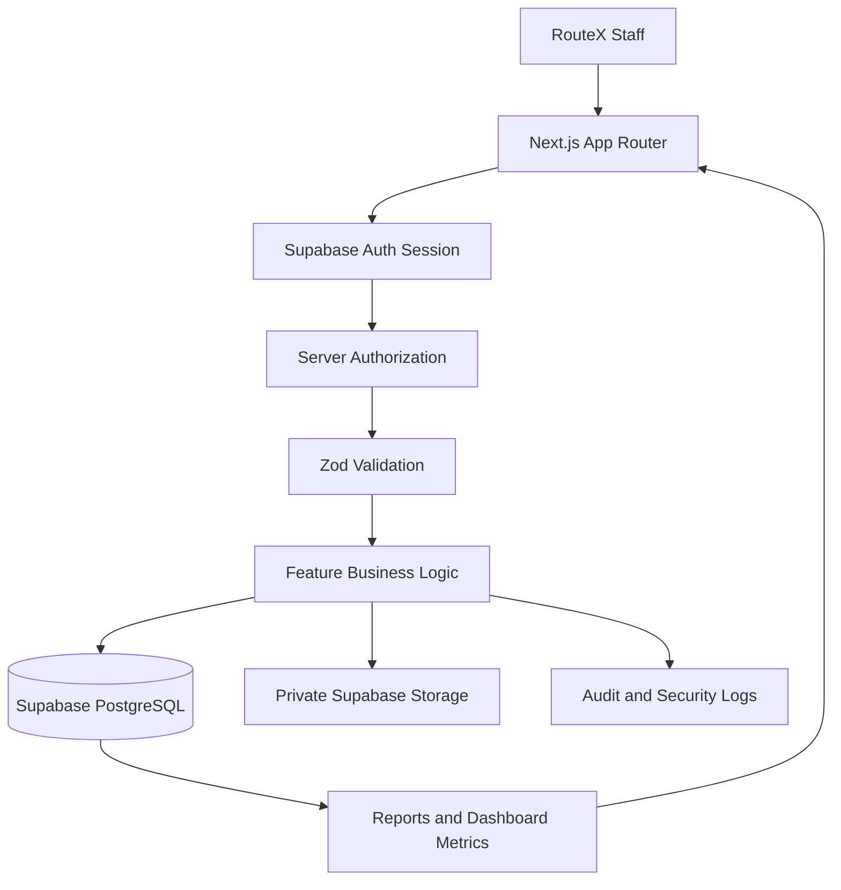

# RouteX
## Software Architecture Blueprint v1

**Status:** Provisional working specification  
**Date:** October 28, 2026  
**Purpose:** Establish the technical foundation, system structure, security model, core workflows, and release plan for RouteX.

---

## 1. Project Overview

RouteX is a logistics operations and profitability management platform for a single company in the Philippines.

The system will manage deliveries, fleet records, delivery-related expenses, general company finances, data imports, and operational reports.

The primary objective is to replace disconnected records and static interfaces with a reliable, secure, database-backed application.

### First-release scope

- Authentication and role-based permissions
- Delivery creation, completion, and correction
- Fleet management and truck assignment
- Delivery profitability calculations
- Basic company-wide Finance
- Validated CSV/XLSX imports
- Essential reports and exports
- Audit history and operational monitoring

Advanced integrations, automated reminders, offline synchronization, and a centralized notification inbox are excluded from v1.

---

## 2. Current Codebase Assessment

The existing RouteX project is a static Next.js preview, not yet a functioning operational system.

| Area | Current state |
|---|---|
| Frontend | Next.js App Router, React, TypeScript, Tailwind CSS |
| Authentication | No real authentication |
| Database | No connected database or migrations |
| Backend | No implemented business API or server actions |
| Deliveries | Partially functional local fixture-based UI |
| Fleet and Finance | Primarily placeholder interfaces |
| Reports | No complete data-backed reporting workflow |
| Persistence | No business-record persistence |
| Automated tests | Limited existing tests, primarily sidebar behavior |

The live project uses Next.js 16.4.2, React 19.3.0, TypeScript, and Tailwind CSS 4. These are the reported existing versions and should be verified against the actual repository before implementation.

The README's proposed stack differs from the live codebase. The implementation should follow the verified project configuration rather than assume the README is authoritative.

**Key implication:** RouteX needs a backend and domain-model implementation, not merely more frontend screens.

---

## 3. Technology Stack

| Layer | Selected technology |
|---|---|
| Frontend | Next.js App Router, React, TypeScript |
| Styling | Tailwind CSS 4 |
| Backend | Next.js server-side application logic |
| Database | Supabase PostgreSQL |
| Authentication | Supabase Auth |
| Session integration | `@supabase/ssr` |
| Database access | Supabase server client |
| Authorization | Server-side checks and PostgreSQL Row-Level Security |
| Validation | Zod |
| File storage | Private Supabase Storage |
| Hosting | Vercel |
| Deployment configuration | Vercel environment variables and local `.env.local` |
| Schema management | Supabase CLI migrations, versioned in Git |
| Testing | Unit and integration tests; end-to-end tests for critical workflows |
| Monitoring | Application error tracking, health monitoring, and structured logs |

### Architectural principles

1. Supabase Auth is the sole authentication and session system. Do not introduce Auth.js as a competing session authority.
2. Business records are accessed through server-side Next.js workflows.
3. Normal database operations use the authenticated, user-scoped Supabase client.
4. PostgreSQL RLS provides an additional database-level authorization boundary.
5. Privileged database access is isolated and used only for explicitly authorized workflows.
6. Business rules and financial calculations are centralized in reusable server-side TypeScript functions.
7. Shared TypeScript domain types and Zod schemas establish consistent data contracts.
8. The backend is organized by business feature, not as one large collection of unrelated functions.

---

## 4. System Architecture

The intended request flow is:

**Browser → Next.js application → Authentication and authorization → Validation → Business logic → PostgreSQL / private file storage**

### Main responsibilities

**Browser**
- Render the interface and collect user input.
- Display validation and operational errors.
- Preserve unsaved form data where possible.
- Never be trusted to enforce permissions or calculate authoritative financial results.

**Next.js server**
- Verify the current Supabase Auth session.
- Check that the staff account is active.
- Evaluate current role and action permissions.
- Validate inputs using Zod.
- Execute business rules and database operations.
- Calculate authoritative metrics and financial totals.
- Record audit events.
- Authorize protected file operations.

**Supabase PostgreSQL**
- Store operational records and relationships.
- Enforce primary keys, foreign keys, unique constraints, and other database invariants.
- Apply RLS policies.
- Preserve audit history and import history.
- Support transactional operations where required.

**Supabase Storage**
- Store private proof-of-delivery files and related delivery documents.
- Permit access only through an authorized flow.
- Enforce file restrictions before upload.

**Vercel**
- Host the Next.js application.
- Provide separate deployment environments and environment variables.
- Support preview deployments and controlled production releases.

### Architecture diagram



---

## 5. Application Structure

Use a feature-based architecture with shared infrastructure.

```text
src/
├── app/
│   ├── login/
│   ├── dashboard/
│   ├── deliveries/
│   ├── fleet/
│   ├── finance/
│   ├── reports/
│   ├── imports/
│   ├── administration/
│   └── api/
├── components/
│   ├── layout/
│   ├── tables/
│   ├── forms/
│   └── feedback/
├── features/
│   ├── deliveries/
│   │   ├── schemas/
│   │   ├── services/
│   │   ├── queries/
│   │   └── types/
│   ├── fleet/
│   ├── finance/
│   ├── reports/
│   ├── imports/
│   ├── authentication/
│   └── administration/
├── lib/
│   ├── supabase/
│   ├── authorization/
│   ├── validation/
│   ├── audit/
│   ├── logging/
│   └── errors/
└── types/
```

This is a proposed target structure, not a description of existing folders. Adapt it to the actual repository during implementation.

---

## 6. Authentication and Staff Accounts

### Authentication policy

- Use Supabase Auth with email and password.
- Disable public sign-up.
- Require Admin-created staff accounts.
- Support secure self-service password reset by email.
- Provide Admin-assisted account recovery when staff cannot access their email.
- Support optional MFA for all staff.
- Permit multiple active sessions across devices.
- Target a 30-day session lifetime with a 30-minute inactivity timeout, subject to provider capabilities and app-level enforcement.
- Require fresh identity verification for high-risk actions, including password changes, staff account management, and critical security settings.

### Account deactivation

When a staff account is disabled:

1. Reject future requests once the server observes the inactive state.
2. Revoke existing sessions where supported.
3. Preserve historical business records and audit history.
4. Record the account-management action.

### Authorization

Roles and permissions are stored in PostgreSQL. Server-side authorization checks current account data rather than trusting a role supplied by the browser.

The system uses module access and action permissions, such as:

- View
- Create
- Edit
- Complete
- Correct
- Import
- Export
- Manage staff

Exact role-to-permission assignments remain to be finalized.

---

## 7. Database and Data Integrity

### Database policy

- Use Supabase PostgreSQL.
- Manage schema changes through versioned Supabase CLI migrations.
- Keep migration files in Git.
- Test migrations in preview/staging before production.
- Require production migration approval.
- Maintain separate Supabase projects for development, staging, and production.

### Initial domain entities

The proposed data model will include:

- Staff profiles and roles
- Permissions
- Clients
- Fleet trucks
- Deliveries
- Delivery expense details
- General financial transactions
- Financial categories
- Proof-of-delivery file metadata
- Audit events
- Import batches and import results
- Staff interface preferences
- Security events

These are proposed entities. Exact tables, relationships, fields, indexes, and constraints require schema design before migrations are written.

### Data integrity rules

- Waybill numbers must be globally unique.
- Enforce uniqueness in PostgreSQL, not just in the UI.
- Use foreign keys to connect deliveries to clients and trucks.
- Preserve historical references to inactive trucks.
- Never permanently delete deliveries or financial transactions through normal workflows.
- Use controlled status changes and audited corrections.
- Maintain separate business dates and system-generated creation/import timestamps.

---

## 8. Delivery Management

### Delivery creation

A delivery must include:

- Delivery date
- Waybill number
- Client
- Assigned truck
- Origin
- Destination

Rate and expenses may be entered later.

The initial status is **In Progress**. There is no Draft stage.

### Truck assignment

New deliveries can be assigned only to active Fleet trucks. Inactive trucks remain visible in historical delivery records.

### Client selection

Staff can select an existing client or add a new client inline during delivery creation. A separate Clients module is not required for the first release.

### Completion

Before a delivery can be marked Completed:

1. Required financial details must be supplied or explicitly confirmed as not applicable.
2. The system must validate the required rate and applicable expenses.
3. RouteX calculates the final financial figures.
4. The user reviews the figures and confirms completion.
5. The completion operation and its audit record must succeed atomically.

Unknown expenses cannot be treated as zero merely to complete a delivery.

Completed deliveries are locked against ordinary editing. Authorized corrections remain possible with a reason and immutable audit history.

Proof of delivery is supported but is optional for completion in v1.

### Failure and concurrency handling

- Completion must be all-or-nothing.
- A failed completion leaves the delivery In Progress.
- Retries must not create duplicate records or repeat an operation incorrectly.
- Use idempotency keys for delivery submissions where appropriate.
- Reject stale saves if another user has changed the record.
- Preserve unsaved input and require reloading the latest version before retrying a conflicting edit.

Exact status transitions, cancellation rules, and all financial validation conditions remain subject to final business-rule approval.

---

## 9. Fleet Management

The Fleet module is the source of truth for truck records.

It must support the truck information needed by operations and reporting, including truck identifiers and active/inactive status.

Delivery forms reference existing Fleet records instead of maintaining independent truck details.

Bulk Fleet imports are excluded from v1. Fleet records are entered manually through normal screens.

---

## 10. Finance and Profitability

### Delivery profitability

Delivery profitability is calculated on the server through centralized financial business rules.

The intended high-level calculation is:

**Net Income = Delivery Rate − Total Delivery Expenses**

Expense categories may include fuel, tolls, other expenses, entry fees, and driver/helper costs.

The exact expense aggregation formula, rounding rules, treatment of special cases, and required expense fields must be finalized before production.

### General Finance

Finance manages company-wide income and expenses independently of delivery entry.

The first release includes:

- Income and expense entries
- Categories, including user-managed categories
- Company-wide financial summaries
- Date-range filtering
- Category breakdowns
- PDF/XLSX exports

Delivery-related revenue and expenses contribute automatically to company-wide totals. They must not be entered a second time as duplicate general Finance transactions.

Delivery reporting uses the delivery's actual business date. General Finance transactions use their own transaction dates.

### Access to financial summaries

All signed-in staff can view company-wide financial totals, while access to individual financial records remains permission-restricted.

Exporting company-wide totals requires a separate permission.

All displayed figures must be calculated from authorized records using centralized server-side rules.

---

## 11. Imports and Data Migration

### Supported imports

V1 supports manual CSV/XLSX imports for:

- Deliveries
- Financial transactions

Staff accounts, Fleet trucks, and clients are excluded from bulk import in v1.

The backend should remain ready for future API integrations, without requiring those integrations in the first release.

### Import workflow

1. Download an official template managed by Admins.
2. Upload the CSV/XLSX file.
3. Validate file type, structure, fields, and row count.
4. Resolve client and truck references.
5. Detect duplicate rows and existing-record conflicts.
6. Preview valid and rejected rows with clear errors.
7. Confirm the import.
8. Revalidate records and conflicts immediately before saving.
9. Save the import atomically or reject the batch.
10. Display results and provide a downloadable error report when needed.

### Import constraints

- Maximum 1,000 rows per file initially.
- Imports are synchronous in v1.
- Imports create new records only; existing records are updated through normal screens.
- Duplicate or conflicting records reject the entire batch.
- Related clients and trucks must already exist.
- Historical business dates are allowed subject to validation and permissions.
- Every imported record must link to its import batch.
- Original import files are retained for 30 days, then automatically deleted.
- Import history is available on-screen but cannot itself be exported.
- Reversals require a reason, an authorized user, and an audit entry.
- A reversal is allowed only when the imported records have not changed or been used by other workflows.

### Completed delivery imports

Authorized Operations staff can import deliveries as In Progress. Direct import as Completed requires a separate permission and must pass the same required financial and validation checks as normal completion.

Authorized Finance users can import financial transactions without an additional approval step beyond their validated import confirmation and normal Finance permissions.

### Initial production migration

1. Prepare source files.
2. Test migration in a separate environment.
3. Reconcile record counts and financial totals.
4. Investigate discrepancies.
5. Obtain approval for the corrected baseline.
6. Perform production migration.
7. Verify imported records and totals before operational rollout.

---

## 12. Search, Lists, and Dashboard

### Global search

RouteX will provide one global search across deliveries, trucks, clients, and financial transactions.

Search will focus on important identifiers and key fields, including:

- Names
- Waybill numbers
- Plate numbers
- Transaction references

Search results must respect user permissions.

### Large lists

Use server-side pagination, filtering, search, and sorting for large record lists.

Avoid loading every business record into the browser.

### Dashboard

Dashboards are role-based and show relevant summaries and pending tasks.

Dashboard metrics are calculated on the server using centralized business rules. Authorization filtering occurs before metrics are calculated, except for explicitly permitted aggregate totals.

### Date filters

- Use consistent date-filter behavior across modules.
- Apply filters to the relevant business date for each module.
- Default to the current calendar month, from the first day through today.
- Use the `Asia/Manila` business timezone.

### Pending tasks

Show pending and overdue counts on dashboards and relevant modules according to role and permissions.

V1 does not include automatic overdue reminders or a centralized notification inbox.

### Staff preferences

Save interface preferences in the user's account so they persist across devices. Examples include table preferences and sidebar state.

---

## 13. File Storage and Upload Security

Proof-of-delivery files are stored in private Supabase Storage.

Uploads are mediated through Next.js so authorization and validation happen before storage operations.

Initial restrictions:

- Maximum file size: 10 MB per file
- Accepted types: JPEG, PNG, WebP, and PDF
- Server-side file validation
- Authenticated and authorized viewing/downloads

The database stores file metadata and its relationship to the associated delivery.

Implement independent POD file backups and periodic restoration tests. Database backups alone are not sufficient to recover uploaded files.

---

## 14. Audit, Logging, and Error Handling

### Business audit history

Important changes must record:

- Acting staff member
- Timestamp
- Previous value
- New value
- Reason, where required
- Associated business record

Completed-record corrections preserve previous values and require a correction reason.

Audit history is retained indefinitely for now, with access restricted. Legal, regulatory, and business retention requirements must be reviewed before production.

### Security-event logging

Record important authentication and account-security events, including outcomes, timestamps, and staff identity when known.

Security-event logs have a provisional one-year retention period, followed by deletion through a documented process.

Critical security events may trigger email notifications to affected staff. Important account-management events may alert Admins.

### Application logging

Use structured server-side logs with automatic redaction of credentials, tokens, sensitive personal information, and financial details.

Retain request IDs, error codes, module context, and technical details needed for troubleshooting.

### Error handling

Use centralized error handling and consistent user-facing messages.

Unexpected failures should not expose secrets or internal technical details. Preserve unsaved form data where possible, disable unsafe actions, and support safe retries.

---

## 15. Reliability and Operations

### Connectivity

RouteX requires an internet connection to save changes.

If connectivity is lost:

- Preserve unsaved form data where possible.
- Show a clear error.
- Allow safe retries.
- Do not claim that an unsuccessful operation was saved.

Offline synchronization is excluded from v1.

### Rate limiting

Apply targeted rate limits to login, password recovery, uploads, exports, and other sensitive or expensive operations while keeping ordinary workflows responsive.

### Backups and recovery

- Use Supabase-managed database backups, subject to the selected plan's capabilities.
- Target daily database backups.
- Document recovery-point and recovery-time objectives.
- Test restoration procedures.
- Back up uploaded files independently.
- Use known-good application deployments for application rollback.
- Repair incompatible database changes through tested forward-fix migrations when appropriate.

### Monitoring

Monitor application errors, failed requests, database errors, service health, and serious operational failures.

Provide an internal status page for signed-in staff. Use separate external monitoring to detect outages when RouteX itself is unavailable.

An Admin-controlled maintenance mode is included for planned downtime.

---

## 16. Testing Strategy

V1 requires both unit and integration tests.

### Unit tests

Cover:

- Delivery status rules
- Financial calculations
- Expense validation
- Permission evaluation
- Import validation
- Duplicate detection
- Date handling and timezone behavior

### Integration tests

Cover:

- Authentication and authorization
- Database constraints and RLS
- Delivery creation and completion
- Transactional rollback
- Idempotent retries
- Concurrent-edit conflict detection
- Import validation, saving, and reversal
- File authorization
- Audit-history creation
- Finance totals and report calculations

### End-to-end tests

Add browser-level tests for critical workflows before production launch.

At minimum, verify the complete delivery lifecycle, Finance workflows, imports, role restrictions, and recovery from failures.

Production release requires successful tests and security checks for every core workflow.

---

## 17. Deployment and Environments

Maintain separate Supabase projects for development, staging, and production.

### Release workflow

1. Develop changes in the development environment.
2. Run unit and integration tests.
3. Deploy a Vercel preview.
4. Test the feature and database migrations in staging.
5. Obtain approval for production migrations.
6. Deploy the approved application and database changes.
7. Verify health checks and critical workflows.
8. Retain a known-good application deployment for rollback.

Use separate credentials and environment variables for each environment. Keep secrets out of source control and browser-exposed variables.

---

## 18. Implementation Roadmap

### Phase 1: Foundation

- Verify the current repository and resolve documentation mismatches.
- Configure Supabase projects and `@supabase/ssr`.
- Implement real authentication and session handling.
- Establish roles, permissions, RLS policies, and server-side authorization.
- Establish migrations, shared types, Zod schemas, logging, and audit infrastructure.
- Set up unit and integration testing.

### Phase 2: Delivery vertical slice

Implement one complete workflow through the full stack:

- Create a delivery.
- Validate its inputs.
- Persist it in PostgreSQL.
- Assign an existing client and active truck.
- Edit it safely.
- Complete it using the approved financial rules.
- Record audit history.
- Handle retries and stale edits.
- Test permissions and failure recovery.

This is the first implementation milestone because it exercises the architecture end to end.

### Phase 3: Fleet and profitability

- Implement Fleet records and active/inactive status.
- Connect Fleet records to deliveries.
- Implement approved expense fields and profitability calculations.
- Add delivery profitability reports and filters.

### Phase 4: Finance

- Implement general income and expense entries.
- Add categories and company-wide summaries.
- Connect delivery financial results without duplicate accounting entries.
- Implement approved PDF/XLSX exports.

### Phase 5: Imports and reporting

- Implement templates, validation, preview, revalidation, and batch saving.
- Add import history and downloadable error reports.
- Implement import reversal and audit history.
- Complete essential reports and server-side filtering.

### Phase 6: Hardening and release

- Complete security and failure-path testing.
- Verify backup and recovery procedures.
- Test the initial data migration and reconcile financial totals.
- Run the pilot with a small group.
- Resolve pilot issues.
- Obtain business-owner approval before company-wide rollout.

---

## 19. Decisions Still Requiring Approval

This blueprint is not yet an implementation-ready business specification. The following items must be resolved or explicitly accepted before their respective features are built.

### Business rules

- Complete delivery status model and allowed transitions.
- Cancellation and On Hold behavior.
- Exact delivery expense fields and applicability rules.
- Final profitability formula, rounding rules, and financial edge cases.
- Rules for correcting historical delivery dates and reporting periods.
- Detailed permissions for each role and sensitive action.
- Finance transaction correction and category-management rules.

### Data model

- Final table definitions, relationships, indexes, and constraints.
- Exact fields required for trucks, clients, deliveries, and transactions.
- Audit-event schema and protection against unauthorized alteration.
- Import batch schema and reversal constraints.
- Account profile and permission schema.

### Operational settings

- Confirm Supabase plan suitability for backup and recovery requirements.
- Finalize the inactivity timeout and session lifetime against provider capabilities.
- Establish precise file-backup procedures and recovery targets.
- Set report size limits and detailed export permissions.
- Review retention requirements for audit, security, and imported files.

### Launch requirements

- Confirm the responsible business approver.
- Define pilot acceptance criteria.
- Approve the migration baseline.
- Approve the final business rules and production schema.

---

## 20. Definition of Done for V1

RouteX is ready for its first production release only when:

- Authentication and authorization work correctly.
- PostgreSQL constraints and RLS protect business records.
- Core delivery workflows are complete and tested.
- Delivery profitability and Finance totals follow approved rules.
- Imports validate, prevent duplicates, and preserve traceability.
- Audit history records critical changes.
- Reports and exports respect permissions.
- Backup and recovery procedures have been tested.
- Initial data migration has been reconciled and approved.
- The pilot has passed its acceptance criteria.
- The responsible business owner or designated decision-maker has approved production launch.

**Final principle:** Build a reliable operational system first. Every core workflow must be secure, auditable, and financially consistent before RouteX is opened to the entire company.
