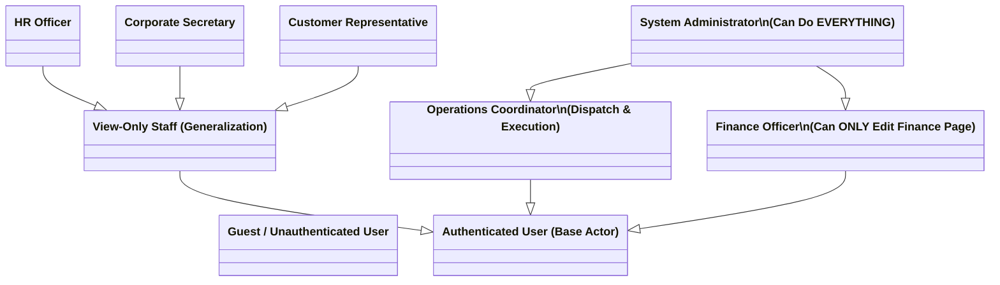
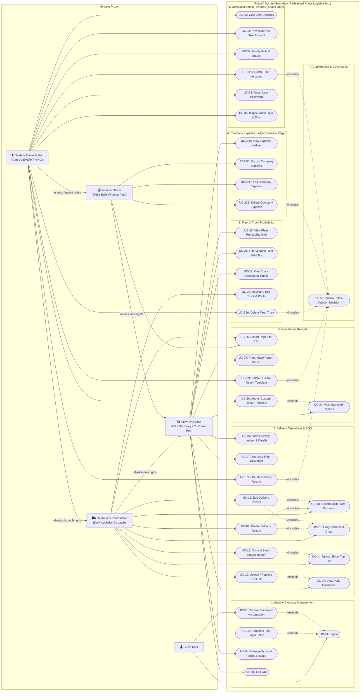

# RouteX: Role-Based Access Control (RBAC) & Use Case Diagram Reference Guide
**Project:** RouteX — Logistics Delivery Operations & Truck Profitability Management System  
**Client / Domain Organization:** Redeemed Route Logistics Inc. (RRLI)  
**Target Audience:** Systems Analyst / UI-UX Designer / Software Engineering Groupmate  
**Document Purpose:** Complete, authoritative specification of Actors, Roles, Permissions, Use Cases, and UML Relationships to construct an accurate and compliant **Use Case Diagram**.

---

## 1. System Overview & Scope Boundaries

RouteX is a centralized logistics web application designed specifically for **Redeemed Route Logistics Inc. (RRLI)** to monitor completed delivery trips, audit financial revenue and expenses, manage cold chain (refrigerated) and ambient fleet vehicles, verify proof-of-delivery (POD) documentation, manage company operating expenses, and generate operational summaries.

### Core Governance Tenets (Clarified Role Principles)

1. **The Administrator Can Do EVERYTHING:**
   - Full system administration, complete operational execution, user management, audit logging, report template authoring, and audited record deletions.
   - Freedom to record and edit deliveries from the company foundation year (`2024-01-01`) onward without the 3-day submission window restriction.
   - Complete authority over all modules: Deliveries, Multi-Store Drop-offs, Fleet Trucks, Drivers & Helpers, POD Documents, Excel Staging, Company Expenses, Reports, and System Administration.

2. **Finance Can ONLY Edit Whatever Is in the Finance Page:**
   - On the **Finance Page** (`/finance` -> Company Expenses), Finance holds full write authority to record new company expenses, edit existing expenses, and delete expense entries (`finance:manage`).
   - In **ALL OTHER MODULES** (Deliveries, Multi-Store Drop-offs, Fleet Vehicles, Drivers/Helpers, POD Documents, User Management, and Report Template Authoring), Finance is strictly **VIEW-ONLY**.
   - Finance can inspect delivery records, client drop-offs, trip revenues, and operational expenses to audit net profitability, but cannot tamper with operational dispatch or administrative configurations.

3. **The Rest Are Just View-Only, With Exceptions to Additional Admin Features:**
   - **Operations Staff (`operations`):** Hands-on daily dispatch and execution coordinator. Can create and edit deliveries (subject to a strict 3-day submission window), record store drop-offs, assign vehicles and crew, upload Excel spreadsheets, attach POD receipts, and register fleet trucks. However, Operations is strictly **View-Only on the Finance Page** (cannot record or edit company expenses) and is completely **excluded from additional admin features**.
   - **Auditing Staff (`hr`, `secretary`, `customer_representative`):** Purely **View-Only** across the entire application. Zero mutation authority anywhere.
   - **Additional Admin Features (Strictly Exclusive to Admin):**
     - User Account Management (`/user-management`): Provisioning staff, assigning roles, toggling active/inactive status, password resets, and account deletion.
     - Audited Deletion Authority (`UC-35`): Permanent deletion of deliveries, trucks, company expenses, report templates, and accounts with mandatory confirmation modals.
     - System Audit Logging (`/api/audit`): Chronological diff inspection of attribute state changes (old vs. new values).
     - Custom Report Template Authoring (`/reports`): Creating and deleting custom reporting layouts.
     - Unlimited Historical Recording: Recording operational trips prior to the 3-day operational window.

---

## 2. Actors & Role Hierarchy

A Use Case Diagram requires clearly identified **Actors** (human or external systems interacting with the system) and their **generalization / inheritance** relationships.

### 2.1 The Six Canonical User Roles

RouteX implements **6 Canonical Business Roles** mapped into distinct operational profiles:

| Role Name | Access Level | UI Label & Badge Tone | Primary Business Purpose & Domain Responsibilities |
| :--- | :--- | :--- | :--- |
| **`admin`** | **Admin** (`admin`) | `Admin`  *(Primary / Green)* | **Can do EVERYTHING.** Full system administration, user account management, role assignment, credential resets, audit log inspection, custom report template authoring, audited record deletions, full operational dispatch write capabilities, and company expenses management. |
| **`finance`** | **Finance Write / View-Only** (`view_only`) | `Finance`  *(Neutral / Yellow)* | **Can ONLY edit whatever is on the Finance page.** Full write access to the Company Expenses module (`/finance` -> record, edit, and delete company expenses). Strictly view-only across all other operational modules (deliveries, drop-offs, trucks, drivers, POD documents, user management). |
| **`operations`** | **Operations Write Access** (`operations`) | `Operations`  *(Primary / Green)* | **Daily logistics dispatch & execution.** Create and edit deliveries (within 3-day window), record store drop-offs, upload and review Excel bulk trips, attach POD files, and register fleet trucks. Strictly view-only on Finance page and restricted from additional admin features. |
| **`hr`** | **Strictly View-Only** (`view_only`) | `HR`  *(Neutral)* | **Personnel auditing.** Strictly view-only access to delivery trip records, driver and helper crew assignments, daily trip wage rates, and meal allowances to prepare payroll summaries. Zero mutation authority. |
| **`secretary`** | **Strictly View-Only** (`view_only`) | `Secretary`  *(Neutral)* | **Operational compliance.** Strictly view-only access to delivery records, POD document completeness, truck performance summaries, and operational reports. Zero mutation authority. |
| **`customer_representative`** | **Strictly View-Only** (`view_only`) | `Customer Rep`  *(Neutral)* | **Customer service inquiries.** Strictly view-only access to client delivery records, store drop-off timelines, waybill statuses, and signed POD receipts to resolve customer claims. Zero mutation authority. |

### 2.2 Unauthenticated & Secondary Actors

* **`Guest / Unauthenticated User`**: Any visitor accessing the public route (`/login`). Can submit credentials to log in, complete mandatory first-login password/security question setup, or perform password self-recovery.
* **`System Audit Logger` (Secondary / Supporting Actor)**: Automated background subsystem that intercepts administrative mutations and records immutable attribute transitions (old vs. new values).

### 2.3 Actor Generalization Hierarchy (UML Inheritance)

In UML Use Case Diagrams, actor generalization captures shared capabilities cleanly:

* **Inheritance & Permission Rules:**
  - `Authenticated User` provides universal access to login session management (`Log Out`, `Manage Account Profile`).
  - `View-Only Staff` (`HR`, `Secretary`, `Customer Rep`) inherits read-only visibility into operational screens (`Dashboard`, `Deliveries`, `POD Documents`, `Trucks`, `Reports`, `Settings`). They have **zero mutation rights**.
  - `Finance Officer` inherits general viewing capabilities and adds **exclusive write authority to the Finance Page** (`Record Company Expense`, `Edit Company Expense`, `Delete Company Expense`). In all other areas, Finance acts as View-Only Staff.
  - `Operations Coordinator` inherits viewing capabilities and adds write capabilities for daily operational dispatch (`Create Delivery`, `Edit Delivery`, `Store Drop-offs`, `Excel Import`, `POD Upload`, `Truck Registration`). Operations cannot edit company expenses and cannot access additional admin features.
  - `System Administrator` inherits **ALL** operational and financial capabilities ("Can do EVERYTHING") and adds **Additional Admin Features** (`User Management`, `Audit Logs`, `Template Authoring`, `Audited Deletion Decisions`).

---

## 3. Comprehensive Use Case Catalog by Subsystem

Below is the complete list of system use cases, their descriptions, primary actors, and UML relationships (`<<include>>` or `<<extend>>`).

### Subsystem 1: Identity & Access Management (IAM)

| UC ID | Use Case Name | Primary Actor | Relationships & Triggers | Brief Description |
| :--- | :--- | :--- | :--- | :--- |
| **UC-01** | **Log In** | Guest User | — | Authenticate into RouteX using username/email and RFC 9106 Argon2id password. |
| **UC-02** | **Complete First-Login Setup** | Authenticated User | `<<extend>>` UC-01 *(Condition: temporary password assigned)* | Mandatory workflow on first login: set a permanent password and register security questions. |
| **UC-03** | **Recover Password via Security Question** | Guest User | `<<extend>>` UC-01 *(Condition: user forgot password)* | Self-service password recovery by answering predefined security question. |
| **UC-04** | **Manage Account Profile** | Authenticated User | `<<include>>` UC-01 | User updates own display name, username, password, or uploads profile picture avatar. |
| **UC-05** | **Log Out** | Authenticated User | `<<include>>` UC-01 | Terminate the active session and invalidate HMAC-SHA256 session cookie. |

---

### Subsystem 2: Delivery Operations & Trip Management

| UC ID | Use Case Name | Primary Actor | Relationships & Triggers | Brief Description |
| :--- | :--- | :--- | :--- | :--- |
| **UC-06** | **View Delivery Ledger** | View-Only Staff, Finance, Operations, Admin | `<<include>>` UC-01 | View completed delivery records in a tabular ledger with pagination and financial totals. |
| **UC-07** | **Search & Filter Deliveries** | View-Only Staff, Finance, Operations, Admin | `<<include>>` UC-06 | Filter deliveries by global date range, client, truck plate, driver, or POD attachment status; sort via 3-state sort controls. |
| **UC-08** | **View Delivery Details Page** | View-Only Staff, Finance, Operations, Admin | `<<include>>` UC-06 | Open dedicated detail page with compact record navigator, crew, vehicle specs, drop-offs, and financial breakdown. |
| **UC-09** | **Create Delivery Record** | Operations, Admin | `<<include>>` UC-01, `<<include>>` UC-10, `<<include>>` UC-11 | Register a new delivery trip manually (Operations subject to 3-day window; Admin has unlimited 2024+ window). |
| **UC-10** | **Record Multi-Store Drop-off Sequence** | Operations, Admin | `<<include>>` UC-09, `<<include>>` UC-12 | Specify ordered destination stores, drop-off locations, and individual delivery quantities. |
| **UC-11** | **Assign Vehicle & Crew** | Operations, Admin | `<<include>>` UC-09, `<<include>>` UC-12 | Select truck plate (owned/subcontracted), assign driver, and assign up to two helpers with wage rates and meal allowances. |
| **UC-12** | **Edit Delivery Record** | Operations, Admin | `<<include>>` UC-08 | Modify operational or financial attributes of an existing delivery (e.g. resolve unknown expenses). |
| **UC-13** | **Calculate Trip Financials & Margin** | System / Automated | `<<include>>` UC-09, `<<include>>` UC-12 | Automatically compute revenue, total expenses, net income, and profit margin percent. Incomplete expenses mark delivery incomplete and exclude from aggregates. |
| **UC-13B** | **Delete Delivery Record** | Admin | `<<include>>` UC-08, `<<include>>` UC-35 | Permanently delete an invalid delivery record via an audited confirmation screen. Exclusive to Admin. |

---

### Subsystem 3: Batch Staging & Excel Bulk Import

| UC ID | Use Case Name | Primary Actor | Relationships & Triggers | Brief Description |
| :--- | :--- | :--- | :--- | :--- |
| **UC-14** | **Upload Excel Trip File** | Operations, Admin | `<<include>>` UC-01 | Upload `.xlsx` / `.csv` spreadsheet containing multiple delivery trip rows into the staging environment. |
| **UC-15** | **Review & Validate Staged Deliveries** | Operations, Admin | `<<include>>` UC-14 | Inspect parsed rows, check for missing fields, rate anomalies, or unrecognized truck plates prior to saving. |
| **UC-16** | **Confirm & Commit Batch Import** | Operations, Admin | `<<include>>` UC-15 | Atomically commit validated staging rows into the active delivery database. |

---

### Subsystem 4: Proof of Delivery (POD) & Document Management

| UC ID | Use Case Name | Primary Actor | Relationships & Triggers | Brief Description |
| :--- | :--- | :--- | :--- | :--- |
| **UC-17** | **View Proof of Delivery (POD)** | View-Only Staff, Finance, Operations, Admin | `<<include>>` UC-08 | View attached POD files (high-resolution PNG/JPG receipts or embedded PDF documents). |
| **UC-18** | **Download POD File** | View-Only Staff, Finance, Operations, Admin | `<<include>>` UC-17 | Download the original signed delivery receipt or invoice document. |
| **UC-19** | **Upload / Replace POD Document** | Operations, Admin | `<<extend>>` UC-17 *(Condition: missing or updated document)* | Attach or update a digital POD file against a delivery stop. |

---

### Subsystem 5: Fleet & Truck Profitability Analytics

| UC ID | Use Case Name | Primary Actor | Relationships & Triggers | Brief Description |
| :--- | :--- | :--- | :--- | :--- |
| **UC-20** | **View Fleet & Profitability Grid** | View-Only Staff, Finance, Operations, Admin | `<<include>>` UC-01 | Review owned truck cards and subcontracted fleet vehicles with aggregated net profits and performance KPIs. |
| **UC-21** | **Filter & Rank Trucks** | View-Only Staff, Finance, Operations, Admin | `<<include>>` UC-20 | Filter by cargo storage capability (Refrigerated vs. Dry Cargo), wheel count, or ownership; rank by profit, revenue, or margin. |
| **UC-22** | **View Truck Operational Profile** | View-Only Staff, Finance, Operations, Admin | `<<include>>` UC-20 | View dedicated truck profile page containing specifications, vehicle photo, revenue history, and assigned trip log. |
| **UC-23** | **Register / Update Truck Information** | Operations, Admin | `<<include>>` UC-01 | Register a new truck plate, define classification, ownership (Owned/Subcon), cargo capability, and upload vehicle image. |
| **UC-23A** | **Delete Fleet Truck** | Admin | `<<include>>` UC-22, `<<include>>` UC-35 | Permanently delete a truck registration via an audited confirmation screen. Exclusive to Admin. |

---

### Subsystem 6: Company Expense Ledger (Finance Module)

> **Core Tenet:** Finance can **ONLY** edit whatever is on the Finance page (`/finance`). Admin can also edit because Admin can do **EVERYTHING**. Operations and View-Only staff can only view.

| UC ID | Use Case Name | Primary Actor | Relationships & Triggers | Brief Description |
| :--- | :--- | :--- | :--- | :--- |
| **UC-23B** | **View Company Expense Ledger** | View-Only Staff, Operations, Finance, Admin | `<<include>>` UC-01 | View company expense ledger records, total company expenses, search by description, filter by date, and sort by date or amount. |
| **UC-23C** | **Record Company Expense** | Finance, Admin | `<<include>>` UC-01 | Record an overall company operating overhead expense (warehouse, rent, utilities, insurance) with positive PHP amount, date, and optional notes. |
| **UC-23D** | **Edit Company Expense** | Finance, Admin | `<<include>>` UC-23B | Update description, amount, date, or notes of an existing company expense record. |
| **UC-23E** | **Delete Company Expense** | Finance, Admin | `<<include>>` UC-23B, `<<include>>` UC-35 | Permanently delete a company expense record via an audited confirmation modal. |

---

### Subsystem 7: Operational & Financial Reporting

| UC ID | Use Case Name | Primary Actor | Relationships & Triggers | Brief Description |
| :--- | :--- | :--- | :--- | :--- |
| **UC-24** | **Generate Operational Reports** | View-Only Staff, Finance, Operations, Admin | `<<include>>` UC-01 | View structured reports across built-in layouts: Client Summary, Truck Summary, or Trip Ledger. |
| **UC-25** | **Filter Report by Date Range** | View-Only Staff, Finance, Operations, Admin | `<<include>>` UC-24 | Recompute report totals dynamically using date presets (Today, This Week, This Month, All Time) or custom dates. |
| **UC-26** | **Export Report to CSV / Excel** | Finance, Operations, Admin | `<<include>>` UC-24 | Export RFC 4180-compliant CSV containing metadata, active filters, column headings, and calculated summary totals. |
| **UC-27** | **Print / Save Report as PDF** | View-Only Staff, Finance, Operations, Admin | `<<include>>` UC-24 | Open clean browser print dialogue optimized for formal paper or PDF archiving. |
| **UC-28** | **Author Custom Report Template** | Admin | `<<extend>>` UC-24 *(Condition: Admin customizes layout)* | Customize column visibility, display labels, ordering, and aggregation groupings. Exclusive to Admin. |
| **UC-29** | **Delete Custom Report Template** | Admin | `<<include>>` UC-28, `<<include>>` UC-35 | Delete user-created templates via an audited confirmation screen. Exclusive to Admin. |

---

### Subsystem 8: User Administration & System Auditing (Additional Admin Features)

> **Core Tenet:** All Subsystem 8 capabilities are **Additional Admin Features** exclusive to Admin. Non-admin roles (Finance, Operations, HR, Secretary, Customer Rep) have zero access.

| UC ID | Use Case Name | Primary Actor | Relationships & Triggers | Brief Description |
| :--- | :--- | :--- | :--- | :--- |
| **UC-30** | **View User Directory** | Admin | `<<include>>` UC-01 | View list of system staff, assigned roles, email addresses, and account status (`Active` vs. `Inactive`). |
| **UC-31** | **Provision New User Account** | Admin | `<<include>>` UC-30 | Create account with temporary credentials and assign canonical role. |
| **UC-32** | **Modify User Role & Status** | Admin | `<<include>>` UC-30 | Change staff role assignment or toggle active status (soft-disable without deleting records). |
| **UC-32B** | **Delete User Account** | Admin | `<<include>>` UC-30, `<<include>>` UC-35 | Permanently delete staff user account (preventing primary admin self-deletion) via an audited confirmation screen. |
| **UC-33** | **Reset User Password (Admin-Assisted)** | Admin | `<<include>>` UC-30 | Issue temporary password to unlock an account when user forgets security question answers. |
| **UC-34** | **Inspect System Audit Logs** | Admin | `<<include>>` UC-30 | View audit trail capturing security events, credential updates, and record diffs showing old vs. new state changes. |

---

### Subsystem 9: Critical Confirmation & Governance

| UC ID | Use Case Name | Primary Actor | Relationships & Triggers | Brief Description |
| :--- | :--- | :--- | :--- | :--- |
| **UC-35** | **Confirm Critical Deletion Decision** | Admin, Finance | `<<included by>>` UC-13B, UC-23A, UC-23E, UC-29, UC-32B | Present an explicit modal confirmation screen displaying entity details and destructive warnings before executing permanent deletion. Admin confirms delivery/truck/user/template deletions; Finance confirms expense deletions. |

---

## 4. RBAC Permissions Matrix (CRUD & Execution Mapping)

This matrix maps system permissions directly across all roles, highlighting the three clarified principles:

| Module / Permission Key | Code Identifier | Admin (Can Do EVERYTHING) | Finance (ONLY Edits Finance Page) | Operations (Dispatch & Execution) | HR (View-Only) | Secretary (View-Only) | Customer Rep (View-Only) |
| :--- | :--- | :---: | :---: | :---: | :---: | :---: | :---: |
| **Dashboard** | | | | | | | |
| View Dashboard & KPIs | `dashboard:view` | ✅ | 👁 (Read) | ✅ | 👁 (Read) | 👁 (Read) | 👁 (Read) |
| **Deliveries & Drop-offs** | | | | | | | |
| View Delivery Ledger & Details | `deliveries:view` | ✅ | 👁 (Read) | ✅ | 👁 (Read) | 👁 (Read) | 👁 (Read) |
| Create New Delivery | `deliveries:create` | ✅ *(Unlimited)* | ❌ | ✅ *(3-day window)* | ❌ | ❌ | ❌ |
| Edit Existing Delivery | `deliveries:edit` | ✅ *(Unlimited)* | ❌ | ✅ *(3-day window)* | ❌ | ❌ | ❌ |
| Delete Delivery Record | `deliveries:delete` | ✅ | ❌ | ❌ | ❌ | ❌ | ❌ |
| Complete / Finalize Trip | `deliveries:complete` | ✅ | ❌ | ✅ | ❌ | ❌ | ❌ |
| Manage Store Drop-offs | `dropoffs:manage` | ✅ | ❌ | ✅ | ❌ | ❌ | ❌ |
| **Excel Batch Staging** | | | | | | | |
| Upload Excel Trip File | `imports:upload` | ✅ | ❌ | ✅ | ❌ | ❌ | ❌ |
| Review & Confirm Import | `imports:review_confirm` | ✅ | ❌ | ✅ | ❌ | ❌ | ❌ |
| **Proof of Delivery (POD)** | | | | | | | |
| View & Download POD | `pod:view` | ✅ | 👁 (Read) | ✅ | 👁 (Read) | 👁 (Read) | 👁 (Read) |
| Upload / Replace POD | `deliveries:edit` | ✅ | ❌ | ✅ | ❌ | ❌ | ❌ |
| **Fleet & Profitability** | | | | | | | |
| View Trucks & Profitability | `profitability:view` | ✅ | 👁 (Read) | ✅ | 👁 (Read) | 👁 (Read) | 👁 (Read) |
| Register / Edit Trucks & Photos | `profitability:manage` | ✅ | ❌ | ✅ | ❌ | ❌ | ❌ |
| Delete Fleet Truck | `profitability:manage` | ✅ | ❌ | ❌ | ❌ | ❌ | ❌ |
| **Company Expenses (Finance)** | | | | | | | |
| View Expense Ledger & Totals | `finance:view` | ✅ | ✅ | 👁 (Read) | 👁 (Read) | 👁 (Read) | 👁 (Read) |
| Record & Edit Company Expenses | `finance:manage` | ✅ | **✅ (Write)** | ❌ *(View-Only)* | ❌ | ❌ | ❌ |
| Delete Company Expense Record | `finance:manage` | ✅ | **✅ (Delete)** | ❌ *(View-Only)* | ❌ | ❌ | ❌ |
| **Reports** | | | | | | | |
| View Report Document Previews | `reports:view` | ✅ | 👁 (Read) | ✅ | 👁 (Read) | 👁 (Read) | 👁 (Read) |
| Export Reports to CSV/Excel | `reports:export` | ✅ | ✅ | ✅ | ❌ | ❌ | ❌ |
| Print Report Document / PDF | `reports:view` | ✅ | 👁 (Read) | ✅ | 👁 (Read) | 👁 (Read) | 👁 (Read) |
| Author Custom Templates | `reports:manage_templates`| ✅ | ❌ | ❌ | ❌ | ❌ | ❌ |
| Delete Custom Templates | `reports:manage_templates`| ✅ | ❌ | ❌ | ❌ | ❌ | ❌ |
| **Administration & IAM (Admin Only)** | | | | | | | |
| View User Accounts Directory | `users:view` | ✅ | ❌ | ❌ | ❌ | ❌ | ❌ |
| Provision Staff Accounts & Roles | `users:manage` | ✅ | ❌ | ❌ | ❌ | ❌ | ❌ |
| Modify Role / Status / Resets | `users:manage` | ✅ | ❌ | ❌ | ❌ | ❌ | ❌ |
| Delete User Account | `users:manage` | ✅ | ❌ | ❌ | ❌ | ❌ | ❌ |
| Inspect System Audit Logs | `users:manage` | ✅ | ❌ | ❌ | ❌ | ❌ | ❌ |
| View Account Settings Page | `settings:view` | ✅ | 👁 (Read) | 👁 (Read) | 👁 (Read) | 👁 (Read) | 👁 (Read) |
| Manage System Configuration | `settings:manage` | ✅ | ❌ | ❌ | ❌ | ❌ | ❌ |

> **Legend:**  
> - **✅ Full Access:** Can view, execute, create, edit, or submit changes.  
> - **👁 Read Only:** Can view data, filter, search, and inspect drawers; mutation controls are hidden and server-blocked (HTTP 403 Forbidden).  
> - **❌ Prohibited:** Action and navigation route are completely inaccessible.

---

## 5. Ready-to-Use Mermaid UML Diagram

Your groupmate can paste this code directly into markdown viewers, GitHub, or Mermaid Live Editor (`mermaid.live`):

---

## 6. Role-Specific Business Context for Use Case Narratives

If your groupmate needs to write descriptions or narrative specifications for each role, use these verified domain summaries:

### 1. System Administrator (`admin`)
* **Role Clarification:** **The Admin can do EVERYTHING.** Full access across every module, operational capability, financial management, user management, audit logs, template authoring, and audited record deletions.
* **Why they use RouteX:** System security, account provisioning, role assignment, format configuration, accountability auditing, and ultimate operational authority.
* **Key Use Cases:** UC-30 through UC-34 (User Directory, Account Provisioning, Role Management, Credential Resets, Audit Logs with State Diffs), UC-13B/23A/23E/29/32B (Audited Deletion Decisions), UC-28 (Custom Report Template Authoring), plus all operational and finance use cases.
* **Special Rights:** Can record or edit deliveries from `2024-01-01` onward without the 3-day submission window restriction.

### 2. Finance Officer (`finance`)
* **Role Clarification:** **Finance can ONLY edit whatever is on the Finance page.** Full write authority over company operating expenses (`/finance`), but strictly view-only across all other operational modules.
* **Why they use RouteX:** To record and manage overall company overhead expenses (warehouse rent, office utilities, general administrative costs), monitor delivery revenue, and audit company net profit without altering operational trip data.
* **Key Use Cases:** UC-23B (View Expense Ledger), UC-23C (Record Company Expense), UC-23D (Edit Company Expense), UC-23E (Delete Company Expense), UC-06 (View Deliveries Ledger), UC-08 (Delivery Details Page), UC-20 (Truck Profitability Grid), UC-24 (Client & Truck Summary Reports), UC-26 (Export CSV).
* **Specific Data Watched:** Fuel expenses, highway toll receipts, helper daily allowances, client delivery rates, revenue, total company expenses, net profit (`Company Net Profit = Total Delivery Revenue - Total Delivery Expenses - Total Company Expenses`), profit margins, and incomplete expense flags.

### 3. Operations Coordinator (`operations`)
* **Role Clarification:** Hands-on daily dispatch execution and operational data entry. Restricted to a 3-day delivery recording window, view-only on Finance page, and completely excluded from additional admin features.
* **Why they use RouteX:** Dispatch scheduling, trip entry, store drop-off tracking, driver/helper assignments, POD image uploads, and fleet registration.
* **Key Use Cases:** UC-09 (Create Delivery), UC-12 (Edit Delivery), UC-10 (Drop-off stops), UC-11 (Assign Crew), UC-14 (Excel Bulk Upload), UC-16 (Confirm Staged Batch), UC-19 (Upload PODs), UC-23 (Register Fleet Trucks), UC-26 (Export CSV).

### 4. HR Officer (`hr`)
* **Role Clarification:** **Strictly View-Only Staff.** Zero mutation rights across the entire system.
* **Why they use RouteX:** To verify staff assignments and calculate bi-monthly crew compensation.
* **Key Use Cases:** UC-06 (Delivery Ledger), UC-08 (View Crew Details), UC-24 (Trip Ledger Report).
* **Specific Data Watched:** Driver assignments, Helper 1 and Helper 2 assignments, daily trip rates (e.g. ₱700 driver daily rate), meal allowances (e.g. ₱300), and delivery dates.

### 5. Corporate Secretary (`secretary`)
* **Role Clarification:** **Strictly View-Only Staff.** Zero mutation rights across the entire system.
* **Why they use RouteX:** To verify organizational compliance, client contract fulfillment, and document completeness.
* **Key Use Cases:** UC-06 (Deliveries), UC-17 (View POD Documents), UC-20 (Fleet Registry), UC-24 (Operational Reports).
* **Specific Data Watched:** Stamped waybill receipts, customer signature attachments on PODs, vehicle registration plate types, and delivery dates.

### 6. Customer Representative (`customer_representative`)
* **Role Clarification:** **Strictly View-Only Staff.** Zero mutation rights across the entire system.
* **Why they use RouteX:** To answer client delivery inquiries and resolve missing delivery disputes.
* **Key Use Cases:** UC-06 (Search Deliveries by Client/Waybill), UC-08 (Drop-off Sequence), UC-17 (View Signed POD).
* **Specific Data Watched:** Client name (e.g., Alfamart, SM Supermarket), waybill numbers, store drop-off timestamps, quantities delivered, and signed delivery receipts.

---

## 7. Diagramming Best Practices & Tips for Your Groupmate

1. **Use Actor Generalization to Model the Clarified Hierarchy:**  
   - Draw `View-Only Staff` as the base generalization for `HR`, `Secretary`, and `Customer Rep`.
   - Draw `Finance Officer` with direct association to the **Company Expense Ledger** use cases (`UC-23C`, `UC-23D`, `UC-23E`), while inheriting view rights from `View-Only Staff`.
   - Draw `Operations Coordinator` with associations to operational dispatch (`UC-09` through `UC-23`), while inheriting view rights.
   - Draw `System Administrator` inheriting all operations and finance capabilities and adding associations to **Additional Admin Features** (`UC-30` through `UC-34`, `UC-28`, `UC-13B`, `UC-23A`).
2. **Proper Use of `<<include>>`:**  
   Use `<<include>>` when a use case cannot complete without another. Example: *Creating a Delivery* always includes *Recording Drop-offs* and *Assigning Crew*. The arrow points **from** the base use case **to** the included use case: `(Create Delivery) .-> <<include>> (Assign Crew)`.
3. **Proper Use of `<<extend>>`:**  
   Use `<<extend>>` for optional or conditional workflows. Example: *First-Login Setup* only happens conditionally if the account is new; *Upload POD* is an extension when viewing a delivery stop that lacks a document. The arrow points **from** the extending use case **back to** the base use case: `(Complete First-Login Setup) .-> <<extend>> (Log In)`.
4. **Tool Compatibility:**  
   This document's structure and naming conventions can be directly copied into popular modeling tools:
   - **draw.io / diagrams.net:** Standard UML Use Case stencil set.
   - **Lucidchart:** UML Use Case library.
   - **Visual Paradigm / StarUML:** Use Case Diagram view.
   - **PlantUML:** Convert the catalog above using standard `actor` and `usecase` syntax.
