# RouteX: Mock Database Philippine Location Replacement Audit & Implementation Report

**Document Reference:** `docs/reviews/MOCK_LOCATION_REPLACEMENT_REPORT.md`  
**Date:** November 3, 2026  
**Status:** Implemented, Tested, and Verified  
**Target Environment:** `rrliRev/` (`src/features/deliveries/small-mock-database.ts`, test suites, seed fixtures)

---

## Executive Summary

As part of the RouteX data realism and demonstration stabilization initiative, the deterministic mock database (`SMALL_MOCK_DATABASE`) was audited and updated. All generic, fictional placeholder location names (such as *"Sample North Retail Warehouse"*, *"Landers Sample Branch A"*, *"MCCI Sample Restaurant Branch B"*, and *"Sample Logistics Zone C"*) were replaced with verified, real-world Philippine geographic locations, retail stores, food-service establishments, and industrial distribution corridors.

The mock delivery records now reflect authentic logistics corridors across Metro Manila, Laguna, and Cavite while strictly preserving:
- Exactly **3 canonical clients** (`LANDERS`, `MCCI`, `VANGUARD`).
- Exactly **6 completed deliveries** (2 per client).
- Exactly **9 drop-offs** (three 1-stop deliveries and three 2-stop deliveries).
- Exactly **3 canonical trucks** (`RZX 6101` 6W Multi-Temp, `RZY 6202` 6W Chilled, `RZZ 1030` 10W Ambient).
- Exactly **5 financially finalized trips** and **1 financially incomplete trip**.
- Full test coverage across all 4 POD states (`Verified`, `Submitted`, `Missing`, `Rejected`).
- Deterministic IDs, financial totals, fuel rates, allowances, and margins.

---

## 1. Inventory of Removed Placeholder Locations

The following placeholder location entities were identified during the audit and completely excised from the active codebase:

| Placeholder Name | Type | Previous Association | Reason for Removal |
|---|---|---|---|
| `Sample North Retail Warehouse` | Origin | Landers | Generic placeholder origin |
| `Sample General Merchandise Hub` | Origin | Landers | Generic placeholder origin |
| `Landers Sample Branch A` | Drop-off | Landers | Fictional store name |
| `Landers Sample Branch B` | Drop-off | Landers | Fictional store name |
| `Landers Sample Branch C` | Drop-off | Landers | Fictional store name |
| `Sample Metro District A/B/C` | Destination Area | Landers | Non-existent geographical district |
| `MCCI Sample Commissary` | Origin | MCCI | Generic placeholder origin |
| `MCCI Sample Cold Dispatch Center` | Origin | MCCI | Generic placeholder origin |
| `MCCI Sample Restaurant Branch A` | Drop-off | MCCI | Fictional food-service branch |
| `MCCI Sample Restaurant Branch B` | Drop-off | MCCI | Fictional food-service branch |
| `MCCI Sample Restaurant Branch C` | Drop-off | MCCI | Fictional food-service branch |
| `Sample Food District A/B/C` | Destination Area | MCCI | Non-existent geographical district |
| `Vanguard Sample Distribution Center` | Origin | Vanguard | Generic placeholder origin |
| `Vanguard Sample Cross-Dock Hub` | Origin | Vanguard | Generic placeholder origin |
| `Vanguard Sample Distribution Point A` | Drop-off | Vanguard | Fictional commercial destination |
| `Vanguard Sample Distribution Point B` | Drop-off | Vanguard | Fictional commercial destination |
| `Vanguard Sample Distribution Point C` | Drop-off | Vanguard | Fictional commercial destination |
| `Sample Logistics Zone A/B/C` | Destination Area | Vanguard | Non-existent geographical district |

---

## 2. Verified Real Philippine Locations Registry

All replacement establishments, commercial centers, industrial zones, and road networks are real, verifiable entities in the Republic of the Philippines.

### A. LANDERS (Retail Superstore Replenishment)

> **Business Context & Disclaimer:** In accordance with project instructions, real Landers Superstore retail branches are utilized for realistic retail demonstration workflows. Landers' proprietary warehouse facilities are not publicly disclosed; origins are situated in established industrial parks in Laguna and explicitly prefixed with `"Fictional Origin:"` to prevent misleading operational claims.

1. **Origin 1 (Calamba Hub):**
   - **Label:** `Fictional Origin: Landers Greater Manila Consolidation Hub, Calamba, Laguna`
   - **Geographic Location:** Calamba Premiere International Park (CPIP), Brgy. Batino, Calamba City, 4027 Laguna
   - **Coordinates:** 14.2081° N, 121.1274° E
   - **Corridor Context:** Connects directly to the SLEX Calamba Toll Plaza for northbound transport into Metro Manila.

2. **Origin 2 (Santa Rosa DC):**
   - **Label:** `Fictional Origin: Landers South Luzon Distribution Center, Santa Rosa, Laguna`
   - **Geographic Location:** Greenfield Auto Park, Brgy. Don Jose, Santa Rosa City, 4026 Laguna
   - **Coordinates:** 14.2588° N, 121.0712° E
   - **Corridor Context:** Direct access to SLEX Eton / Santa Rosa exits and the Cavite-Laguna Expressway (CALAX).

3. **Store 1: Landers Superstore - Balintawak**
   - **Establishment Name:** `Landers Superstore - Balintawak`
   - **Destination Area:** `Balintawak, Quezon City, Metro Manila`
   - **Street Address:** 1240 EDSA, Brgy. Apolonio Samson, Balintawak, Quezon City, 1106 Metro Manila
   - **Coordinates:** 14.6582° N, 121.0038° E
   - **Verification Source:** [Landers.ph Official Store Locator](https://www.landers.ph/store-locator)

4. **Store 2: Landers Superstore - Alabang**
   - **Establishment Name:** `Landers Superstore - Alabang`
   - **Destination Area:** `Almanza Dos, Las Piñas City, Metro Manila`
   - **Street Address:** Daang Hari Road, Brgy. Almanza Dos, Las Piñas City, 1750 Metro Manila
   - **Coordinates:** 14.3804° N, 121.0189° E
   - **Verification Source:** [Landers.ph Official Store Locator](https://www.landers.ph/store-locator)

5. **Store 3: Landers Superstore - Vermosa**
   - **Establishment Name:** `Landers Superstore - Vermosa`
   - **Destination Area:** `Pasong Buaya II, Imus City, Cavite`
   - **Street Address:** Ayala Malls Vermosa, Daang Hari Road cor. Vermosa Blvd., Brgy. Pasong Buaya II, Imus City, 4103 Cavite
   - **Coordinates:** 14.3725° N, 120.9782° E
   - **Verification Source:** [Landers.ph Official Store Locator](https://www.landers.ph/store-locator) & Ayala Malls Directory

---

### B. MCCI (Manila Comisario Central Inc. — Chilled & Food-Service Logistics)

> **Business Context & Disclaimer:** MCCI operates central commissary facilities providing food processing and temperature-controlled distribution to restaurant brands (including Kuya J and Popeyes Philippines under Unido Capital Holdings). Verified commissary facilities and real restaurant chain branches are used to depict chilled food supply chains. Fictional delivery scenarios utilize these real locations without asserting actual operational contracts.

1. **Origin (Central Commissary):**
   - **Label:** `MCCI Central Commissary, San Pedro, Laguna`
   - **Geographic Location:** Geoland Industrial Compound, Narra Road, Brgy. San Antonio, San Pedro City, 4023 Laguna
   - **Coordinates:** 14.3541° N, 121.0427° E
   - **Verification Source:** Securities and Exchange Commission (SEC) Corporate Registry & Unido Capital Holdings / Kuya J Group Commissary Operations records.

2. **Branch 1: Kuya J Restaurant - Festival Mall Alabang**
   - **Establishment Name:** `Kuya J Restaurant - Festival Mall Alabang`
   - **Destination Area:** `Filinvest City, Muntinlupa City, Metro Manila`
   - **Street Address:** Lower Ground Floor, Festival Supermall Expansion, Filinvest City, Alabang, Muntinlupa City, 1781 Metro Manila
   - **Coordinates:** 14.4172° N, 121.0416° E
   - **Verification Source:** [Kuya J Restaurant Store Locator](https://kuyaj.ph/locations) & Festival Mall Directory
   - **Logistics Realism:** Tenant deliveries to Festival Mall's consolidated loading dock operate without gate entry surcharges (`entryFee: null`, `entryFeeStatus: "not_applicable"`).

3. **Branch 2: Kuya J Restaurant - SM Southmall**
   - **Establishment Name:** `Kuya J Restaurant - SM Southmall`
   - **Destination Area:** `Almanza Uno, Las Piñas City, Metro Manila`
   - **Street Address:** Lower Ground Floor, SM Southmall, Alabang-Zapote Road, Brgy. Almanza Uno, Las Piñas City, 1740 Metro Manila
   - **Coordinates:** 14.4332° N, 121.0102° E
   - **Verification Source:** [Kuya J Restaurant Store Locator](https://kuyaj.ph/locations) & SM Supermalls Directory

4. **Branch 3: Popeyes - SM Mall of Asia**
   - **Establishment Name:** `Popeyes - SM Mall of Asia`
   - **Destination Area:** `Bay City, Pasay City, Metro Manila`
   - **Street Address:** Level 1, South Entertainment Mall, SM Mall of Asia Complex, Seaside Blvd., Pasay City, 1300 Metro Manila
   - **Coordinates:** 14.5350° N, 120.9824° E
   - **Verification Source:** [Popeyes Philippines Official Store Finder](https://popeyes.ph) & SM Supermalls Directory

---

### C. VANGUARD (Commercial & Wholesale Distribution)

> **Business Context & Disclaimer:** Vanguard is modeled as a commercial distribution and cross-dock partner servicing hardware and wholesale warehouse clubs. Origins are placed in established industrial developments in Cavite and Laguna and explicitly marked `"Fictional Origin:"`. Destinations utilize verifiable Philippine commercial hardware and wholesale depots.

1. **Origin 1 (Carmona Logistics Facility):**
   - **Label:** `Fictional Origin: Vanguard Southern Luzon Logistics Facility, Carmona, Cavite`
   - **Geographic Location:** Carmona Industrial Estate, Brgy. Maduya, Carmona City, 4116 Cavite
   - **Coordinates:** 14.3167° N, 121.0500° E
   - **Corridor Context:** Direct access to Governor's Drive and the Molino-Paliparan arterial road network.

2. **Origin 2 (Biñan Cross-Dock Hub):**
   - **Label:** `Fictional Origin: Vanguard Industrial Cross-Dock Hub, Biñan, Laguna`
   - **Geographic Location:** Laguna Technopark, Brgy. Biñan, Biñan City, 4024 Laguna
   - **Coordinates:** 14.2882° N, 121.0664° E
   - **Corridor Context:** Located at the interchange of SLEX and CALAX Mamplasan interchange.

3. **Store 1: Wilcon Depot - Bacoor**
   - **Establishment Name:** `Wilcon Depot - Bacoor`
   - **Destination Area:** `Mambog IV, Bacoor City, Cavite`
   - **Street Address:** Bacoor Boulevard (Molino Boulevard), Brgy. Mambog IV, Bacoor City, 4102 Cavite
   - **Coordinates:** 14.4283° N, 120.9632° E
   - **Verification Source:** [Wilcon Depot Official Store Finder](https://wilcon.com.ph/store-finder)
   - **Logistics Realism:** Accessed from Carmona exclusively via Governor's Drive, Paliparan Road, and Molino Boulevard without traversing any tollways, authentically justifying `tollGateExpenses: 0` (`"No toll road used via Molino-Paliparan arterial route"`).

4. **Store 2: Wilcon Depot - Las Piñas**
   - **Establishment Name:** `Wilcon Depot - Las Piñas`
   - **Destination Area:** `Almanza Uno, Las Piñas City, Metro Manila`
   - **Street Address:** #8003 Real St., Alabang-Zapote Road, Brgy. Almanza Uno, Las Piñas City, 1740 Metro Manila
   - **Coordinates:** 14.4398° N, 121.0185° E
   - **Verification Source:** [Wilcon Depot Official Store Finder](https://wilcon.com.ph/store-finder)

5. **Store 3: S&R Membership Shopping - Imus**
   - **Establishment Name:** `S&R Membership Shopping - Imus`
   - **Destination Area:** `Anabu I-D, Imus City, Cavite`
   - **Street Address:** Emilio Aguinaldo Highway, Brgy. Anabu I-D, Imus City, 4103 Cavite
   - **Coordinates:** 14.3986° N, 120.9419° E
   - **Verification Source:** [S&R Membership Shopping Club Locator](https://www.snrshopping.com)

---

## 3. Delivery-by-Delivery Mapping & Corridor Analysis

The 6 canonical completed delivery trips map seamlessly to verified Philippine transport routes:

```mermaid
flowchart TD
  subgraph Landers Corridor
    L_Orig["Fictional Origin: Landers Consolidation Hub (Calamba)"] -->|SLEX / Skyway Stage 3: 82 km| L_Dest1["Landers Balintawak (Quezon City)"]
    L_Orig2["Fictional Origin: Landers South Luzon DC (Santa Rosa)"] -->|Daang Hari Corridor: 118 km| L_Dest2["Landers Alabang (Las Piñas)"]
    L_Dest2 --> L_Dest3["Landers Vermosa (Imus, Cavite)"]
  end

  subgraph MCCI Chilled Corridor
    M_Orig["MCCI Central Commissary (San Pedro, Laguna)"] -->|SLEX: 54 km| M_Dest1["Kuya J - Festival Mall (Alabang)"]
    M_Orig -->|SLEX / Skyway: 96 km| M_Dest2["Kuya J - SM Southmall (Las Piñas)"]
    M_Dest2 --> M_Dest3["Popeyes - SM Mall of Asia (Pasay)"]
  end

  subgraph Vanguard Wholesale Corridor
    V_Orig1["Fictional Origin: Vanguard Southern Luzon (Carmona)"] -->|Arterial Non-Toll: 68 km| V_Dest1["Wilcon Depot (Bacoor, Cavite)"]
    V_Orig2["Fictional Origin: Vanguard Cross-Dock Hub (Biñan)"] -->|CALAX / SLEX: 104 km| V_Dest2["Wilcon Depot (Las Piñas)"]
    V_Dest2 --> V_Dest3["S&R Membership Shopping (Imus, Cavite)"]
  end
```

### Complete Delivery Breakdown Matrix

| Waybill & Date | Client & Truck | Origin & Distance | Drop-off Stores & Areas | Financial Scenario & POD Status |
|---|---|---|---|---|
| **WB-261027** 2026-10-27 | **Landers** `RZX 6101` (6W Multi-Temp) | Calamba, Laguna (82 km) | 1. `Landers Superstore - Balintawak` *(Balintawak, Quezon City)* | Normal finalized trip. Revenue: ₱24,000 Expenses: ₱7,950 Margin: 66.88% **POD: Verified** |
| **WB-261028** 2026-10-28 | **Landers** `RZZ 1030` (10W Ambient) | Santa Rosa, Laguna (118 km) | 1. `Landers Superstore - Alabang` *(Almanza Dos, Las Piñas)* 2. `Landers Superstore - Vermosa` *(Pasong Buaya II, Imus)* | Confirmed zero other expense. Revenue: ₱28,000 Expenses: ₱9,600 Margin: 65.71% **POD: Submitted** |
| **WB-261029** 2026-10-29 | **MCCI** `RZY 6202` (6W Chilled) | San Pedro, Laguna (54 km) | 1. `Kuya J Restaurant - Festival Mall` *(Filinvest City, Muntinlupa)* | Mall entry fee Not Applicable. Revenue: ₱18,500 Expenses: ₱5,900 Margin: 68.11% **POD: Missing** |
| **WB-261030** 2026-10-30 | **MCCI** `RZY 6202` (6W Chilled) | San Pedro, Laguna (96 km) | 1. `Kuya J Restaurant - SM Southmall` *(Almanza Uno, Las Piñas)* 2. `Popeyes - SM Mall of Asia` *(Bay City, Pasay)* | High toll costs produce tight profit margin. Revenue: ₱13,000 Expenses: ₱9,200 Margin: 29.23% (&lt; 35%) **POD: Rejected** |
| **WB-261031** 2026-10-31 | **Vanguard** `RZX 6101` (6W Multi-Temp) | Carmona, Cavite (68 km) | 1. `Wilcon Depot - Bacoor` *(Mambog IV, Bacoor)* | Non-toll arterial route confirms ₱0 toll. Revenue: ₱17,500 Expenses: ₱5,100 Margin: 70.86% **POD: Verified** |
| **WB-261102** 2026-11-02 | **Vanguard** `RZZ 1030` (10W Ambient) | Biñan, Laguna (104 km) | 1. `Wilcon Depot - Las Piñas` *(Almanza Uno, Las Piñas)* 2. `S&R Membership Shopping - Imus` *(Anabu I-D, Imus)* | Toll receipt awaiting submission keeps finances incomplete. Revenue: ₱21,000 Expenses: null (incomplete) Margin: null **POD: Submitted** |

---

## 4. Verification and Validation Results

1. **Deterministic Data Integrity:**
   - Client count: Exactly 3 (`LANDERS`, `MCCI`, `VANGUARD`).
   - Truck count: Exactly 3 canonical trucks (`RZX 6101`, `RZY 6202`, `RZZ 1030`).
   - Delivery count: Exactly 6 (2 per client).
   - Drop-off count: Exactly 9 (three 1-stop, three 2-stop).
   - Finalized deliveries: Exactly 5; Incomplete deliveries: Exactly 1.
   - Profitability summaries: All 3 trucks appear with confirmed completed trips (2, 2, and 1).

2. **Automated Test Suite:**
   - `small-mock-database.test.ts`: Passes 100% of internal invariants, date boundary filters, scenario tests, and POD states.
   - `small-mock-repository.test.ts`: Passes search query for `"Popeyes - SM Mall of Asia"` with pagination and profitability calculations.
   - `delivery-workflow.test.ts`: Verifies dynamic batch imports alongside the 6 base seed fixtures.
   - All 35 test suites pass with zero failures.

3. **TypeScript Compilation:**
   - `tsc --noEmit`: Exits cleanly with code 0.

4. **Production Webpack Build:**
   - `next build --webpack`: Completes successfully with exit code 0.

