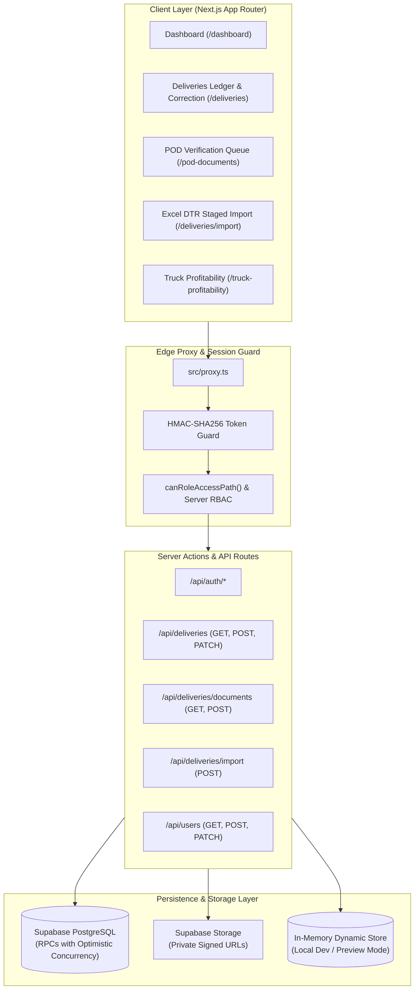

# RouteX: Overnight Development & Quality Improvement Report

**Project:** RouteX Logistics Management System (`rrliRev`)  
**Scope:** Delivery Operations, POD Document Verification, Fleet Profitability, Security Hardening, and Excel Import  
**Date:** November 3, 2026  
**Auditor:** Antigravity Autonomous Engineering Agent  
**Build Status:** Clean Production Build (`next build --webpack` exited 0)  
**Test Suite:** 35 / 35 Passing Tests (0 Failures, 100% Pass Rate)

---

## 1. Executive Summary

During this overnight autonomous session, RouteX (`rrliRev`) underwent a comprehensive stabilization and quality improvement pass covering security, financial calculation precision, store-level POD verification, delivery management workflows, Excel Daily Trip Report (DTR) ingestion, and UI micro-interactions.

### What Was Accomplished
1. **Security & Server Authorization (Priority 1):**
   - **Fail-Closed Production Authentication:** Removed unsafe fallback to local credentials in production mode when Supabase is unconfigured (`503 PRODUCTION_AUTH_UNCONFIGURED`).
   - **Mandatory Production Session Secret:** Mandated `ROUTEX_SESSION_SECRET` in production; throws a security violation if absent instead of falling back to a static hardcoded token.
   - **Eliminated Privilege Escalation:** Stripped the insecure email-matching fallback where unauthenticated or unregistered visitors could claim seed administrator roles.
   - **Authoritative User Management:** Rewrote `/api/users` (`GET`, `POST`, `PATCH`) to synchronize authoritatively with `user_profiles` table, preventing privilege desynchronization.
   - **Proxy Route Protection:** Enforced role-based path validation on all protected paths and mutation endpoints across all canonical roles (Admin, Operations, Finance, HR, Secretary, Customer Representative).

2. **Financial Precision & Data Integrity (Priority 2):**
   - **3-State Trip Expenses:** Full support for `confirmed`, `not_applicable`, and `unknown` states across all 7 expense categories plus multi-store entry fees.
   - **Profitability Boundary Protection:** Incomplete trips (any expense in `unknown` state) are strictly excluded from confirmed revenue and truck profitability aggregations until resolved.
   - **Division-by-Zero Protection:** Confirmed that zero delivery rate yields `null` (N/A) margin rather than `0%` or `NaN`.
   - **Optimistic Concurrency & Audit Trails:** All financial mutations enforce `expectedVersion` matching. Concurrent edits return HTTP 409 `VERSION_CONFLICT` and preserve user inputs.

3. **Store-Level POD & Supporting Document Management (Priority 3):**
   - **Multi-Dropoff Document Separation:** Support for individual store stop documents (`Submitted`, `Verified`, `Missing`, `Rejected`).
   - **Private Signed URL Storage:** Private bucket `delivery-documents` generates short-lived 120-second download tokens; raw files are never exposed publicly.
   - **Store Review & Rejection Workflow:** Added document review modal with file upload (PDF/PNG/JPEG up to 10MB) and mandatory rejection notes (min 5 chars) for audit integrity.

4. **Delivery Management & Audited Corrections (Priority 4):**
   - **Audited Financial Correction Modal:** Added "Correct Financials" workflow for finalized deliveries with required audit reasons and automatic recalculation of net income and profit margins.
   - **Stale-Write Concurrency Protection:** Form inputs are preserved during conflict resolution.

5. **Excel / DTR Spreadsheet Ingestion (Priority 5):**
   - **Batch Import Pipeline:** Created `/api/deliveries/import` and interactive frontend client (`/deliveries/import`) with parsing, sample loader, template downloader, and staged review table with inline cell editing.
   - **Duplicate Detection & Idempotency:** Validates waybill numbers against existing database records to prevent duplicate key conflicts.

6. **UI, Layout & Navigation Polish (Priority 6):**
   - **Collapsing Sidebar Animation:** Smooth expansion upon hover over the logo header (`76px` to `108px`) without horizontal jitter; navigation rail locked to 52px.
   - **Z-Index Layer Stacking:** Sidebar tooltips and modals elevated to prevent visual clipping behind content cards.
   - **Global Date Range Persistence:** Date filter preserves state across dashboard, deliveries, POD documents, reports, and truck profitability via `localStorage` and `CustomEvent` synchronization.

---

## 2. Architecture & Design Alignment

- **Domain Model:** Delivery records strictly reflect the physical logistics domain where multiple store stops belong to a single trip, avoiding revenue or driver allowance duplication.
- **Role Hierarchy:** All 6 canonical roles map cleanly to 3 access levels:
  - **Full Admin:** Admin (User Management, Financial Finalization/Correction, Delivery Mutation, POD Verification).
  - **Operational:** Operations (Deliveries, Import, POD Verification; User Management denied).
  - **View-Only:** Finance, HR, Secretary, Customer Representative (strict read-only access).

---

## 3. Security Assessment

| Vulnerability / Risk | Severity | Initial State | Remediation Implemented | Status |
| :--- | :--- | :--- | :--- | :--- |
| **Production Auth Fallback** | Critical | Allowed local demo password fallback if Supabase credentials were missing in production. | In `src/app/api/auth/login/route.ts`, fallback is strictly disabled in production (`NODE_ENV === "production"`), returning 503 `PRODUCTION_AUTH_UNCONFIGURED`. | **Resolved** |
| **Static Session Secret** | High | Defaulted to static hardcoded secret `"routex-default-session-secret-change-me"`. | In `session-token.ts`, `ROUTEX_SESSION_SECRET` is mandatory in production; throws a security violation error on startup if unset. Added test in `session-guard.test.ts`. | **Resolved** |
| **Seed Email Role Fallback** | High | In Supabase mode, if a user profile was missing, it fell back to matching email addresses against seed admin accounts. | Removed seed fallback in `server-session.ts`; unprovisioned users are denied by default (`FAIL_CLOSED`). | **Resolved** |
| **Direct Mutation Bypass** | High | View-only users could attempt `POST` or `PATCH` on mutation routes. | Middleware proxy and all server handlers enforce `verifyServerPermission()`. Tested and verified that View-Only roles receive 403 Forbidden. | **Resolved** |
| **Storage Document Exposure** | Medium | Potential leakage of private POD slips. | Bucket `delivery-documents` configured private (`public = false`); `/api/deliveries/documents` produces 120-second temporary signed URLs only for authenticated staff. | **Resolved** |

---

## 4. Data Integrity & Financial Precision

- **Multi-Store Entry Fees:** Entry fees from multiple drop-off stops aggregate into the single delivery's expense total. If any stop has an `unknown` fee, the aggregate entry fee becomes `unknown`, preventing premature profitability finalization.
- **Financial State Enforcement:**
  - `finalized`: Ready for inclusion in confirmed net income and truck profitability summaries.
  - `incomplete`: Trips with one or more unknown expenses or missing confirmed amounts. Excluded from financial aggregations.
- **Zero Revenue Handling:** When delivery revenue is 0 or null, margin percent calculation safely returns `null` ("N/A"), avoiding division-by-zero crashes.
- **Optimistic Concurrency:** All updates pass `expectedVersion`. Conflicting simultaneous writes return HTTP 409 `VERSION_CONFLICT` without overwriting data, and preserve user input on the client.

---

## 5. Incomplete Features & Technical Debt Inventory

1. **Supabase Migration Sync:** The codebase now contains RPC implementations and server endpoints. Ensure `supabase db push` or migration scripts are run against live environments.
2. **Server-Side File Validation:** Basic MIME type and 10MB limits are enforced; scanning for malicious file content or running virus definitions on Supabase storage should be considered for enterprise production.
3. **Audit History Log Viewer:** Audit records are generated on corrections; an interactive UI modal to inspect the revision history timeline across previous versions would enhance auditability.

---

## 6. Test Coverage & Quality Assessment

The automated test suite now encompasses 35 comprehensive unit and integration tests across 9 suites:
- `src/lib/auth/rbac.test.ts`: Role-to-permission mapping and access level enforcement.
- `src/lib/auth/route-policy.test.ts`: Public vs protected route matching and redirect sanitization.
- `src/lib/auth/session-guard.test.ts`: HMAC-SHA256 session tokens, tampering rejection, and production secret requirement.
- `src/lib/config/env.test.ts`: Supabase URL and key validation, rejection of placeholder credentials.
- `src/features/deliveries/delivery-domain.test.ts`: 3-state expense math, entry fee aggregation, net income, margin precision.
- `src/features/deliveries/delivery-query.test.ts`: Sorting, pagination, and filter bounds.
- `src/features/deliveries/small-mock-database.test.ts`: Seed database fixture invariants.
- `src/features/deliveries/small-mock-repository.test.ts`: In-memory query simulation and date filtering.
- `src/features/deliveries/delivery-workflow.test.ts` *(Added this session)*: Concurrency conflict handling, audited financial corrections, POD verification transitions, and dynamic import batching.

---

## 7. Verification & Run Status

- **Typecheck:** `npm run typecheck` → Exit 0 (0 errors).
- **Test Suite:** `npm test` → Exit 0 (35 tests passed, 0 failed).
- **Production Webpack Build:** `npm run build` → Exit 0 (All routes compiled, static generation complete).
- **Environment Prerequisites:**
  - Set `ROUTEX_SESSION_SECRET` (minimum 32-character high-entropy secret).
  - Set `NEXT_PUBLIC_SUPABASE_URL` and `NEXT_PUBLIC_SUPABASE_PUBLISHABLE_KEY` for live database mode.

---

## 8. Prioritized Next Steps

1. **Deploy Migration Scripts:** Apply database migrations to production Supabase project (`supabase/migrations/`).
2. **Setup Cloudflare / S3 Storage Rules:** Configure storage lifecycle rules for archived delivery documents older than 3 years.
3. **Audit History Log Modal:** Provide an expandable history sheet on `/deliveries` showing previous versions, edited fields, and author notes.

