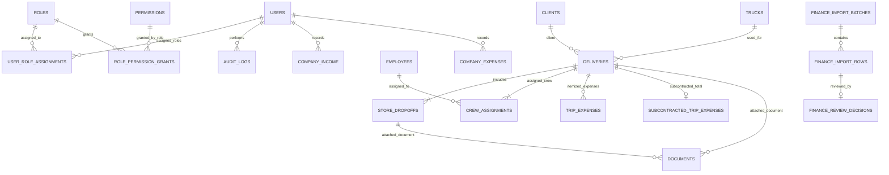

# RRLI Conceptual ERD and Backend Context

## Purpose

This ERD represents the recently discussed RRLI data relationships. It is conceptual and should be reconciled with the actual repository, existing schema, and backend implementation before creating migrations.

## Conceptual ERD

## Entity notes

### Identity and access control

- `USERS`: authenticated account identity, active state, and profile information.
- `ROLES`: built-in or custom role; name, description, enabled state, creator, timestamps.
- `PERMISSIONS`: stable permission identifier and module/action description, derived from actual RRLI functionality.
- `USER_ROLE_ASSIGNMENTS`: many-to-many user/role assignment; supports multiple roles per user.
- `ROLE_PERMISSION_GRANTS`: many-to-many role/permission grants.
- `AUDIT_LOGS`: actor, action, target, timestamp, and relevant before/after values.

### Operations

- `CLIENTS`: customer/client records.
- `TRUCKS`: truck identity, plate, type/ownership, specifications, active state.
- `EMPLOYEES`: employee identity, unique employee ID/code, primary role, active state.
- `DELIVERIES`: one delivery equals one trip; client, date, truck, revenue, status, and trip-level details.
- `STORE_DROPOFFS`: multiple destinations under one delivery, using the existing Store Drop-off structure.
- `CREW_ASSIGNMENTS`: employee, delivery, crew role (driver/helper), manually entered daily rate and applicable fields.
- `TRIP_EXPENSES`: itemized owned-truck expenses with description and amount.
- `SUBCONTRACTED_TRIP_EXPENSES`: one total subcontracted expense amount per delivery.
- `DOCUMENTS`: metadata, storage reference, type/status, and association with a Delivery or Store Drop-off. File bytes remain in private storage when backend storage is implemented.

### Company Finance

- `COMPANY_INCOME`: company-level income/revenue records, such as customer payments or other company revenue.
- `COMPANY_EXPENSES`: company-level costs, such as overhead and other company expenses.
- Both record types are presented in the **Company Finance** module.
- Company Finance summary includes total income, total expenses, and net balance (`income - expenses`).

### Finance import review

- `FINANCE_IMPORT_BATCHES`: import source and batch metadata.
- `FINANCE_IMPORT_ROWS`: parsed rows and processing status.
- `FINANCE_REVIEW_DECISIONS`: manual decision for possible duplicates: combine, keep separate, or exclude.

## Key relationship and integrity rules

- One Delivery = one trip.
- One delivery has exactly one driver and 1-2 helpers.
- No duplicate employee assignment within a delivery.
- An employee cannot be assigned to multiple trips on the same date.
- Do not create separate individual-stop entities beyond the existing Store Drop-off model.
- Do not duplicate delivery revenue or trip expenses across drop-offs.
- Company income/expenses are separate from delivery-level revenue/expenses.
- Company expenses are not allocated to trucks and do not affect truck profitability.
- Disabled roles grant no permissions.
- Effective permissions are the union of grants from enabled assigned roles.
- A custom role assigned to users cannot be deleted until it is unassigned/reassigned.
- Historical delivery and audit attribution must remain available when an employee is removed from active use.

## Backend / implementation context

Before implementation, inspect the repository to determine whether the backend and database are already present.

If an existing backend exists:
- Extend its current schema, services, and API patterns.
- Avoid parallel tables or duplicate finance systems.
- Preserve existing API contracts unless a change is necessary.

If backend work is still pending:
- Treat this model as a conceptual reference, not a migration.
- Confirm the project's planned stack and conventions before creating schema or API endpoints.

If Supabase is the active backend:
- Follow existing migration conventions.
- Enforce access with appropriate server-side checks and Row Level Security.
- Keep private files in private Storage and expose only authorized access.
- Never place service-role secrets in frontend code.

Financial totals should be based on persisted records when backend persistence exists. Validate amounts and required fields server-side. Keep company-level and trip-level financial data distinct.
