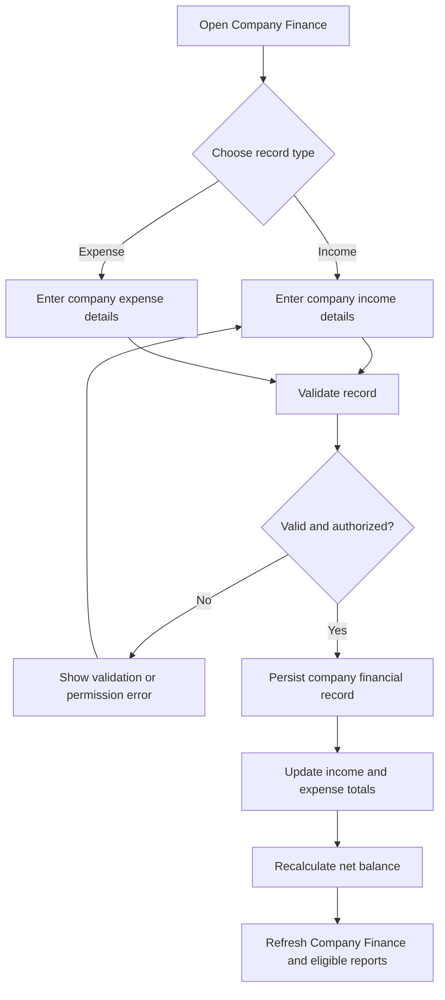
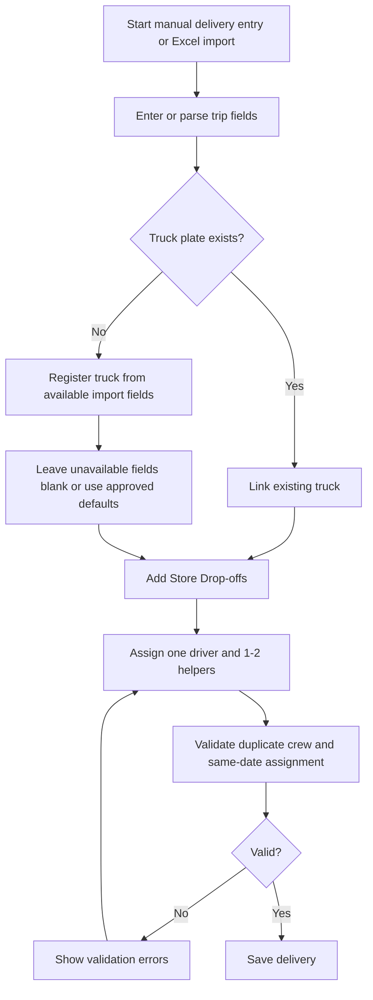
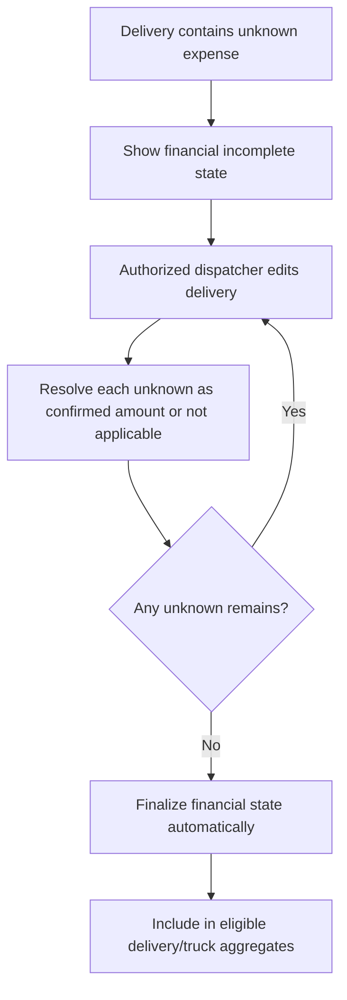
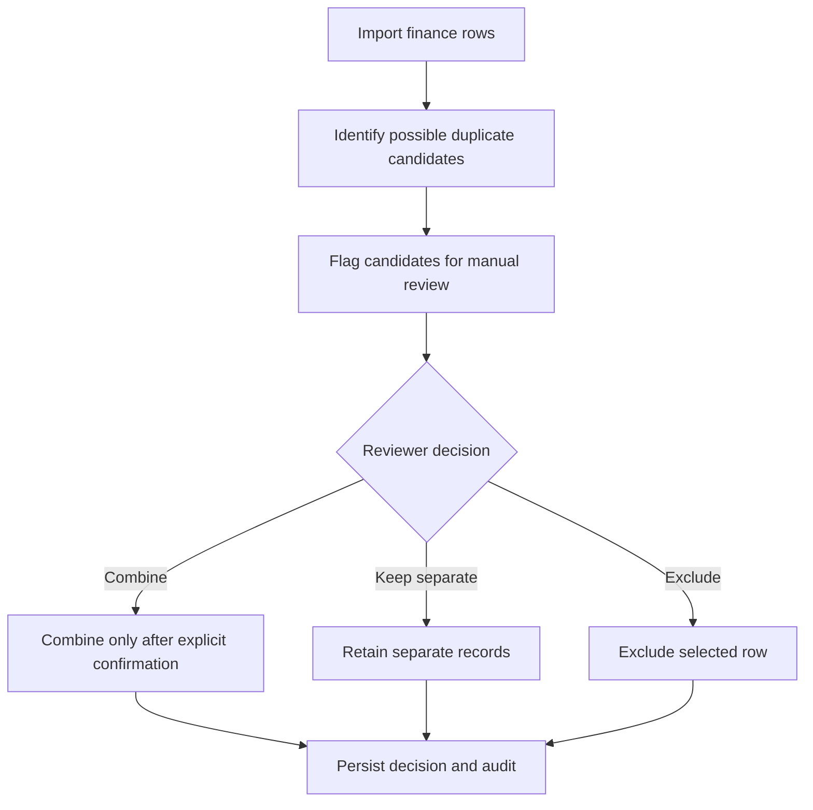
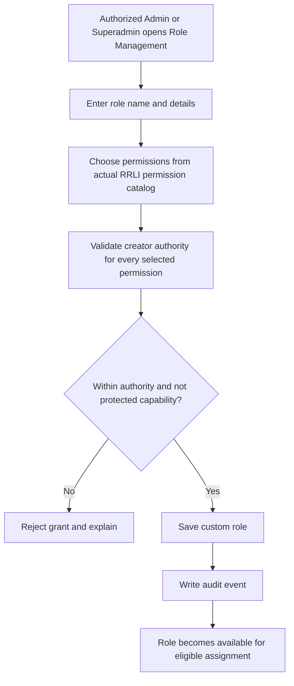
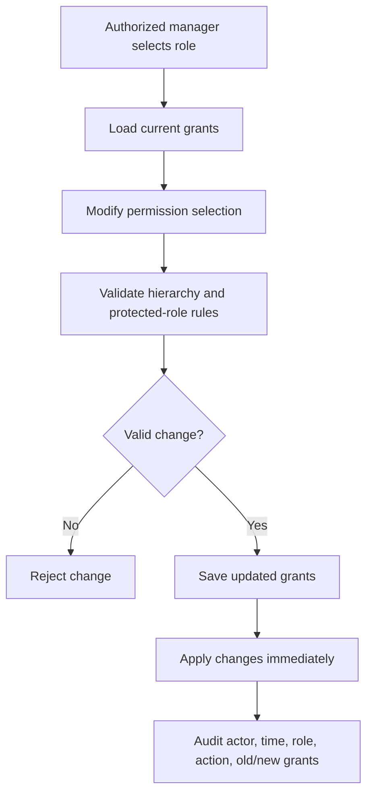
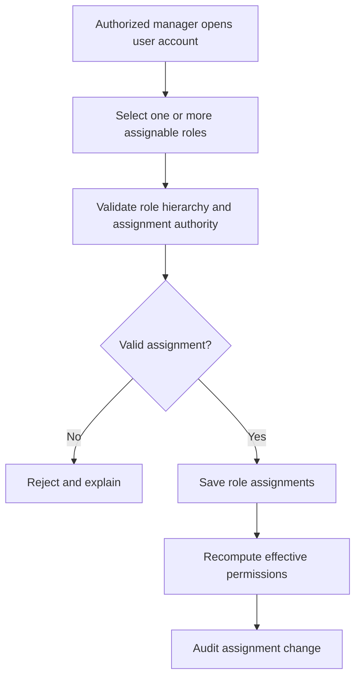
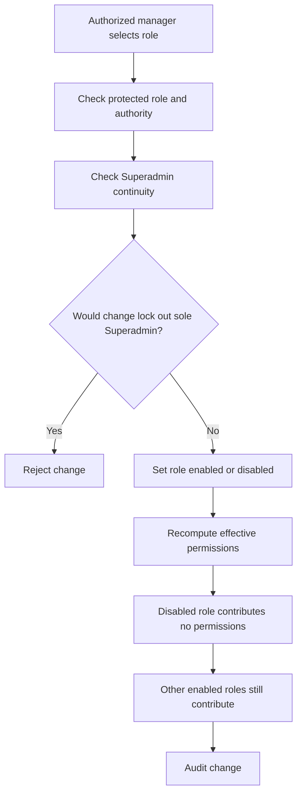
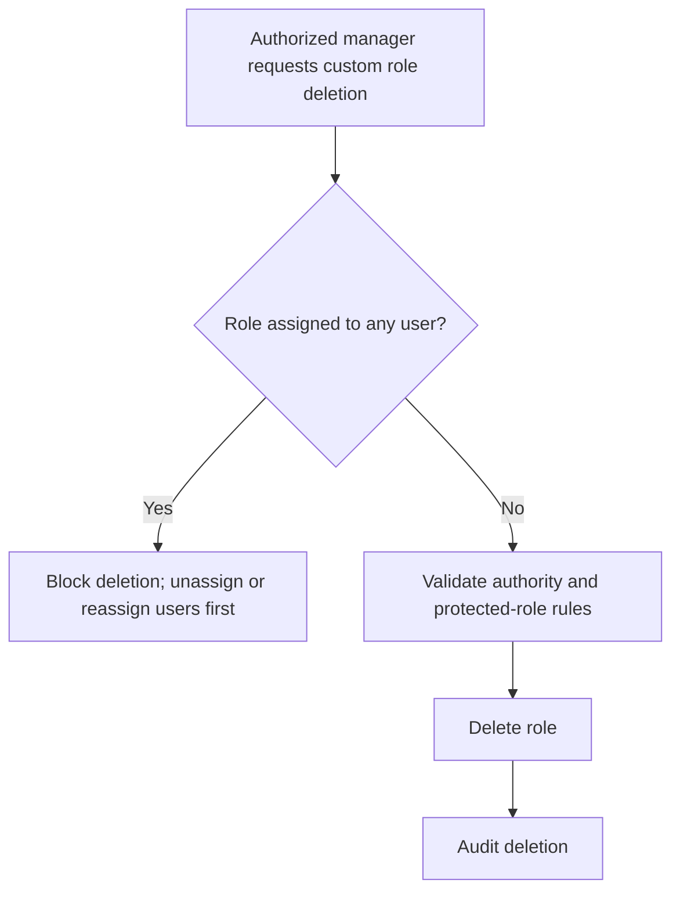
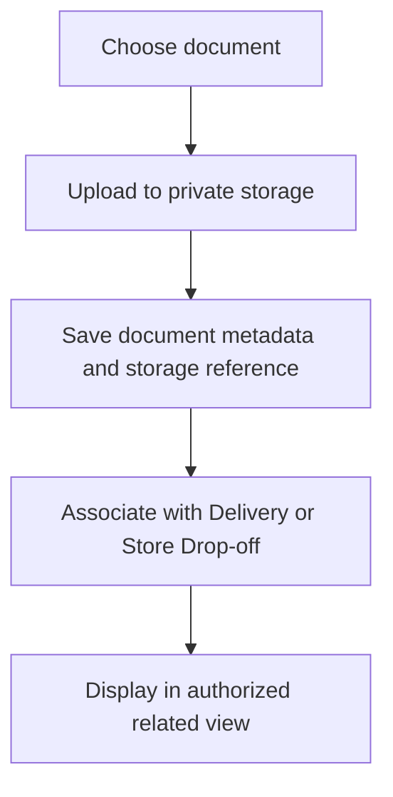

# RRLI Activity Diagrams

These diagrams capture recent workflow decisions. Confirm each action against the actual UI and repository before implementation.

## 1. Record company income or company expense

Rules:
- Company Finance contains both Income and Expenses.
- Net balance = total company income - total company expenses.
- Company-level records do not automatically attach to deliveries or trucks.
- Company expenses do not affect truck profitability.

## 2. Record or import a delivery

Rules:
- One delivery represents one trip.
- Store Drop-offs are destinations within the delivery.
- Do not create individual stop records beyond the existing Store Drop-off structure.
- Do not duplicate revenue or trip expenses across drop-offs.
- Preserve the existing Operations 3-day entry/edit window and Admin historical-entry rule from 2024-01-01, subject to current repository requirements.

## 3. Resolve unknown trip expenses

Company-level expenses are not part of this trip-expense resolution or truck profitability allocation.

## 4. Finance import duplicate review

Never auto-combine possible duplicates.

## 5. Create a custom role

Custom roles must not receive permissions beyond the creator's authority. Protected role-management authority is not a freely grantable custom permission.

## 6. Edit role permissions

Admin may edit lower built-in roles and custom roles within authority. Only Superadmin may edit the Admin role.

## 7. Assign or remove roles from a user

- Users may hold multiple roles.
- Admin cannot assign Admin or Superadmin.
- Only Superadmin can assign Admin.
- Superadmin remains a single protected account held by the President.

## 8. Disable or enable a role

## 9. Delete a custom role

Built-in roles cannot be deleted.

## 10. Upload a document

Use the project's existing storage/backend approach. Do not create separate stop records just to attach documents.
