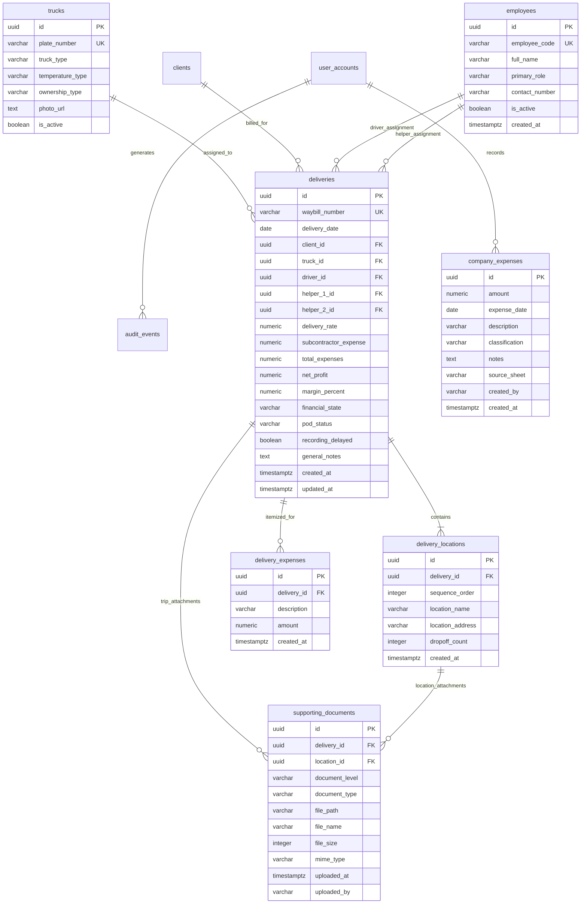

# RouteX (RRLI): Central Requirements & System Design Specification

> **Document Status:** `[Authoritative Source of Truth]`  
> **Application:** RouteX Logistics Management System  
> **Client Organization:** Redeemed Route Logistics Inc. (RRLI)  
> **Codebase Working Directory:** `rrliRev/`  
> **Last Updated & Audited:** November 2026  
> **Authority Precedence:** Confirmed Project Owner Requirements > Frontend Aligned Implementation > Current Repository Code > Historical Docs

---

## 1. Implementation Status & System Architecture Taxonomy

To ensure absolute clarity between what is currently built in the frontend versus what is planned for the backend, this specification adheres to the following status taxonomy:

| Status Tag | Definition in RouteX |
| :--- | :--- |
| **`[Confirmed Requirement]`** | Formally confirmed business requirement, rule, or system behavior from the project owner. |
| **`[Frontend Implemented]`** | Active, functional UI component, view, or client interaction verified in `rrliRev/src/`. |
| **`[Mock-Only]`** | Frontend behavior currently powered by local state, `localStorage`, or verified fixtures (`small-mock-database.ts`). |
| **`[Planned Backend]`** | Future Supabase PostgreSQL tables, RLS policies, Storage buckets, or Edge Functions designed for production. |
| **`[Implemented Backend]`** | Server-side Route Handler or API logic verified and executable in the repository. |
| **`[Superseded]`** | Obsolete requirement, legacy schema, or discarded workflow retained only for historical context. |

> [!IMPORTANT]
> **Current Backend State:** The production Supabase backend has **not been implemented yet**. The application currently operates in **Browser Preview Mode** using verified mock fixtures, local browser storage, and in-memory stores. All database tables, foreign keys, RLS policies, and Supabase Storage workflows described herein represent the **[Planned Backend]** architecture designed to support the aligned frontend.

---

## 2. Core Business Requirements & Invariants

### 2.1 Delivery Structure (`[Confirmed Requirement]` · `[Frontend Implemented]`)
1. **One Delivery Equals One Completed Trip:**
   - A Delivery record represents a single vehicular delivery trip from start to finish.
   - Trips are identified by a unique Waybill Number (`waybillNumber`, e.g., `WB-2026-001`), Delivery Date, Client, and Truck Plate.
   - Deliveries are completed operational trips only. RouteX does not manage live dispatching, in-transit telemetry, or turn-by-turn routing.
2. **Locations and Numeric Stop/Drop-off Counts:**
   - A Delivery can have one or more **Locations**.
   - Each Location records:
     - **Location Name** (e.g., store name, supermarket branch, distribution depot).
     - **Location Address** (destination area / geographic district).
     - **Number of Stops / Drop-offs** (`dropoffCount`): A strictly **numeric** field indicating how many drop-offs occurred at that location.
   - **No Individual Stop Records:** The system **does not** create separate database records, rows, or forms for each individual store stop or crate drop-off.
   - **Derived Total Drop-offs:** The overall drop-off count for a delivery is computed as the sum of drop-off counts across its locations:
     $$\text{Total Stops / Drop-offs} = \sum_{i=1}^{N} \text{Location}_i.\text{dropoffCount}$$
   - The UI displays: e.g., `"Total: 2 locations, 6 stops/drop-offs"`.

### 2.2 Truck Registration & Ownership (`[Confirmed Requirement]` · `[Frontend Implemented]`)
1. **Matching Plate Numbers:**
   - Every delivery is attributed to a truck by plate number (e.g., `NCM-8821`).
   - Plate numbers are normalized (trimmed, standardized casing) for matching against registered vehicles.
2. **Automatic Truck Registration on Import:**
   - When importing deliveries via spreadsheet, if a plate number does not exist in the registered truck registry, the system **automatically creates a new truck record** using available spreadsheet data.
   - Missing fields remain blank or use appropriate defaults (e.g., vehicle type: `4-Wheeler`, ownership: derived from spreadsheet styling or default `Owned`).
   - The import process **does not block** or require the user to manually pre-register trucks before completing the import.
3. **Owned vs. Subcontracted Trucks:**
   - **Owned Trucks:** Company-owned fleet vehicles tracking complete operational costs (diesel, tolls, crew pay, other expenses).
   - **Subcontracted Trucks:** Third-party vehicles hired for specific runs (distinguished in spreadsheets by unshaded/white backgrounds). They follow a simplified financial structure.

### 2.3 Employee Identification & Crew Assignments (`[Confirmed Requirement]` · `[Frontend Implemented]`)
1. **Unique Employee ID/Code:**
   - Every driver and helper has a unique, non-null Employee ID/code (`employeeCode`, e.g., `DRV-01`, `DRV-02`, `HLP-01`, `HLP-02`).
2. **Crew Dropdown Display Format:**
   - Crew selection dropdowns display:  
     $$\text{Full Name } [\text{Employee ID}] \cdot \text{Role}$$
     *(e.g., `Danilo Cruz [DRV-01] · Driver`, `Nestor Ramos [HLP-01] · Helper`)*.
3. **Driver as Helper Selection:**
   - Drivers are cross-trained and **can be selected as helpers** on trips.
   - Helper dropdowns list both active helpers and active drivers.
4. **Crew Composition Rules per Delivery:**
   - **Exactly one (1) Driver** is required per delivery.
   - **One to two (1–2) Helpers** are required (minimum 1 helper, maximum 2 helpers).
5. **Crew Assignment Conflict Prevention:**
   - **Same-Delivery Duplicate Prevention:** The same employee cannot be assigned to multiple roles on the same delivery (e.g., Danilo Cruz cannot be Driver and Helper on the same trip).
   - **Same-Date Schedule Conflict Detection:** An employee cannot be assigned to multiple delivery trips on the same calendar date. If an employee is already assigned to another waybill on that date, the UI flags a visible schedule conflict warning chip (`⚠️ Schedule Conflict: Already assigned to Waybill #...`).
6. **Crew Compensation Rates:**
   - Daily rates and allowances are entered **manually** per trip.
   - The system **does not** perform automatic labor rate or overtime calculations.
7. **Permanent Employee Deletion & Historical Integrity:**
   - When an employee is permanently deleted, they are removed from active registries and future crew assignment dropdowns.
   - **Historical Attribution Preserved:** All past deliveries, completed trip records, and system audit logs retain the deleted employee's name, ID, and attribution.

### 2.4 Expense Tracking: Owned vs. Subcontracted (`[Confirmed Requirement]` · `[Frontend Implemented]`)
The delivery expense interface dynamically adapts based on truck ownership:

#### A. Owned Trucks
- **Itemized Expenses:** Trip expenses are itemized into discrete entries, each having:
  - **Description** (e.g., `Diesel`, `Toll Gates`, `Parking / Hub Fee`, `Meal Allowance`, `Miscellaneous`).
  - **Amount** (₱ numeric).
- Users can add, edit, and remove itemized expense rows.
- **Single Delivery Notes Field:** The delivery record contains **one general notes field** (`notes`). There are no separate note fields per expense item.

#### B. Subcontracted Trucks
- **Single Total Subcontractor Expense:** Subcontracted deliveries track **one total expense amount** (`subcontractorExpense`).
- **No Itemized Entries or Crew Daily Rates:** Diesel, highway tolls, driver daily rates, and helper allowances are not tracked or itemized for subcontracted trucks.

### 2.5 Unknown Expense Invariant & Financial Completeness (`[Confirmed Requirement]` · `[Frontend Implemented]`)
1. **Zero-Tolerance for Silent Zeroes:**
   - An expense marked `unknown` represents an unresolved operational cost.
   - **NEVER silently convert an unknown expense to ₱0.00.**
   - Any delivery with one or more unknown expenses is marked `financialState = "incomplete"`.
2. **Exclusion from Aggregate Financial Totals:**
   - Deliveries in the `incomplete` state are **strictly excluded** from gross revenue, total expense, net profit, and profit margin KPI totals on the Dashboard, Truck Profitability, and Finance pages until resolved.
3. **Automatic Financial Resolution:**
   - There is no separate "Finalize" button. Once dispatchers edit the delivery to confirm all unknown amounts, the system automatically marks the delivery as `finalized`.

### 2.6 Operational Recording Windows & Backdating Requests (`[Confirmed Requirement]` · `[Frontend Implemented]`)
1. **Company Foundation Boundary (2024):**
   - RRLI was founded on **January 1, 2024**. No delivery, expense, or import record may precede `2024-01-01`.
2. **3-Day Operational Submission Window:**
   - Operations staff can record or edit deliveries up to 3 days from the delivery date:
     $$\text{Today} - \text{Delivery Date} \le 3 \text{ days}$$
   - Any trip recorded past 3 days requires an **Approved Backdating Request**.
3. **Backdating Requests Queue (`/api/deliveries/backdating-tickets`):**
   - Operations submits a Backdating Request specifying Waybill Number, Delivery Date, Client, Plate, and Reason.
   - System Admin reviews the Requests Queue to **Approve** or **Reject** the request with optional review notes.
   - Once approved, Operations can record or edit the backdated trip.
   - System Admin is exempt from the 3-day restriction.

### 2.7 Finance Spreadsheet Import & Duplicate Reconciliation (`[Confirmed Requirement]` · `[Frontend Implemented]`)
1. **All Six Reference Sheets Supported:**
   - The finance importer recognizes all six sheets from the legacy `FINANCE REF.` workbook:
     1. *Service Invoice (Billings)* → **Incoming**
     2. *Company Advances (Petty Cash)* → **Outgoing**
     3. *Checks Received* → **Incoming**
     4. *Weekly Payments (Payables)* → **Outgoing**
     5. *Checks Issued (Expenses)* → **Outgoing**
     6. *Daily Collections* → **Incoming**
2. **Three Core Data Points per Transaction:**
   - **Date** (when the financial activity occurred).
   - **Total Amount** (complete monetary transaction value).
   - **Description / Subject** (client, entity, or reference).
3. **No Pending Transactions in Finance:**
   - Every financial record is classified as either **Incoming** or **Outgoing**.
   - Historical status labels (e.g., `NOT PAID`, `NOT CREDITED`) in legacy sheets are imported as completed historical activity, not active pending payables.
4. **Duplicate Record Review Engine:**
   - When imported transactions match across different sheets (same date, matching amount, similar counterparty), the system flags them for **Manual Review**.
   - Duplicate records are **never automatically merged**.
   - Reviewers choose from three explicit review actions:
     - **Combine Records:** Merge into a single reconciled transaction with cross-sheet audit notes.
     - **Keep Separate:** Preserve both entries as distinct legitimate transactions.
     - **Exclude Record:** Discard the redundant entry from the final import commit.

### 2.8 Supporting Documents & Proof of Delivery (`[Confirmed Requirement]` · `[Frontend Implemented]` / `[Planned Backend]`)
1. **Two-Tier Document Association:**
   - Documents are categorized into:
     - **Delivery-Level Documents:** Associated with the overall delivery trip (e.g., Master Waybill, Trip Summary, Fuel Receipt, Weight Slip).
     - **Location-Level Documents:** Associated with a specific Location on the trip (e.g., Signed Store Receipt, Proof of Delivery stamp, Delivery Invoice).
   - **No Individual Stop Documents:** Documents attach to Locations, never to individual stop/drop-off records.
2. **Supabase Storage Architecture (`[Planned Backend]`):**
   - Direct binary upload to private Supabase Storage bucket (`routex-documents`).
   - Document metadata, file path, MIME type, and associations stored in PostgreSQL.
   - Access governed by time-limited (5-minute) pre-signed URLs.
3. **Browser Preview Fallback (`[Mock-Only]`):**
   - Generates deterministic, downloadable SVG receipt documents containing trip and location metadata when running without Supabase credentials.

---

## 3. Role-Based Access Control (RBAC) Matrix

RouteX enforces a strict tripartite governance model across 6 canonical user roles:

| Module / Capability | Admin (`admin`) | Operations (`operations`) | Finance (`finance`) | View-Only (`hr`, `secretary`, `customer_representative`) |
| :--- | :---: | :---: | :---: | :---: |
| **Dashboard & Global KPIs** | Full | Full | Read-Only | Read-Only |
| **Delivery Ledger (`/deliveries`)** | Full (Unlimited 2024+) | Full (3-Day / Approved Request) | Read-Only | Read-Only |
| **Record / Edit Delivery** | Full | Full (3-Day / Approved Request) | ✗ Locked | ✗ Locked |
| **Backdating Requests** | Review & Authorize | Submit Request | Read-Only | Read-Only |
| **Delete Delivery (Audited)** | Full (Mandatory Reason) | ✗ Locked | ✗ Locked | ✗ Locked |
| **Delivery Spreadsheet Import** | Full | Full | ✗ Locked | ✗ Locked |
| **Truck Registry & Profiles** | Full | Full | Read-Only | Read-Only |
| **Drivers & Helpers Registry** | Full | Full | Read-Only | Read-Only |
| **Company Expenses (`/finance`)** | Full | Read-Only | **Full (Write & Manage)** | Read-Only |
| **Finance Spreadsheet Import** | Full | ✗ Locked | **Full** | ✗ Locked |
| **POD & Supporting Documents** | Full | Upload / Manage | Read-Only | Read-Only |
| **Reports Generation & Export** | Full | Full | Full | Read-Only (Export Locked) |
| **User Account Management** | **Exclusive** | ✗ Locked | ✗ Locked | ✗ Locked |
| **System Audit Logs** | **Exclusive** | ✗ Locked | ✗ Locked | ✗ Locked |

---

## 4. Planned Relational Database Schema (`[Planned Backend]`)

When production Supabase integration is performed, the relational schema must match the confirmed requirements:

---

## 5. Profitability & Calculation Invariants

1. **Owned Delivery Trip Profitability:**
   $$\text{Total Trip Expenses} = \sum \text{Itemized Expenses (Diesel, Tolls, Crew Rates, Allowances, Other)}$$
   $$\text{Delivery Net Profit} = \text{Delivery Revenue} - \text{Total Trip Expenses}$$
   $$\text{Profit Margin (\%)} = \left(\frac{\text{Delivery Net Profit}}{\text{Delivery Revenue}}\right) \times 100$$
2. **Subcontracted Delivery Trip Profitability:**
   $$\text{Total Trip Expenses} = \text{Subcontractor Expense}$$
   $$\text{Delivery Net Profit} = \text{Delivery Revenue} - \text{Subcontractor Expense}$$
   $$\text{Profit Margin (\%)} = \left(\frac{\text{Delivery Net Profit}}{\text{Delivery Revenue}}\right) \times 100$$
3. **Truck Profitability (Strict Isolation):**
   $$\text{Truck Revenue} = \sum \text{Finalized Delivery Revenue for Truck Plate}$$
   $$\text{Truck Expenses} = \sum \text{Finalized Trip Expenses for Truck Plate}$$
   $$\text{Truck Net Profit} = \text{Truck Revenue} - \text{Truck Expenses}$$
   > [!IMPORTANT]
   > Truck profitability is strictly isolated from company-wide operating expenses. Corporate expenses (hub rent, electricity, management salaries) are **never** allocated to individual trucks.
4. **Company Consolidated Profitability:**
   $$\text{Company Net Profit} = \sum \text{Delivery Revenue} - \sum \text{Trip Expenses} - \sum \text{Company Operating Expenses}$$
   $$\text{Company Margin (\%)} = \left(\frac{\text{Company Net Profit}}{\sum \text{Delivery Revenue}}\right) \times 100$$

---

## 6. Audit Trail & Immutability Rules

- All financial corrections, delivery deletions, role changes, backdating request approvals, and employee deactivations emit an immutable Audit Trail event (`/api/audit`).
- Audit events record:
  - Timestamp, Actor (`@username` and Role), Action Title, Action Category.
  - Target Entity Type and Entity ID.
  - Structured metadata capturing transition diffs (`attribute`, `oldValue`, `newValue`).
- Passwords, secret keys, and answers are **never** recorded in audit logs.
