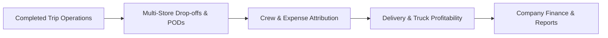

# Knowledge Base: 01 — Project Overview

> **Document Status:** `[Implemented]`  
> **Authority Level:** Authoritative Specification  
> **Last Verified:** November 2026  
> **Location:** `rrliRev/docs/knowledge-base/01-project-overview.md`

---

## 1. Executive Summary

**RouteX** is the internal **Delivery Operations, Multi-Store Drop-offs, Proof of Delivery (POD) Documents, and Truck Profitability** management system engineered specifically for **Redeemed Route Logistics Inc. (RRLI)**, a commercial freight and refrigerated transport carrier based in the Philippines.

The platform provides an auditable operational ledger that bridges field logistics, vehicle tracking, driver/helper payroll attribution, fuel benchmarks, customer store drop-offs, and company-wide financial performance.

---

## 2. Core Problem Statement

Prior to RouteX, RRLI operations faced critical operational challenges:

1. **Disconnected Delivery Records:** Trips, driver assignments, and customer drop-offs were captured across fragmented spreadsheets and paper waybills.
2. **Delayed Invoicing from Missing PODs:** Client payments were delayed because signed physical POD receipts were frequently misplaced or took days to return to headquarters.
3. **Obscured Truck Profitability:** Fleet management lacked real-time visibility into whether individual vehicles were operating above or below operating cost thresholds (fuel, tollways, entry fees, crew allowances).
4. **Distorted Financial Aggregations:** Incomplete delivery records with unknown expenses were frequently zeroed out, corrupting company financial statements and creating false profit margins.

RouteX resolves these issues by serving as the unified source of truth for all operational records, enforcing financial integrity invariants and document completeness.

---

## 3. System Scope & Operational Boundaries

### In Scope (`[Implemented]`)

- **Completed Delivery Ledger:** Recording and reconciling completed delivery trips (`/deliveries`, `/deliveries/[id]`).
- **Multi-Store Drop-off Tracking:** Capturing multiple store destinations per trip, sequenced store entry fees, and destination areas.
- **POD & Supporting Documents:** Stop-level digital document attachment (delivery receipts, invoices, weight slips) with instant viewer and verification flags (`/pod-documents`).
- **Fleet & Crew Management:** Vehicle profiles, dedicated truck photo uploads, refrigerated/dry classification, distance benchmarks, and driver/helper personnel management (`/truck-profitability`, `/drivers`).
- **Financial Reconciliation:** Distinct tracking for Trip Expenses (fuel, tolls, fees, crew) and Company Operating Expenses (`/finance`), ensuring accurate Net Profit and Profit Margin calculations.
- **Reporting & Data Export:** Fixed Daily Trip Reports, customizable multi-table templates, Excel-compliant CSV generation, and print-ready formats (`/reports`).
- **Role-Based Access Control (RBAC):** Strict 6-role permission matrix with server-enforced route guards and session security (`/user-management`, `/settings`).

### Explicitly Excluded from Scope (`[Deprecated]` / Not in v1)

- **No Live GPS Tracking / Telematics:** RouteX is an operational accounting and reconciliation ledger for completed trips, not an active in-cab telematics or GPS fleet tracker.
- **No Turn-by-Turn Dispatch Navigation:** Dispatchers record planned and completed delivery metrics; the system does not provide dynamic live routing.
- **No Public Customer Portal:** RouteX is an internal company operating system. External clients receive exported CSV or PDF reports.

---

## 4. Primary User Personas & Organizational Roles

RouteX is designed for six canonical user roles within RRLI:

| Role | Access Level | Primary Responsibilities |
| :--- | :--- | :--- |
| **System Admin** | `admin` | Full management, user provisioning, security policies, unlimited delivery editing, system audit logs. |
| **Delivery Operations** | `operations` | Dispatch reconciliation, recording deliveries (within 3-day window), fleet management, crew assignments, POD uploads. |
| **Finance Officer** | `view_only` | Reviewing confirmed financials, managing company-wide operating expenses, auditing trip profitability, generating reports. |
| **HR Specialist** | `view_only` | Auditing driver and helper crew assignments, reviewing trip counts, monitoring personnel rates. |
| **Corporate Secretary** | `view_only` | Reviewing official waybills, verifying store drop-off sequences, confirming signed POD compliance. |
| **Customer Representative** | `view_only` | Tracking customer store deliveries, reviewing drop-off statuses, validating proof of delivery for clients. |

---

## 5. Architectural Foundation: Dual-Mode Storage

RouteX is engineered with a **Dual-Mode Storage Architecture**:

1. **Database-Free Browser Preview Mode (Default):**
   - Automatically active when Supabase credentials are absent.
   - Runs on verified mock data fixtures ([`src/features/deliveries/small-mock-database.ts`](file:///c:/Users/suchi/Documents/rrli/rrliRev/src/features/deliveries/small-mock-database.ts)), in-memory caches, and browser `localStorage`.
   - Generates deterministic SVG document previews for PODs.
   - Synchronizes across browser tabs via custom reactive window events (`ROUTEX_DELIVERIES_CHANGED`, `ROUTEX_COMPANY_EXPENSES_CHANGED`, etc.).
   - Enables complete offline testing, demonstrations, and development without database setup.

2. **Supabase Connected Mode:**
   - Active when `NEXT_PUBLIC_SUPABASE_URL` and `NEXT_PUBLIC_SUPABASE_ANON_KEY` are provided.
   - Connects to PostgreSQL using versioned SQL migrations in `supabase/migrations/`.
   - Enforces PostgreSQL Row-Level Security (RLS) policies and stores documents in private Supabase Storage buckets with 5-minute pre-signed URLs.

---

## 6. Project Independence (`rrliRev`)

All active development, testing, documentation, and operational code lives strictly inside **`rrliRev/`**. The legacy root repository (`rrli/`) serves solely as a historical archive. Any new feature, bug fix, or verification must be conducted within `rrliRev/`.
