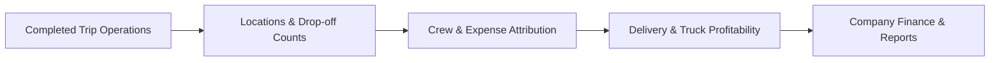

# Knowledge Base: 01 — Project Overview

> **Document Status:** `[Authoritative Overview]`  
> **Authority Level:** Authoritative Specification  
> **Master Source of Truth:** [`../CENTRAL_REQUIREMENTS_AND_SYSTEM_DESIGN.md`](../CENTRAL_REQUIREMENTS_AND_SYSTEM_DESIGN.md)  
> **Last Verified:** November 2026  
> **Location:** `rrliRev/docs/knowledge-base/01-project-overview.md`

---

## 1. Executive Summary

**RouteX** is the internal **Delivery Operations, Multi-Store Drop-offs, Proof of Delivery (POD) Documents, and Truck Profitability** management system engineered specifically for **Redeemed Route Logistics Inc. (RRLI)**, a commercial freight and refrigerated transport carrier based in the Philippines.

The platform provides an auditable operational ledger that bridges field logistics, vehicle tracking, driver/helper payroll attribution, fuel benchmarks, customer store drop-offs, and company-wide financial performance.

---

## 2. Core Problem Statement

Prior to RouteX, RRLI operations faced critical operational challenges:

1. **Disconnected Delivery Records:** Trips, driver assignments, and customer drop-offs were captured across fragmented spreadsheets and paper waybills.
2. **Delayed Invoicing from Missing PODs:** Client payments were delayed because signed physical POD receipts were frequently misplaced or took days to return to headquarters.
3. **Obscured Truck Profitability:** Fleet management lacked visibility into whether individual vehicles were operating above or below operating cost thresholds (fuel, tollways, entry fees, crew allowances).
4. **Distorted Financial Aggregations:** Incomplete delivery records with unknown expenses were frequently zeroed out, corrupting company financial statements and creating false profit margins.

RouteX resolves these issues by serving as the unified source of truth for all operational records, enforcing financial integrity invariants, document completeness, and strict audit compliance.

---

## 3. System Scope & Operational Boundaries

### In Scope (`[Frontend Implemented]` · `[Planned Backend]`)

- **Completed Delivery Ledger:** Recording and reconciling completed delivery trips (`/deliveries`, `/deliveries/[id]`).
- **Locations & Stop/Drop-off Counts:** Capturing multiple store delivery locations per trip, with each location storing its name, address, and a numeric count of stops/drop-offs. Total stops are derived as the sum across locations (no individual stop/drop-off records).
- **POD & Supporting Documents:** Two-tier document attachment (Trip-level supporting documents and Location-level proof of delivery) with instant viewer and verification flags (`/pod-documents`).
- **Fleet & Crew Management:** Vehicle profiles, dedicated truck photo uploads, refrigerated/dry classification, owned vs. subcontracted accounting, unique Employee IDs (`employeeCode`), and driver/helper personnel management (`/truck-profitability`, `/drivers`).
- **Financial Reconciliation:** Distinct tracking for Trip Expenses (owned itemized fuel/tolls/fees/crew vs. subcontracted total expense) and Company Operating Expenses (`/finance`), ensuring accurate Net Profit and Profit Margin calculations.
- **Reporting & Data Export:** Fixed Daily Trip Reports, customizable multi-table templates, Excel-compliant CSV generation, and offline snapshots (`/reports`).
- **Role-Based Access Control (RBAC):** Strict 6-role permission matrix with server-enforced route guards and session security (`/user-management`, `/settings`).
- **Backdating Requests Queue:** Controlled approval workflow for operations staff recording trips past the 3-day window (`/api/deliveries/backdating-tickets`).

### Explicitly Excluded from Scope (`[Confirmed Exclusion]`)

- **No Live GPS Tracking / Telematics:** RouteX is an operational accounting and reconciliation ledger for completed trips, not an active in-cab telematics or GPS fleet tracker.
- **No Turn-by-Turn Dispatch Navigation:** Dispatchers record completed delivery metrics; the system does not provide dynamic live routing.
- **No Public Customer Portal:** RouteX is an internal company operating system. External clients receive exported CSV or PDF reports.
- **No Individual Stop Records:** The system does not maintain individual rows, tables, or forms for each stop/drop-off within a location.

---

## 4. Primary User Personas & Organizational Roles

RouteX is designed for six canonical user roles within RRLI:

| Role | Access Level | Primary Responsibilities |
| :--- | :--- | :--- |
| **System Admin** | `admin` | Full management, user provisioning, security policies, unlimited delivery editing, request approvals, and system audit logs. |
| **Delivery Operations** | `operations` | Dispatch reconciliation, recording deliveries (within 3-day window or via approved request), fleet management, crew assignments, and POD uploads. |
| **Finance Officer** | `finance` | Reviewing confirmed financials, managing company-wide operating expenses, importing legacy finance workbooks, auditing trip profitability, and generating reports. |
| **HR Specialist** | `view_only` | Auditing driver and helper crew assignments, reviewing trip counts, and monitoring personnel rates. |
| **Corporate Secretary** | `view_only` | Reviewing official waybills, verifying store drop-off counts, and confirming signed POD compliance. |
| **Customer Representative** | `view_only` | Tracking customer store deliveries, reviewing drop-off statuses, and validating proof of delivery for clients. |

---

## 5. Architectural Foundation: Implementation Status & Storage

RouteX is currently engineered in **Frontend-Aligned State**:

1. **Database-Free Browser Preview Mode (`[Frontend Implemented]` · `[Mock-Only]`):**
   - Active in the current repository state.
   - Runs on verified mock data fixtures ([`src/features/deliveries/small-mock-database.ts`](file:///c:/Users/suchi/Documents/rrli/rrliRev/src/features/deliveries/small-mock-database.ts)), in-memory caches, and browser `localStorage`.
   - Generates deterministic SVG document previews for PODs.
   - Synchronizes across browser tabs via custom reactive window events (`ROUTEX_DELIVERIES_CHANGED`, `ROUTEX_COMPANY_EXPENSES_CHANGED`, etc.).
   - Enables complete offline testing, demonstrations, and development without database setup.

2. **Supabase Connected Mode (`[Planned Backend]`):**
   - Planned for future backend implementation.
   - Will connect to PostgreSQL using versioned SQL migrations in `supabase/migrations/`.
   - Will enforce PostgreSQL Row-Level Security (RLS) policies and store documents in private Supabase Storage buckets with 5-minute pre-signed URLs.

---

## 6. Project Independence (`rrliRev`)

All active development, testing, documentation, and operational code lives strictly inside **`rrliRev/`**. The legacy root repository (`rrli/`) serves solely as a historical archive. Any new feature, bug fix, or verification must be conducted within `rrliRev/`.
