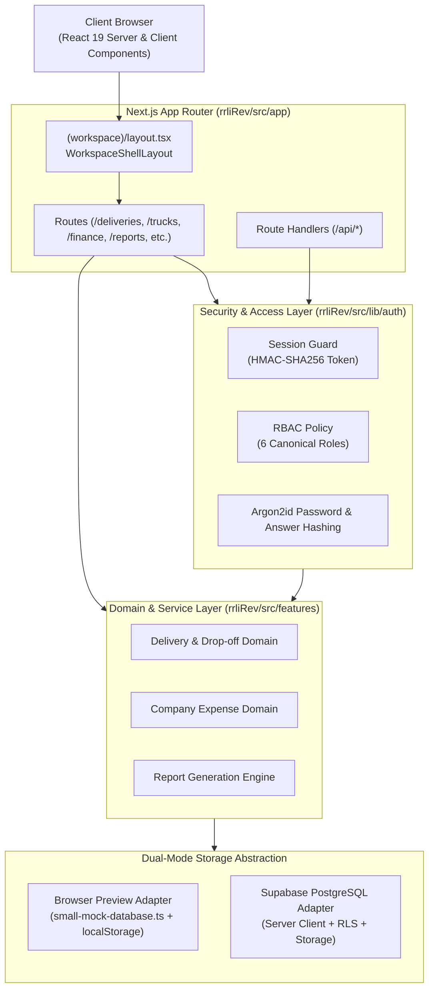
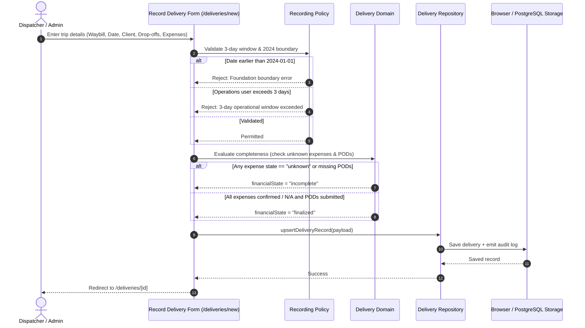
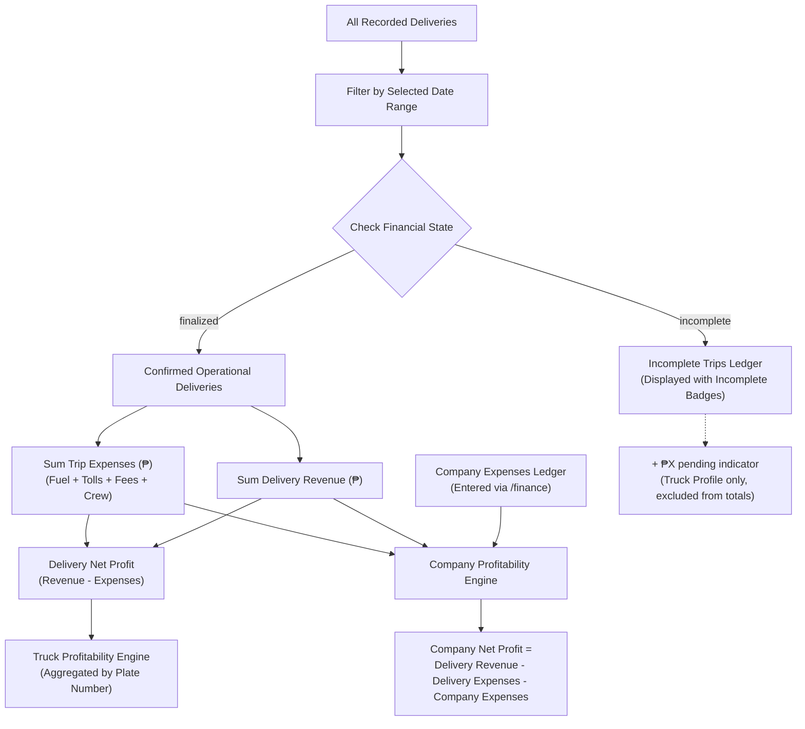

# Knowledge Base: 02 — System Architecture

> **Document Status:** `[Implemented]`  
> **Authority Level:** Authoritative Specification  
> **Last Verified:** November 2026  
> **Location:** `rrliRev/docs/knowledge-base/02-system-architecture.md`

---

## 1. High-Level Architectural Model

RouteX is constructed as a modern, monolithic Next.js 16 full-stack web application running on React 19 and TypeScript. The architecture adheres to a clean separation between Presentation, Domain, Security, and Data Access layers.

---

## 2. Layered Structure & Responsibilities

### Presentation Layer (`src/app/` & `src/components/`)
- **App Router Layouts:** `src/app/(workspace)/layout.tsx` wraps all authenticated routes within `<WorkspaceShellLayout />`, which mounts the sticky resizable `<OperationalSidebar />`, the shared `<RouteXFooter />`, and the `<InitialSetupModal />`.
- **Topbars & Chrome:** Every workspace page mounts `<OperationalTopbar />` with dynamic context labels, date picker integration, and action buttons.
- **Client Primitives:** Reusable controls in `src/components/` (`RoundedSelect`, `TablePagination`, `GlobalDateRangePicker`, `DeliveryFilterDropdown`, `EditDeliveryModal`, `DeliveryNavigator`).
- **Styling Architecture:** Single unified global stylesheet in `src/app/globals.css`. CSS Modules (`*.module.css`) are strictly prohibited due to Turbopack bundler requirements.

### Security & Authentication Layer (`src/lib/auth/`)
- **Session Tokens:** Stateless, cryptographically signed HMAC-SHA256 tokens stored in the secure HTTP-only cookie `routex_session_token`.
- **Role-Based Access Control:** `src/lib/auth/rbac.ts` evaluates permissions (`canMutateDeliveryRecords`, `canManageCompanyExpenses`, `canManageUsers`, etc.) across three access levels: `admin`, `operations`, and `view_only`.
- **Server Route Protection:** Server component pages execute `requireAuthenticatedActor()` to prevent unauthorized rendering, while `/api/*` handlers return 401 or 403 responses.

### Domain & Business Logic Layer (`src/features/`)
- **Delivery Domain (`src/features/deliveries/`):** Encapsulates delivery calculation rules, drop-off timelines, POD verification derivation, fuel cost algorithms, and financial completeness evaluation (`isDeliveryIncomplete`, `isDeliveryFinanciallyComplete`).
- **Finance Domain (`src/features/finance/`):** Manages company-wide operating expenses, date range filtering, and company net profit aggregation.
- **Reports Engine (`src/features/reports/`):** Transforms delivery and expense datasets into structured report tables (Client Summary, Truck Summary, Trip Ledger, Daily Trip Report) and formats compliant CSV documents.

### Data Access Layer & Dual-Mode Abstraction
RouteX isolates database dependencies behind repository contracts:
- [`src/features/deliveries/server/delivery-repository.ts`](file:///c:/Users/suchi/Documents/rrli/rrliRev/src/features/deliveries/server/delivery-repository.ts)
- [`src/features/finance/server/company-expense-repository.ts`](file:///c:/Users/suchi/Documents/rrli/rrliRev/src/features/finance/server/company-expense-repository.ts)
- [`src/lib/auth/server-account-store.ts`](file:///c:/Users/suchi/Documents/rrli/rrliRev/src/lib/auth/server-account-store.ts)
- [`src/lib/audit/server-audit-store.ts`](file:///c:/Users/suchi/Documents/rrli/rrliRev/src/lib/audit/server-audit-store.ts)

When Supabase environment variables are missing, the repositories automatically route calls to `small-mock-database.ts` and browser storage without throwing connection errors.

---

## 3. Data Flow Diagrams

### A. Delivery Creation & Financial Completion Flow

### B. Profitability Aggregation Flow

---

## 4. Deployment & Runtime Architecture

- **Runtime Target:** Node.js (v20+) or Vercel Serverless environment.
- **Build Engine:** Next.js Turbopack (`next build`).
- **Database Engine:** Supabase PostgreSQL with automated migrations in `rrliRev/supabase/migrations/`.
- **Object Storage:** Supabase Storage (private bucket `routex-documents`).
