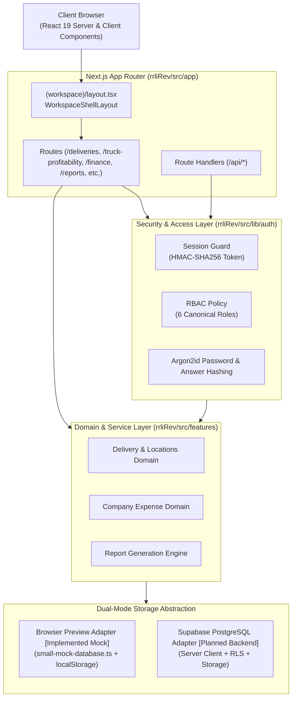
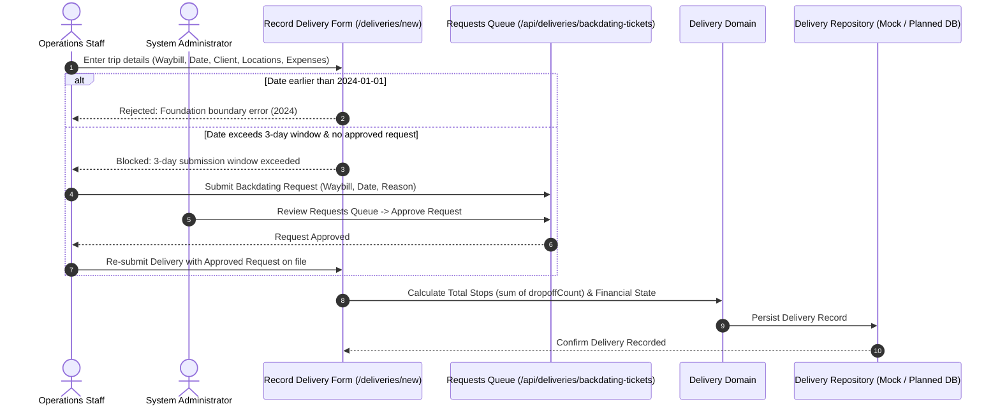

# Knowledge Base: 02 — System Architecture

> **Document Status:** `[Authoritative Architecture]`  
> **Authority Level:** Authoritative Specification  
> **Master Source of Truth:** [`../CENTRAL_REQUIREMENTS_AND_SYSTEM_DESIGN.md`](../CENTRAL_REQUIREMENTS_AND_SYSTEM_DESIGN.md)  
> **Last Verified:** November 2026  
> **Location:** `rrliRev/docs/knowledge-base/02-system-architecture.md`

---

## 1. High-Level Architectural Model

RouteX is constructed as a monolithic Next.js 16 full-stack web application running on React 19 and TypeScript. The architecture adheres to a clean separation between Presentation, Domain, Security, and Data Access layers.

---

## 2. Layered Structure & Responsibilities

### Presentation Layer (`src/app/` & `src/components/`)
- **App Router Layouts:** `src/app/(workspace)/layout.tsx` wraps all authenticated routes within `<WorkspaceShellLayout />`, which mounts the sticky resizable `<OperationalSidebar />`, the shared `<RouteXFooter />`, and the `<InitialSetupModal />`.
- **Topbars & Chrome:** Every workspace page mounts `<OperationalTopbar />` with dynamic context labels, date picker integration, and action buttons.
- **Client Primitives:** Reusable controls in `src/components/` (`RoundedSelect`, `TablePagination`, `GlobalDateRangePicker`, `DeliveryFilterDropdown`, `EditDeliveryModal`, `DeliveryNavigator`).
- **Styling Architecture:** Single unified global stylesheet in `src/app/globals.css`. CSS Modules (`*.module.css`) are strictly prohibited due to Turbopack bundler requirements.

### Security & Authentication Layer (`src/lib/auth/`)
- **Session Tokens:** Stateless, cryptographically signed HMAC-SHA256 tokens stored in the secure HTTP-only cookie `routex_session_token`.
- **Role-Based Access Control:** `src/lib/auth/rbac.ts` evaluates permissions (`canMutateDeliveryRecords`, `canManageCompanyExpenses`, `canManageUsers`, etc.) across three access levels: `admin`, `operations`, and `view_only`.
- **Server Route Protection:** Server component pages execute `requireAuthenticatedActor()` to prevent unauthorized rendering, while `/api/*` handlers return 401 or 403 responses.

### Domain & Business Logic Layer (`src/features/`)
- **Delivery Domain (`src/features/deliveries/`):** Encapsulates delivery calculation rules, locations with numeric drop-off counts, POD verification derivation, fuel cost algorithms, and financial completeness evaluation (`isDeliveryIncomplete`, `isDeliveryFinanciallyComplete`).
- **Finance Domain (`src/features/finance/`):** Manages company-wide operating expenses, 6-sheet spreadsheet ingestion, duplicate reconciliation, date range filtering, and company net profit aggregation.
- **Reports Engine (`src/features/reports/`):** Transforms delivery and expense datasets into structured report tables (Client Summary, Truck Summary, Trip Ledger, Daily Trip Report) and formats compliant CSV documents.

### Data Access Layer & Implementation Status
RouteX isolates database dependencies behind repository contracts:
- [`src/features/deliveries/server/delivery-repository.ts`](file:///c:/Users/suchi/Documents/rrli/rrliRev/src/features/deliveries/server/delivery-repository.ts)
- [`src/features/finance/server/company-expense-repository.ts`](file:///c:/Users/suchi/Documents/rrli/rrliRev/src/features/finance/server/company-expense-repository.ts)
- [`src/lib/auth/server-account-store.ts`](file:///c:/Users/suchi/Documents/rrli/rrliRev/src/lib/auth/server-account-store.ts)
- [`src/lib/audit/server-audit-store.ts`](file:///c:/Users/suchi/Documents/rrli/rrliRev/src/lib/audit/server-audit-store.ts)

> [!NOTE]
> **Implementation Status:** The production database backend has not been implemented yet. In current browser preview mode, repositories seamlessly operate against `small-mock-database.ts`, in-memory stores, and browser `localStorage`. Production Supabase tables and RLS are planned for future backend implementation.

---

## 3. Data Flow Diagrams

### Delivery Creation & Backdating Approval Flow

