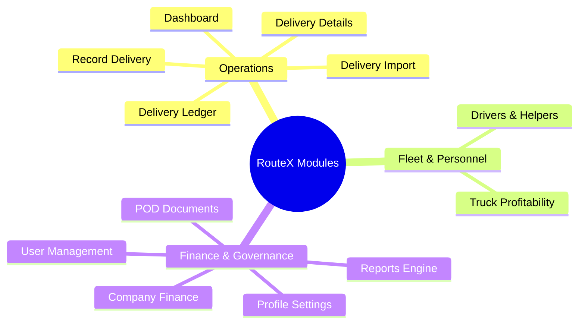

# Knowledge Base: 04 — System Modules

> **Document Status:** `[Authoritative Specifications]`  
> **Authority Level:** Authoritative Specification  
> **Master Source of Truth:** [`../CENTRAL_REQUIREMENTS_AND_SYSTEM_DESIGN.md`](../CENTRAL_REQUIREMENTS_AND_SYSTEM_DESIGN.md)  
> **Last Verified:** November 2026  
> **Location:** `rrliRev/docs/knowledge-base/04-system-modules.md`

---

## Overview

RouteX contains eleven cohesive operational modules integrated into a single App Router workspace layout:

---

## 1. Dashboard (`/dashboard`)

The operational control center for RRLI dispatchers, managers, and executives:

- **Implementation Status:** `[Frontend Implemented]` · `[Mock-Only Storage]`
- **Top KPI Cards:** Four standard cards arranged in strict order:
  1. **Revenue:** Total confirmed delivery revenue within active date range.
  2. **Expenses:** Total trip expenses from finalized deliveries.
  3. **Profit:** Net profit from confirmed deliveries (`Revenue - Expenses`).
  4. **Top Client:** Ranked client generating the highest delivery revenue.
- **Attention Needed Section:** Independently scrollable container displaying actionable alerts (missing PODs, unresolved trip expenses, schedule conflicts) with expandable details.
- **Recent Deliveries Table:** Displays strictly the **top 5 most recent trips** fixed without pagination, with one-click navigation to `/deliveries/[id]`.
- **Revenue Over Time:** Interactive visual trend chart tracking operational delivery revenue across date intervals.

---

## 2. Delivery Ledger (`/deliveries`)

The centralized record of all completed operational freight trips:

- **Implementation Status:** `[Frontend Implemented]` · `[Mock-Only Storage]`
- **Pagination Standard:** Strictly **10 records per page** via `<TablePagination />` with direct typed page input, clamping, and arrow controls.
- **Filter Suite:** Multi-select filtering by Client, Truck, Delivery Status (`All`, `Completed`, `Incomplete`), and global date range.
- **Incomplete Financial Indication:** Deliveries with unknown expenses are highlighted with warning badges and excluded from aggregate financial totals.
- **Backdating Requests Queue:** Header action button **"Requests"** opens the Backdating Requests modal for reviewing or submitting delayed trip recording requests.
- **Audit Actions:** "Edit delivery" modal and audited administrative deletion dialog with mandatory reason tracking.
- **Row Interaction:** Clicking any row navigates directly to `/deliveries/[id]` while preserving active filters, search queries, and sort parameters.

---

## 3. Dedicated Delivery Details Page (`/deliveries/[id]`)

A dedicated full-page view for comprehensive trip inspection:

- **Implementation Status:** `[Frontend Implemented]` · `[Mock-Only Storage]`
- **Delivery Navigator:** Top navigator bar with "Previous" and "Next" buttons and an auto-scrolling horizontal strip of nearby delivery pills, maintaining the ledger's filter context.
- **Locations & Drop-off Breakdown:** Displays all delivery Locations (Name, Address) and their numeric drop-off counts (`dropoffCount`), along with the derived total: `"Total: X locations, Y stops/drop-offs"`. No individual stop records.
- **Vehicle & Crew Assignments:** Plate number, vehicle type, ownership (Owned vs. Subcontracted), Driver name, and Helper(s) with Employee IDs. Historical attribution is preserved even if crew members are later deleted.
- **Adaptive Financial Breakdown:**
  - **Owned Trucks:** Itemized breakdown of Diesel, Highway Tolls, Driver/Helper rates, Allowances, and Other Expenses, plus General Delivery Notes.
  - **Subcontracted Trucks:** Single total Subcontractor Expense amount. Itemized fuel and crew daily rates are omitted.
- **Two-Tier Document Pane:** Clearly distinguishes **Delivery-Level Documents** (Master Waybill, Fuel Receipts) from **Location-Level Documents** (Store PODs, stamped invoices).

---

## 4. Record Delivery (`/deliveries/new`)

The trip capture interface for dispatchers and administrators:

- **Implementation Status:** `[Frontend Implemented]` · `[Mock-Only Storage]`
- **Client Selection with On-the-Fly Creation:** Dispatchers can select existing clients or dynamically add a new client.
- **Dynamic Locations Builder:**
  - Add, edit, or remove delivery Locations.
  - Fields per location: **Location Name**, **Location Address**, and numeric **Number of Stops / Drop-offs**.
  - Total stops/drop-offs are automatically computed across locations. No individual stop records are created.
- **Crew Selection & Conflict Guard:**
  - Dropdown options display: `Name [Employee ID] · Role`.
  - Drivers can also be selected as helpers.
  - Mandates exactly 1 driver and 1 to 2 helpers (maximum 2).
  - **Duplicate Prevention:** Disallows assigning the same employee to multiple roles on the trip.
  - **Schedule Conflict Detection:** Warns if an employee is already assigned to another waybill on the same date.
  - Daily wage rates and allowances are entered manually (no automated labor calculations).
- **Ownership-Adaptive Expense Form:**
  - **Owned Trucks:** Itemized expense rows (Description + Amount) with Add/Remove buttons, plus one General Notes field.
  - **Subcontracted Trucks:** Single Total Subcontractor Expense field; itemized fuel and crew rates are hidden.
- **Submission Window Enforcement:** Enforces the 3-day window for Operations staff. Trips past 3 days require an approved Backdating Request.

---

## 5. Delivery Spreadsheet Import (`/deliveries/import`)

Bulk spreadsheet ingestion for dispatch logs:

- **Implementation Status:** `[Frontend Implemented]` · `[Mock-Only Storage]`
- **Automatic Truck Registration:** If a plate number is not found in the truck registry, the system **automatically registers the truck** using available spreadsheet data without blocking the import or requiring manual pre-registration.
- **Owned vs. Subcontracted Distinction:** Recognizes subcontracted trucks by spreadsheet structure and formatting (unshaded/white cell backgrounds), applying the appropriate financial structure.
- **Crew Matching:** Matches imported driver and helper names against existing records, selecting matching personnel while supporting on-the-fly creation.
- **Staged Row Review:** Interactive preview table highlighting validation warnings, missing fields, and unmapped columns before committing.

---

## 6. Drivers & Helpers (`/drivers`)

Personnel management for RRLI delivery crew:

- **Implementation Status:** `[Frontend Implemented]` · `[Mock-Only Storage]`
- **Unique Employee IDs:** Every employee has a mandatory unique code (`employeeCode`, e.g., `DRV-01`, `HLP-01`).
- **Role Flexibility:** Drivers and Helpers are managed in the central registry; drivers can be selected for helper duty.
- **Permanent Deletion & Historical Preservation:** When an employee is permanently deleted, they are removed from active registries and future dropdowns, but **all past delivery records and audit entries retain the deleted employee's full attribution**.

---

## 7. Truck Profitability (`/truck-profitability` & `/[plate]`)

Fleet performance and individual vehicle financial evaluation:

- **Implementation Status:** `[Frontend Implemented]` · `[Mock-Only Storage]`
- **Fleet Overview Table:** Paginated table (10/page) detailing completed trips, total locations served, total derived drop-offs, distance, revenue, trip expenses, net profit, and profit margin.
- **Strict Isolation Invariant:** Truck profitability evaluates only direct trip revenues and expenses. Company-wide operating expenses are **never** allocated to individual trucks.
- **Vehicle Profiles (`/[plate]`):** Vehicle specifications, temperature capabilities (Cold Chain vs. Dry Cargo), ownership classification (Owned vs. Subcontracted), and truck trip ledgers.

---

## 8. Company Finance (`/finance` & `/finance/import`)

Corporate expense ledger and legacy finance workbook ingestion:

- **Implementation Status:** `[Frontend Implemented]` · `[Mock-Only Storage]`
- **Company Expense Ledger:** Record, edit, and delete company-wide operating expenses (rent, utilities, administration). Restricted to Admin and Finance roles (`finance:manage`).
- **6-Sheet Workbook Importer (`/finance/import`):**
  - Ingests all six sheets from the legacy `FINANCE REF.` workbook (Billings, Petty Cash, Checks Received, Payables, Checks Issued, Collections).
  - Normalizes transactions into **Date**, **Total Amount**, and **Description/Subject**, classified strictly as **Incoming** or **Outgoing** (no pending status).
- **Duplicate Review Engine:** Flags matching transactions across sheets for manual review, offering three explicit actions:
  1. **Combine Records**
  2. **Keep Records Separate**
  3. **Exclude Record**

---

## 9. POD & Supporting Documents (`/pod-documents`)

Centralized document inspection and verification queue:

- **Implementation Status:** `[Frontend Implemented]` · `[Mock-Only Storage]` / `[Planned Backend Storage]`
- **Two-Tier Document Hierarchy:** Organizes documents by **Delivery-Level** (trip-wide documents) and **Location-Level** (store drop-off PODs). No individual stop/drop-off records are created for document association.
- **Status Filter:** "POD Attached" vs. "Missing POD" (canonical terms).
- **Preview vs. Production:** Uses deterministic SVG document generators in browser preview mode; will upload to private Supabase Storage buckets with 5-minute pre-signed URLs in connected mode.

---

## 10. Reports Engine (`/reports`)

Operational and financial reporting center:

- **Implementation Status:** `[Frontend Implemented]` · `[Mock-Only Storage]`
- **Daily Trip Report:** Fixed single-date operational summary.
- **Customizable Templates:** Client Summary, Truck Profitability, Trip Ledger, Financial Overview, and Audit Trail.
- **Data Export Packages:** Simplified export suite (Excel XLSX, CSV Spreadsheets, JSON Dump, SQL Dump, Offline Web App). Requests from Operations and Finance are reviewed in the **Approval Queue**.

---

## 11. User Management & Settings (`/user-management` & `/settings`)

Administrative governance and self-service account management:

- **Implementation Status:** `[Frontend Implemented]` · `[Mock-Only Storage]`
- **User Management (`/user-management`):** Exclusive to System Admin. Provision user accounts, assign roles, reset credentials, and view system audit logs.
- **Account Settings (`/settings`):** Self-service profile photo uploads, username changes, password updates, and security questions.
