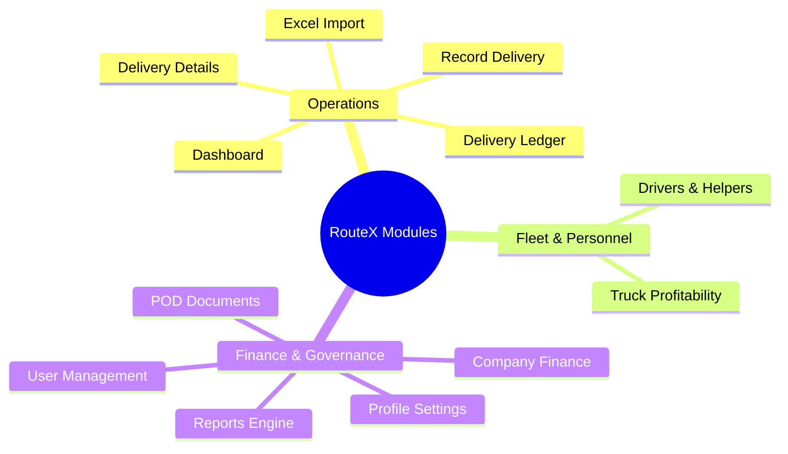

# Knowledge Base: 04 — System Modules

> **Document Status:** `[Implemented]`  
> **Authority Level:** Authoritative Specification  
> **Last Verified:** November 2026  
> **Location:** `rrliRev/docs/knowledge-base/04-system-modules.md`

---

## Overview

RouteX contains eleven cohesive operational modules integrated into a single App Router workspace layout:

---

## 1. Dashboard (`/dashboard`)

The operational control center for RRLI dispatchers, managers, and executives:

- **Top KPI Cards:** Four standard cards arranged in strict order:
  1. **Revenue:** Total confirmed delivery revenue within active date range.
  2. **Expenses:** Total trip expenses from finalized deliveries.
  3. **Profit:** Net profit from confirmed deliveries (`Revenue - Expenses`).
  4. **Top Client:** Ranked client generating the highest delivery revenue (calculated by revenue, not trip count; ties handled cleanly).
- **Attention Needed Section:** Independently scrollable container displaying actionable alerts (missing PODs, unresolved trip expenses, unverified paperwork) with expandable details.
- **Recent Deliveries Table:** Displays strictly the **top 5 most recent trips** fixed without pagination, with one-click navigation to `/deliveries/[id]`.
- **Revenue Over Time:** Interactive visual trend chart tracking operational delivery revenue across date intervals.

---

## 2. Delivery Ledger (`/deliveries`)

The centralized record of all completed operational freight trips:

- **Pagination Standard:** Strictly **10 records per page** via `<TablePagination />` with direct typed page input, clamping, and arrow controls.
- **Filter Suite:** Multi-select filtering by Client, Truck, Delivery Status (`All`, `Completed`, `Incomplete`), and global date range.
- **Incomplete Financial Indication:** Deliveries with missing documents or unknown expenses are highlighted with warning badges and excluded from aggregate financial totals.
- **Audit Actions:** "Edit delivery" modal and audited administrative deletion dialog with mandatory reason tracking.
- **Row Interaction:** Clicking any row navigates directly to the dedicated detail view at `/deliveries/[id]` while preserving active filters, search queries, and sort parameters.

---

## 3. Dedicated Delivery Details Page (`/deliveries/[id]`)

A spacious, dedicated page replacing former slide-over drawer modals:

- **Delivery Navigator:** Top navigator bar with "Previous" and "Next" buttons and an auto-scrolling horizontal strip of nearby delivery pills, maintaining the ledger's filter context.
- **Spacious Layout:**
  - Trip overview: Waybill number, date, client, origin, distance, fuel benchmark, late recording flag.
  - Store Drop-off sequence & timeline: Store names, destination areas, entry fees, and stop-level document flags.
  - Vehicle & Crew assignments: Plate number, vehicle type, driver name, and helper name.
  - Financial Breakdown: Complete reconciliation of revenue, diesel fuel, highway tolls, crew compensation, and other expenses.
  - Document Viewer & Inline Upload: Stop-level POD dropzone with instant offline SVG receipt generator.
- **Navigation Back:** "← Back to Deliveries" returns to the exact ledger page, preserving search, sort, and status parameters.

---

## 4. Record Delivery (`/deliveries/new`)

The trip capture interface for dispatchers and administrators:

- **Client Selection with On-the-Fly Creation:** Dispatchers can type a new client name and select **"Add [Client Name]"** to create and persist clients immediately.
- **Dynamic Store Drop-off Builder:** Sequenced drop-offs with location area, store name, entry fee amount, and fee status (`confirmed`, `not_applicable`, `unknown`).
- **Clean Currency Inputs:** Zero placeholder zeroes; empty fields appear clean. Monetary symbols are formatted internally to prevent duplication.
- **Crew Daily Rates & Allowances:** Driver and Helper daily rates and travel allowances. Daily rate is mandatory and cannot be marked N/A or unknown.
- **Operational Submission Window:** Automatically enforces the **3-day submission window** for Operations roles; Admin accounts can record trips from 2024 onward without restriction.

---

## 5. Excel Import & Staged Review (`/deliveries/import`)

Bulk spreadsheet ingestion for operations dispatch logs:

- **Format Compatibility:** Accepts `.xlsx`, `.xls`, and `.csv` files.
- **Field Auto-Mapping:** Automatically maps columns for Waybill, Date, Client, Plate Number, Driver, Helper, Revenue, Fuel, Tolls, and Store Drop-offs.
- **Staged Row Review:** Interactive preview table highlighting validation warnings, missing fields, and unmapped columns before committing to the database.
- **Founding Year Invariant:** Flags any records dated prior to `2024-01-01` as invalid.

---

## 6. Drivers & Helpers (`/drivers`)

Personnel management for RRLI delivery crew:

- **Clean Action Icons:** Borderless, clean action icons (edit, view, delete) with consistent hover states and zero button shadows.
- **Simple Text Classification:** Clean text tags replacing decorative badges.
- **No Employee Codes:** Displays full legal name, contact details, assigned role (Driver vs Helper), and active trip history.
- **Crew Registry Integration:** Automatically populates autocomplete dropdowns across delivery recording and editing forms.

---

## 7. Truck Profitability (`/truck-profitability` & `/[plate]`)

Fleet performance and individual vehicle financial evaluation:

- **Fleet Overview Table:** Paginated table (10/page) detailing completed trips, total stores served, total distance (km), total revenue, fuel costs, tollway fees, crew costs, net profit, and profit margin.
- **Dedicated Truck Profile (`/[plate]`):**
  - High-resolution vehicle photo upload and management.
  - Fuel efficiency benchmarks (km per liter) and vehicle classification (Owned vs Subcontracted, 4-Wheeler to 10-Wheeler, Refrigerated vs Dry).
  - Truck-specific trips ledger.
- **Strict Financial Isolation:** Truck profitability calculations evaluate solely trip revenues and trip expenses attributable to that specific plate number. Overall company expenses are strictly excluded.

---

## 8. Company Finance (`/finance`)

Company-wide operating expense accounting and consolidated net profit:

- **Top KPI Cards:** Total Company Expenses, Company Net Profit, Delivery Revenue, Delivery Expenses.
- **Streamlined Single Expense Entry:** Finance Officers and Administrators enter the **single total company expense amount**, date, and optional reference note. Operations and all other roles have view-only access to `/finance`. No itemized tags, categories, or distributions.
- **Company Net Profit Formula:**
  $$\text{Company Net Profit} = \text{Total Delivery Revenue} - \text{Total Delivery Expenses} - \text{Total Company Expenses}$$
- **Audited Expense Ledger:** Paginated ledger (10/page) with date and amount sorting, search, inline editing, and deletion with mandatory audit reasons.

---

## 9. POD Documents (`/pod-documents`)

Centralized repository for Proof of Delivery documents:

- **Document Overview Table:** Paginated table (10/page) tracking waybills, client names, drop-off stores, attached files, upload dates, and verification status.
- **Status Filter:** "POD Attached" vs "Missing POD" (never uses "Verified" / "Pending Verification").
- **Integrated Document Viewer:** Inline lightbox preview supporting images and PDFs, with instant SVG receipt rendering in preview mode.

---

## 10. Reports Engine (`/reports`)

Executive and operational reporting and data export:

- **Daily Trip Report:** Locked to a dedicated single date selector, operating independently of the global date range picker.
- **Customizable Report Templates:** Six built-in company templates (Client Summary, Truck Summary, Trip Ledger, Financial Summary, Operations Daily, Complete Ledger).
- **Export Formats:** One-click Excel-compliant CSV export with company metadata and clean column headers, plus print-ready view.

---

## 11. User Management (`/user-management`) & Profile Settings (`/settings`)

- **User Management (Admin Only):** Account provisioning, role assignments across all 6 roles, password reset, account deactivation/activation, and audit trail inspection.
- **Profile-Centered Settings (`/settings`):** Inspired by Google Account's mobile UI:
  - Top-centered profile hero with circular avatar (112px), quick-action camera upload button, full name, `@username`, and role pill.
  - Vertically stacked settings sections: Account Details (Username), Sign-in & Security (Password), Recovery & Verification (Security Question), Security Status Checklist, and Role Permissions Matrix.
