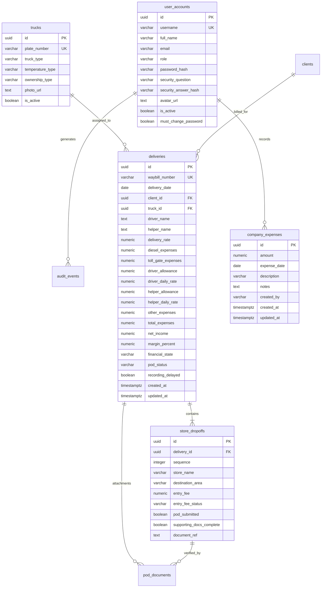

# Knowledge Base: 05 — Database Documentation

> **Document Status:** `[Implemented]`  
> **Authority Level:** Authoritative Specification  
> **Last Verified:** November 2026  
> **Location:** `rrliRev/docs/knowledge-base/05-database-documentation.md`

---

## 1. Relational Database Architecture (PostgreSQL / Supabase)

RouteX uses PostgreSQL hosted on Supabase as its primary production relational database. Database migrations are stored chronologically in [`rrliRev/supabase/migrations/`](file:///c:/Users/suchi/Documents/rrli/rrliRev/supabase/migrations/).

---

## 2. Table Specifications & Constraints

### `deliveries`
The central operational delivery record representing one completed trip.

| Column | Type | Constraints | Description |
| :--- | :--- | :--- | :--- |
| `id` | `UUID` | `PRIMARY KEY`, `DEFAULT gen_random_uuid()` | Unique delivery identifier. |
| `waybill_number` | `VARCHAR(64)` | `NOT NULL`, `UNIQUE` | Waybill number format (e.g. `WB-2026-001`). |
| `delivery_date` | `DATE` | `NOT NULL`, `CHECK (delivery_date >= '2024-01-01')` | Delivery date, clamped to RRLI founding year. |
| `client_id` | `UUID` | `REFERENCES clients(id)` | Associated client company. |
| `truck_id` | `UUID` | `REFERENCES trucks(id)` | Assigned vehicle plate. |
| `driver_name` | `TEXT` | `NOT NULL` | Full name of primary driver. |
| `helper_name` | `TEXT` | `NULLABLE` | Full name of assistant helper. |
| `delivery_rate` | `NUMERIC(12,2)` | `NULLABLE` | Delivery revenue (₱). |
| `diesel_expenses` | `NUMERIC(12,2)`| `NULLABLE` | Fuel cost for trip. |
| `toll_gate_expenses` | `NUMERIC(12,2)`| `NULLABLE` | Highway toll costs. |
| `driver_daily_rate` | `NUMERIC(12,2)`| `NOT NULL` | Mandatory driver trip pay. |
| `driver_allowance` | `NUMERIC(12,2)`| `NULLABLE` | Optional driver per diem. |
| `helper_daily_rate` | `NUMERIC(12,2)`| `NULLABLE` | Helper trip pay. |
| `helper_allowance` | `NUMERIC(12,2)`| `NULLABLE` | Optional helper per diem. |
| `other_expenses` | `NUMERIC(12,2)`| `NULLABLE` | Miscellaneous trip costs. |
| `total_expenses` | `NUMERIC(12,2)`| `NULLABLE` | Sum of all confirmed trip expenses. |
| `net_income` | `NUMERIC(12,2)`| `NULLABLE` | `delivery_rate - total_expenses`. |
| `margin_percent` | `NUMERIC(6,2)` | `NULLABLE` | Profit margin percentage. |
| `financial_state` | `VARCHAR(20)` | `NOT NULL`, `CHECK (financial_state IN ('finalized', 'incomplete'))` | Completeness status. |
| `pod_status` | `VARCHAR(20)` | `NOT NULL`, `CHECK (pod_status IN ('Verified', 'Incomplete', 'Pending'))` | Document status. |
| `recording_delayed` | `BOOLEAN` | `DEFAULT FALSE` | Flagged if submitted after 3 days. |

### `store_dropoffs`
Individual store drop-off destinations contained within a single delivery trip.

| Column | Type | Constraints | Description |
| :--- | :--- | :--- | :--- |
| `id` | `UUID` | `PRIMARY KEY`, `DEFAULT gen_random_uuid()` | Unique stop identifier. |
| `delivery_id` | `UUID` | `NOT NULL`, `REFERENCES deliveries(id) ON DELETE CASCADE` | Parent trip. |
| `sequence` | `INTEGER` | `NOT NULL`, `CHECK (sequence >= 1)` | Sequence order (1, 2, 3...). |
| `store_name` | `VARCHAR(128)` | `NOT NULL` | Name of retail outlet / warehouse. |
| `destination_area` | `VARCHAR(128)` | `NOT NULL` | City or region (e.g. `Makati`, `Pasig`). |
| `entry_fee` | `NUMERIC(10,2)`| `NULLABLE` | Mall or market entry fee. |
| `entry_fee_status` | `VARCHAR(20)` | `NOT NULL`, `CHECK (entry_fee_status IN ('confirmed', 'not_applicable', 'unknown'))` | Resolution flag. |
| `pod_submitted` | `BOOLEAN` | `NOT NULL`, `DEFAULT FALSE` | Whether physical/digital POD was attached. |
| `document_ref` | `TEXT` | `NULLABLE` | Storage path or reference key for POD document. |

### `company_expenses`
General company-wide operating expenses (distinct from trip expenses).

| Column | Type | Constraints | Description |
| :--- | :--- | :--- | :--- |
| `id` | `UUID` | `PRIMARY KEY`, `DEFAULT gen_random_uuid()` | Unique expense entry identifier. |
| `amount` | `NUMERIC(14,2)`| `NOT NULL`, `CHECK (amount >= 0)` | Total company operating expense amount. |
| `expense_date` | `DATE` | `NOT NULL`, `CHECK (expense_date >= '2024-01-01')` | Incurred date. |
| `description` | `VARCHAR(256)` | `NOT NULL` | Standard title (e.g. `Company Expenses`). |
| `notes` | `TEXT` | `NULLABLE` | Optional reference note. |
| `created_by` | `VARCHAR(64)` | `NOT NULL` | Username of recorder. |

---

## 3. Row-Level Security (RLS) Policies

All tables in connected Supabase mode enforce Row-Level Security:

- **Admin Role:** Full `SELECT`, `INSERT`, `UPDATE`, `DELETE` permissions on all tables.
- **Operations Role:** `SELECT` on all tables; `INSERT` and `UPDATE` on `deliveries`, `store_dropoffs`, `trucks`, `fleet_crew`, and `company_expenses`. `DELETE` is prohibited and requires Admin authorization.
- **View-Only Roles (`finance`, `hr`, `secretary`, `customerrep`):** `SELECT` access permitted across authorized tables. Direct mutations (`INSERT`, `UPDATE`, `DELETE`) are strictly rejected by PostgreSQL policies with 403 Forbidden.

---

## 4. Database-Free Browser Preview Mode Mirrors

When Supabase is unconfigured, RouteX mirrors the complete relational schema in browser memory and `localStorage`:

| Database Concept | Browser Preview Storage Mechanism |
| :--- | :--- |
| **Deliveries Table** | `small-mock-database.ts` + `localStorage` key `routex-deliveries-v2` |
| **Drop-offs Table** | Embedded array `dropoffs` in delivery object |
| **Trucks Table** | `small-mock-database.ts` + `localStorage` key `routex-trucks-v1` |
| **Company Expenses** | `localStorage` key `routex-company-expenses-v1` |
| **User Accounts** | In-memory `server-account-store.ts` seeded with 6 test accounts |
| **Audit Log Table** | In-memory `server-audit-store.ts` + `localStorage` key `routex-audit-trail` |
| **Document Storage** | SVG receipt generator with data URI encoding |
| **Reactivity** | Browser `window.dispatchEvent` with custom events |
