# Knowledge Base: 05 — Database Documentation

> **Document Status:** `[Planned Backend Schema]`  
> **Authority Level:** Planned Architecture Specification  
> **Master Source of Truth:** [`../CENTRAL_REQUIREMENTS_AND_SYSTEM_DESIGN.md`](../CENTRAL_REQUIREMENTS_AND_SYSTEM_DESIGN.md)  
> **Last Verified:** November 2026  
> **Location:** `rrliRev/docs/knowledge-base/05-database-documentation.md`

---

## 1. Relational Database Architecture Overview

> [!IMPORTANT]
> **Implementation Status:** The database backend has **not been implemented yet**. The schema below specifies the **[Planned Backend]** relational design for future Supabase PostgreSQL integration. The running application currently operates in **Browser Preview Mode** using verified mock fixtures (`small-mock-database.ts`) and local browser storage.

```mermaid
erDiagram
    user_accounts ||--o{ audit_events : generates
    trucks ||--o{ deliveries : assigned_to
    clients ||--o{ deliveries : billed_for
    deliveries ||--|{ delivery_locations : contains
    deliveries ||--o{ delivery_expenses : itemized_for
    deliveries ||--o{ supporting_documents : trip_attachments
    delivery_locations ||--o{ supporting_documents : location_attachments
    user_accounts ||--o{ company_expenses : records
    employees ||--o{ deliveries : driver_assignment
    employees ||--o{ deliveries : helper_assignment

    deliveries {
        uuid id PK
        varchar waybill_number UK
        date delivery_date
        uuid client_id FK
        uuid truck_id FK
        uuid driver_id FK
        uuid helper_1_id FK
        uuid helper_2_id FK
        numeric delivery_rate
        numeric subcontractor_expense
        numeric total_expenses
        numeric net_profit
        numeric margin_percent
        varchar financial_state
        varchar pod_status
        boolean recording_delayed
        text general_notes
        timestamptz created_at
        timestamptz updated_at
    }

    delivery_locations {
        uuid id PK
        uuid delivery_id FK
        integer sequence_order
        varchar location_name
        varchar location_address
        integer dropoff_count
        timestamptz created_at
    }

    delivery_expenses {
        uuid id PK
        uuid delivery_id FK
        varchar description
        numeric amount
        timestamptz created_at
    }

    employees {
        uuid id PK
        varchar employee_code UK
        varchar full_name
        varchar primary_role
        varchar contact_number
        boolean is_active
        timestamptz created_at
    }

    trucks {
        uuid id PK
        varchar plate_number UK
        varchar truck_type
        varchar temperature_type
        varchar ownership_type
        text photo_url
        boolean is_active
    }

    supporting_documents {
        uuid id PK
        uuid delivery_id FK
        uuid location_id FK
        varchar document_level
        varchar document_type
        varchar file_path
        varchar file_name
        integer file_size
        varchar mime_type
        timestamptz uploaded_at
        varchar uploaded_by
    }

    company_expenses {
        uuid id PK
        numeric amount
        date expense_date
        varchar description
        varchar classification
        text notes
        varchar source_sheet
        varchar created_by
        timestamptz created_at
    }

    user_accounts {
        uuid id PK
        varchar username UK
        varchar full_name
        varchar email
        varchar role
        varchar password_hash
        varchar security_question
        varchar security_answer_hash
        text avatar_url
        boolean is_active
        boolean must_change_password
    }
```

---

## 2. Table Specifications & Constraints (`[Planned Backend]`)

### `deliveries`
The central operational record representing one completed trip.

| Column | Type | Constraints | Description |
| :--- | :--- | :--- | :--- |
| `id` | `UUID` | `PRIMARY KEY`, `DEFAULT gen_random_uuid()` | Unique delivery identifier. |
| `waybill_number` | `VARCHAR(64)` | `NOT NULL`, `UNIQUE` | Waybill number format (e.g., `WB-2026-001`). |
| `delivery_date` | `DATE` | `NOT NULL`, `CHECK (delivery_date >= '2024-01-01')` | Delivery date, clamped to RRLI founding year. |
| `client_id` | `UUID` | `REFERENCES clients(id)` | Associated client company. |
| `truck_id` | `UUID` | `REFERENCES trucks(id)` | Assigned vehicle plate. |
| `driver_id` | `UUID` | `REFERENCES employees(id)` | Assigned primary driver. |
| `helper_1_id` | `UUID` | `REFERENCES employees(id)` | Mandatory first helper. |
| `helper_2_id` | `UUID` | `REFERENCES employees(id)`, `NULLABLE` | Optional second helper. |
| `delivery_rate` | `NUMERIC(12,2)` | `NULLABLE` | Gross delivery revenue (₱). |
| `subcontractor_expense` | `NUMERIC(12,2)` | `NULLABLE` | Single total expense for subcontracted trips. |
| `total_expenses` | `NUMERIC(12,2)` | `NULLABLE` | Calculated total trip expenses. |
| `net_profit` | `NUMERIC(12,2)` | `NULLABLE` | Delivery revenue minus total expenses. |
| `margin_percent` | `NUMERIC(6,2)` | `NULLABLE` | Profit margin percentage. |
| `financial_state` | `VARCHAR(32)` | `DEFAULT 'incomplete'` | `finalized` or `incomplete`. |
| `pod_status` | `VARCHAR(32)` | `DEFAULT 'Missing POD'` | `POD Attached` or `Missing POD`. |
| `recording_delayed` | `BOOLEAN` | `DEFAULT FALSE` | True if submitted past 3-day window. |
| `general_notes` | `TEXT` | `NULLABLE` | General delivery notes field. |
| `created_at` | `TIMESTAMPTZ` | `DEFAULT NOW()` | Record creation timestamp. |
| `updated_at` | `TIMESTAMPTZ` | `DEFAULT NOW()` | Last update timestamp. |

### `delivery_locations`
Locations visited during a delivery trip. Note that individual drop-offs are not stored as separate rows.

| Column | Type | Constraints | Description |
| :--- | :--- | :--- | :--- |
| `id` | `UUID` | `PRIMARY KEY`, `DEFAULT gen_random_uuid()` | Unique location identifier. |
| `delivery_id` | `UUID` | `REFERENCES deliveries(id) ON DELETE CASCADE` | Parent delivery trip. |
| `sequence_order` | `INTEGER` | `NOT NULL` | Order of visit ($1, 2, 3\dots$). |
| `location_name` | `VARCHAR(255)` | `NOT NULL` | Name of store, branch, or depot. |
| `location_address` | `VARCHAR(255)` | `NULLABLE` | Destination geographic area or address. |
| `dropoff_count` | `INTEGER` | `NOT NULL`, `CHECK (dropoff_count > 0)` | Numeric count of stops/drop-offs at this location. |
| `created_at` | `TIMESTAMPTZ` | `DEFAULT NOW()` | Record creation timestamp. |

### `delivery_expenses`
Itemized expense records for Owned truck deliveries.

| Column | Type | Constraints | Description |
| :--- | :--- | :--- | :--- |
| `id` | `UUID` | `PRIMARY KEY`, `DEFAULT gen_random_uuid()` | Unique expense entry identifier. |
| `delivery_id` | `UUID` | `REFERENCES deliveries(id) ON DELETE CASCADE` | Parent delivery trip. |
| `description` | `VARCHAR(128)` | `NOT NULL` | Expense name (e.g., Diesel, Tolls, Driver Pay). |
| `amount` | `NUMERIC(12,2)` | `NOT NULL`, `CHECK (amount >= 0)` | Confirmed expense amount. |
| `created_at` | `TIMESTAMPTZ` | `DEFAULT NOW()` | Record creation timestamp. |

### `employees`
Personnel registry for drivers and helpers.

| Column | Type | Constraints | Description |
| :--- | :--- | :--- | :--- |
| `id` | `UUID` | `PRIMARY KEY`, `DEFAULT gen_random_uuid()` | Unique employee identifier. |
| `employee_code` | `VARCHAR(32)` | `NOT NULL`, `UNIQUE` | Unique Employee ID (e.g., `DRV-01`, `HLP-01`). |
| `full_name` | `VARCHAR(255)` | `NOT NULL` | Full legal name. |
| `primary_role` | `VARCHAR(32)` | `NOT NULL` | `Driver` or `Helper`. |
| `contact_number` | `VARCHAR(32)` | `NULLABLE` | Phone contact. |
| `is_active` | `BOOLEAN` | `DEFAULT TRUE` | Active employment status. When deleted, set to FALSE to preserve historical delivery attribution. |
| `created_at` | `TIMESTAMPTZ` | `DEFAULT NOW()` | Record creation timestamp. |

### `supporting_documents`
Digital documents associated with deliveries or specific locations.

| Column | Type | Constraints | Description |
| :--- | :--- | :--- | :--- |
| `id` | `UUID` | `PRIMARY KEY`, `DEFAULT gen_random_uuid()` | Unique document identifier. |
| `delivery_id` | `UUID` | `REFERENCES deliveries(id) ON DELETE CASCADE` | Parent delivery trip. |
| `location_id` | `UUID` | `REFERENCES delivery_locations(id) ON DELETE SET NULL`, `NULLABLE` | Associated Location (for location-level PODs). |
| `document_level` | `VARCHAR(32)` | `NOT NULL` | `delivery` (trip-wide) or `location` (store POD). |
| `document_type` | `VARCHAR(64)` | `NOT NULL` | Type (e.g., `Waybill`, `POD`, `Invoice`, `Toll Receipt`). |
| `file_path` | `TEXT` | `NOT NULL` | Path in private Supabase Storage bucket. |
| `file_name` | `VARCHAR(255)` | `NOT NULL` | Original uploaded file name. |
| `file_size` | `INTEGER` | `NOT NULL` | File size in bytes. |
| `mime_type` | `VARCHAR(64)` | `NOT NULL` | MIME type (`image/jpeg`, `application/pdf`). |
| `uploaded_at` | `TIMESTAMPTZ` | `DEFAULT NOW()` | Upload timestamp. |
| `uploaded_by` | `VARCHAR(64)` | `NOT NULL` | Username of uploader. |

---

## 3. Storage & Row-Level Security (RLS) Policies (`[Planned Backend]`)

### Storage Bucket: `routex-documents`
- **Visibility:** Completely private (no public access).
- **Access Protocol:** Authenticated server actions generate 5-minute pre-signed URLs.
- **Path Hierarchy:**
  - Trip Documents: `deliveries/{waybillNumber}/trip_{timestamp}.{ext}`
  - Location Documents: `deliveries/{waybillNumber}/loc_{locationId}_{timestamp}.{ext}`

### RLS Policies Outline
- **`deliveries` & `delivery_locations`**:
  - `SELECT`: Permitted for all authenticated roles.
  - `INSERT` / `UPDATE`: Permitted for `admin` and `operations`.
  - `DELETE`: Restricted exclusively to `admin`.
- **`company_expenses`**:
  - `SELECT`: Permitted for all authenticated roles.
  - `INSERT` / `UPDATE` / `DELETE`: Permitted exclusively for `admin` and `finance`.
