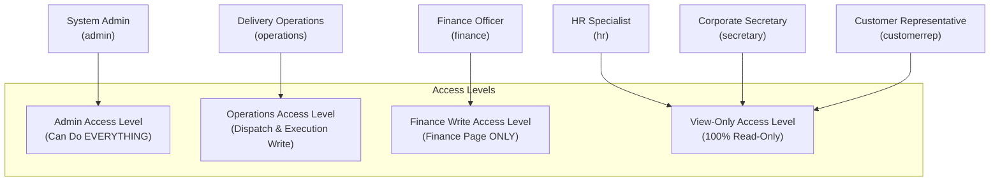

# Knowledge Base: 07 — User Roles & Permissions (RBAC)

> **Document Status:** `[Authoritative RBAC Matrix]`  
> **Authority Level:** Authoritative Specification  
> **Master Source of Truth:** [`../CENTRAL_REQUIREMENTS_AND_SYSTEM_DESIGN.md`](../CENTRAL_REQUIREMENTS_AND_SYSTEM_DESIGN.md)  
> **Last Verified:** November 2026  
> **Location:** `rrliRev/docs/knowledge-base/07-user-roles-and-permissions.md`

---

## 1. Access Level Hierarchy & Core Governance Tenets

RouteX enforces a clear, unambiguous Role-Based Access Control (RBAC) hierarchy centered around three core governance tenets:

1. **The Admin Can Do EVERYTHING:**
   - The System Administrator (`admin`) holds full, unrestricted access across all operational, financial, and administrative modules.
   - Admin can record or edit deliveries from company foundation (`2024-01-01`) onward without the 3-day restriction.
   - Admin reviews and authorizes **Backdating Requests** and **Data Export Requests**.
   - Admin possesses exclusive authority over **Additional Admin Features**: User Account Management, Audited Record Deletions, Audit Log Inspection, and Custom Report Template Authoring.

2. **Finance Can ONLY Edit Whatever Is on the Finance Page:**
   - The Finance Officer (`finance`) holds full write authority over the **Company Expense Ledger** (`/finance` -> record, edit, delete company operating expenses, and import 6-sheet workbooks).
   - In **all other operational modules** (Deliveries, Locations, Fleet Trucks, Drivers & Helpers, POD Documents, User Management, and Report Template Authoring), Finance is strictly **VIEW-ONLY**.
   - Finance can inspect delivery revenues, trip expenses, and margins to audit profitability, but cannot mutate operational delivery records.

3. **The Rest Are Just View-Only, With Exceptions to Operations Execution:**
   - **Operations Staff (`operations`):** Daily logistics dispatch coordinator. Can record and edit deliveries (within 3-day window or via approved Backdating Request), manage locations and drop-off counts, upload spreadsheet deliveries, attach PODs, and register trucks. Operations is strictly **View-Only on the Finance Page** and is completely **excluded from additional admin features**.
   - **Auditing Staff (`hr`, `secretary`, `customer_representative`):** Purely **View-Only** across the entire application. Zero mutation authority anywhere.
   - **Additional Admin Features (Exclusive to Admin):** User Management, Audited Deletions, System Audit Logs, Custom Report Template Authoring, and Backdating Request Authorizations.

---

## 2. Complete RBAC Permission Matrix

| Functional Capability | Admin (EVERYTHING) | Finance (Finance Page ONLY) | Operations (Dispatch & Execution) | HR (View-Only) | Secretary (View-Only) | Customer Rep (View-Only) |
| :--- | :---: | :---: | :---: | :---: | :---: | :---: |
| **View Dashboard & KPIs** | ✓ | 👁 (Read) | ✓ | 👁 (Read) | 👁 (Read) | 👁 (Read) |
| **View Delivery Ledger & Details** | ✓ | 👁 (Read) | ✓ | 👁 (Read) | 👁 (Read) | 👁 (Read) |
| **Record New Delivery** | ✓ *(Unlimited 2024+)* | ✗ | ✓ *(3-day or Approved Req)* | ✗ | ✗ | ✗ |
| **Edit Delivery Records** | ✓ *(Unlimited 2024+)* | ✗ | ✓ *(3-day or Approved Req)* | ✗ | ✗ | ✗ |
| **Submit Backdating Request** | ✓ | ✗ | ✓ | ✗ | ✗ | ✗ |
| **Approve / Reject Requests** | **✓ (Exclusive)** | ✗ | ✗ | ✗ | ✗ | ✗ |
| **Delete Delivery (Audited)** | **✓ (Exclusive)** | ✗ | ✗ | ✗ | ✗ | ✗ |
| **Complete / Finalize Delivery** | ✓ | ✗ | ✓ | ✗ | ✗ | ✗ |
| **Manage Delivery Locations** | ✓ | ✗ | ✓ | ✗ | ✗ | ✗ |
| **Excel Delivery Bulk Import** | ✓ | ✗ | ✓ | ✗ | ✗ | ✗ |
| **View POD Documents** | ✓ | 👁 (Read) | ✓ | 👁 (Read) | 👁 (Read) | 👁 (Read) |
| **Upload / Replace POD Documents** | ✓ | ✗ | ✓ | ✗ | ✗ | ✗ |
| **View Trucks & Profitability** | ✓ | 👁 (Read) | ✓ | 👁 (Read) | 👁 (Read) | 👁 (Read) |
| **Register / Edit Truck Specs** | ✓ | ✗ | ✓ | ✗ | ✗ | ✗ |
| **Delete Fleet Truck (Audited)** | **✓ (Exclusive)** | ✗ | ✗ | ✗ | ✗ | ✗ |
| **View Drivers & Helpers** | ✓ | 👁 (Read) | ✓ | 👁 (Read) | 👁 (Read) | 👁 (Read) |
| **Register / Edit Drivers & Helpers**| ✓ | ✗ | ✓ | ✗ | ✗ | ✗ |
| **Delete Employee (Audited)** | **✓ (Exclusive)** | ✗ | ✗ | ✗ | ✗ | ✗ |
| **View Company Expense Ledger** | ✓ | ✓ | 👁 (Read) | 👁 (Read) | 👁 (Read) | 👁 (Read) |
| **Record / Edit Company Expenses** | ✓ | **✓ (Write)** | ✗ *(View-Only)* | ✗ | ✗ | ✗ |
| **Finance Workbook Import** | ✓ | **✓ (Write)** | ✗ *(View-Only)* | ✗ | ✗ | ✗ |
| **Delete Company Expenses (Audited)**| ✓ | **✓ (Delete)** | ✗ *(View-Only)* | ✗ | ✗ | ✗ |
| **Generate & View Reports** | ✓ | 👁 (Read) | ✓ | 👁 (Read) | 👁 (Read) | 👁 (Read) |
| **Export Reports to CSV / Excel** | ✓ | ✓ | ✓ | ✗ | ✗ | ✗ |
| **Approve Data Export Requests** | **✓ (Exclusive)** | ✗ | ✗ | ✗ | ✗ | ✗ |
| **Author Custom Report Templates** | **✓ (Exclusive)** | ✗ | ✗ | ✗ | ✗ | ✗ |
| **User Account Management** | **✓ (Exclusive)** | ✗ | ✗ | ✗ | ✗ | ✗ |
| **View System Audit Logs** | **✓ (Exclusive)** | ✗ | ✗ | ✗ | ✗ | ✗ |
| **Self-Service Profile & Password** | ✓ | ✓ | ✓ | ✓ | ✓ | ✓ |

---

## 3. Enforcement Mechanisms & Implementation Status

- **UI & Client-Side Guards (`[Frontend Implemented]`):** Menus, buttons, and mutation forms dynamically hide or disable based on the user's active role.
- **Route Handlers (`[Implemented Backend]` / `[Mock-Only]`):** Server handlers check session tokens and permissions, returning HTTP 403 Forbidden for unauthorized callers.
- **PostgreSQL Row-Level Security (RLS) (`[Planned Backend]`):** Database RLS policies are prepared in migrations for future Supabase connection.

---

## 4. Discord-Style Permission Management Interface (`[Frontend Implemented]`)

To make configuring permissions user-friendly, transparent, and non-technical, RouteX provides a Discord-inspired role and member permission workspace:

1. **Dedicated Page (`/permissions`) & Settings Left-Tabs Layout**:
   - Uses the standard RouteX settings layout with vertical navigation tabs on the left:
     - **Roles & Staff:** Discord-style master-detail configuration canvas.
     - **Departments:** Additive department groups and member assignments.
     - **Access Matrix:** Visual cross-role capability reference table.
   - Also integrated directly into `/settings#permissions` and `/user-management` (under the **Permissions** tab).
2. **Master List (Left Column)**:
   - **ROLES Section:** Displays all system roles (Admin, Operations, Finance, HR Specialist, Corporate Secretary, Customer Representative) with their access level badges and active member counts.
   - **MEMBERS Section:** Roster of all active staff members with avatars, `@username`, role pills, and Superadmin crown indicator.
   - Real-time search filter to quickly find any role or employee.
3. **Permission Canvas (Right Column)**:
   - **Header Banner:** Displays entity avatar, full name, role summary, and quick employee permission cloning tool.
   - **Superadmin Protection:** Displays permanent executive badge indicating that the President holds unconditional, non-revocable system authority.
   - **Department Assignment Chips:** Clickable additive department badges (+ / ✓) for quick reassignment.
   - **Human-Friendly Categorized Permissions:** Organized into 7 plain-language operational categories:
     - 🚚 *Trip & Delivery Operations* (Record Deliveries, Edit Trips, Finalize Financials, Multi-Store Drops)
     - 📥 *Excel Spreadsheet Imports* (Upload Dispatch Files, Review & Commit Imports)
     - 📄 *Proof of Delivery (POD) & Documents* (View Receipts & POD Attachments)
     - 💵 *Finance & Operational Cashflow* (View Ledgers, Manage Transactions, View Profitability, Manage Rates)
     - 📊 *Analytics & Data Export* (View Reports, Export to Excel, Manage Templates)
     - 👥 *Personnel & Access Control* (View Staff Accounts, Manage Staff & Security)
     - ⚙️ *System Configuration & Security* (View Organization Settings, Manage Global Configuration)
   - **Intuitive Toggles & Statuses:** Modern toggle switches with status badges:
     - `Granted by Role` (Inherited baseline)
     - `+ Custom Grant` (Individual additive override)
     - `✕ Restricted` (Individual restriction override)
     - Quick "Reset" link to restore role inheritance.
   - **Unsaved Changes Bar (Discord-Style Floating Bottom Banner):**
     - Smoothly slides up when modifications are pending.
     - One-click "Discard Changes" and "Save Changes" with instant feedback and API synchronization.
