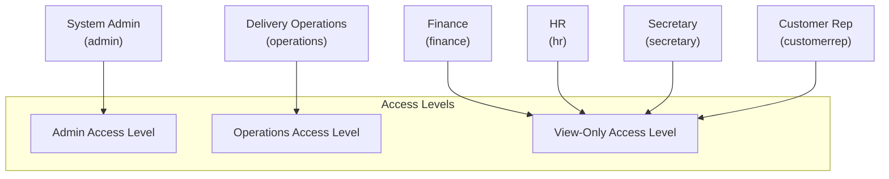

# Knowledge Base: 07 — User Roles & Permissions (RBAC)

> **Document Status:** `[Implemented]`  
> **Authority Level:** Authoritative Specification  
> **Last Verified:** November 2026  
> **Location:** `rrliRev/docs/knowledge-base/07-user-roles-and-permissions.md`

---

## 1. Access Level Hierarchy & Role Architecture

RouteX organizes all system capabilities into three access levels and maps six canonical business roles to them:



---

## 2. Complete RBAC Permission Matrix

| Functional Capability | Admin | Operations | Finance | HR | Secretary | Customer Rep |
| :--- | :---: | :---: | :---: | :---: | :---: | :---: |
| **View Dashboard & KPIs** | ✓ | ✓ | ✓ | ✓ | ✓ | ✓ |
| **View Delivery Ledger & Details** | ✓ | ✓ | ✓ | ✓ | ✓ | ✓ |
| **Record New Delivery** | ✓ | ✓ (3-day limit) | ✗ | ✗ | ✗ | ✗ |
| **Edit Delivery Records** | ✓ | ✓ (3-day limit) | ✗ | ✗ | ✗ | ✗ |
| **Delete Delivery (Audited)** | ✓ | ✗ | ✗ | ✗ | ✗ | ✗ |
| **Excel Delivery Import** | ✓ | ✓ | ✗ | ✗ | ✗ | ✗ |
| **Upload / Manage POD Documents** | ✓ | ✓ | ✗ | ✗ | ✗ | ✗ |
| **View POD Documents** | ✓ | ✓ | ✓ | ✓ | ✓ | ✓ |
| **Manage Fleet (Truck Profiles/Photos)**| ✓ | ✓ | ✗ | ✗ | ✗ | ✗ |
| **View Truck Profitability** | ✓ | ✓ | ✓ | ✓ | ✓ | ✓ |
| **Manage Drivers & Helpers** | ✓ | ✓ | ✗ | ✗ | ✗ | ✗ |
| **View Drivers & Helpers** | ✓ | ✓ | ✓ | ✓ | ✓ | ✓ |
| **Record / Edit Company Expenses** | ✓ | ✓ | ✓ | ✗ | ✗ | ✗ |
| **Delete Company Expenses** | ✓ | ✗ | ✗ | ✗ | ✗ | ✗ |
| **Generate & Export Reports** | ✓ | ✓ | ✓ | ✓ | ✓ | ✓ |
| **Manage Custom Report Templates**| ✓ | ✗ | ✗ | ✗ | ✗ | ✗ |
| **User Account Management** | ✓ | ✗ | ✗ | ✗ | ✗ | ✗ |
| **View System Audit Logs** | ✓ | ✗ | ✗ | ✗ | ✗ | ✗ |
| **Self-Service Password / Username**| ✓ | ✓ | ✓ | ✓ | ✓ | ✓ |

---

## 3. Server-Side Enforcement Mechanisms

Permissions in RouteX are **never** merely cosmetic or UI-level toggles. They are enforced through multiple server-side layers:

1. **Server Session Guard (`requireAuthenticatedActor`):**
   Server components and route handlers verify the cryptographic session cookie before rendering. If missing or invalid, they redirect to `/login`.
2. **Page-Level Role Policy (`checkRouteAccess`):**
   `src/lib/auth/route-policy.ts` validates whether the authenticated actor's role is authorized to view the requested URL path. Unauthorized requests redirect to `/dashboard`.
3. **API Route Handlers (`hasPermission`):**
   API endpoints inspect `actor.role` using domain helpers from `src/lib/auth/rbac.ts`:
   - `canMutateDeliveryRecords(actor.role)`
   - `canManageCompanyExpenses(actor.role)`
   - `canManageUsers(actor.role)`
   - `canManageDocuments(actor.role)`
   If unauthorized, endpoints immediately respond with HTTP `403 Forbidden` (`{"ok": false, "error": "Forbidden"}`).
4. **PostgreSQL Row-Level Security (RLS):**
   In Supabase connected mode, database policies enforce table-level mutation restrictions using PostgreSQL role claims.

---

## 4. Primary Navigation Visibility by Role

The application sidebar ([`src/components/operational-sidebar.tsx`](file:///c:/Users/suchi/Documents/rrli/rrliRev/src/components/operational-sidebar.tsx)) dynamically renders authorized navigation items based on `getAuthorizedNavigationForRole(actor.role)`:

| Route Path | Label | Permitted Roles |
| :--- | :--- | :--- |
| `/dashboard` | Dashboard | All Roles |
| `/deliveries` | Deliveries | All Roles |
| `/truck-profitability`| Trucks | All Roles |
| `/drivers` | Drivers & Helpers | All Roles |
| `/finance` | Finance | Admin, Operations, Finance |
| `/pod-documents` | POD Documents | All Roles |
| `/reports` | Reports | All Roles |
| `/user-management`| User Management | **Admin Only** |
| `/settings` | Settings | All Roles (Personal account profile) |

---

## 5. Test Credentials & Demo Accounts

All accounts use the standard preview password: `password123`

```
Admin:        username: admin        (System Administrator - Full Access)
Operations:   username: operations   (Dispatch Specialist - 3-day window)
Finance:      username: finance      (Finance Officer - View-only)
HR:           username: hr           (HR Specialist - View-only)
Secretary:    username: secretary    (Corporate Secretary - View-only)
Customer Rep: username: customerrep  (Customer Support - View-only)
```
