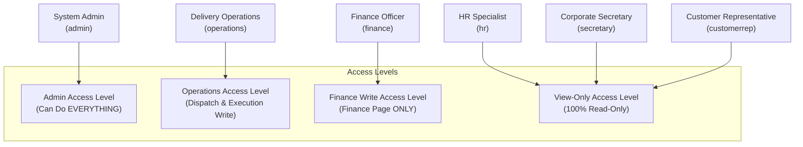

# Knowledge Base: 07 — User Roles & Permissions (RBAC)

> **Document Status:** `[Implemented & Authoritative]`  
> **Authority Level:** Authoritative Specification  
> **Last Verified:** November 2026  
> **Location:** `rrliRev/docs/knowledge-base/07-user-roles-and-permissions.md`

---

## 1. Access Level Hierarchy & Core Governance Tenets

RouteX enforces a clear, unambiguous Role-Based Access Control (RBAC) hierarchy centered around three core governance tenets:

1. **The Admin Can Do EVERYTHING:**
   - The System Administrator (`admin`) holds full, unrestricted access across all operational, financial, and administrative modules.
   - Admin can record or edit deliveries from company foundation (`2024-01-01`) onward without the 3-day submission restriction.
   - Admin possesses exclusive authority over **Additional Admin Features**: User Account Management, Audited Record Deletions, Audit Log Inspection, and Custom Report Template Authoring.

2. **Finance Can ONLY Edit Whatever Is on the Finance Page:**
   - The Finance Officer (`finance`) holds full write authority over the **Company Expense Ledger** (`/finance` -> record, edit, and delete company operating overhead expenses).
   - In **all other operational modules** (Deliveries, Multi-Store Drop-offs, Fleet Trucks, Drivers & Helpers, POD Documents, User Management, and Report Template Authoring), Finance is strictly **VIEW-ONLY**.
   - Finance can inspect delivery revenues, trip expenses, and margins to audit profitability, but cannot mutate operational records.

3. **The Rest Are Just View-Only, With Exceptions to Additional Admin Features:**
   - **Operations Staff (`operations`):** Hands-on daily dispatch coordinator. Can record and edit deliveries (subject to a 3-day submission window), record drop-offs, upload Excel files, attach PODs, and register trucks. However, Operations is strictly **View-Only on the Finance Page** (cannot manage company expenses) and is completely **excluded from additional admin features**.
   - **Auditing Staff (`hr`, `secretary`, `customer_representative`):** Purely **View-Only** across the entire application. Zero mutation authority anywhere.
   - **Additional Admin Features (Exclusive to Admin):** User Management, Audited Deletions (`UC-35`), Audit Logs, Custom Report Template Authoring, and Unlimited Historical Delivery Recording.



---

## 2. Complete RBAC Permission Matrix

| Functional Capability | Admin (EVERYTHING) | Finance (Finance Page ONLY) | Operations (Dispatch & Execution) | HR (View-Only) | Secretary (View-Only) | Customer Rep (View-Only) |
| :--- | :---: | :---: | :---: | :---: | :---: | :---: |
| **View Dashboard & KPIs** | ✓ | 👁 (Read) | ✓ | 👁 (Read) | 👁 (Read) | 👁 (Read) |
| **View Delivery Ledger & Details** | ✓ | 👁 (Read) | ✓ | 👁 (Read) | 👁 (Read) | 👁 (Read) |
| **Record New Delivery** | ✓ *(Unlimited 2024+)* | ✗ | ✓ *(3-day window)* | ✗ | ✗ | ✗ |
| **Edit Delivery Records** | ✓ *(Unlimited 2024+)* | ✗ | ✓ *(3-day window)* | ✗ | ✗ | ✗ |
| **Delete Delivery (Audited UC-35)** | ✓ | ✗ | ✗ | ✗ | ✗ | ✗ |
| **Complete / Finalize Delivery** | ✓ | ✗ | ✓ | ✗ | ✗ | ✗ |
| **Manage Store Drop-offs** | ✓ | ✗ | ✓ | ✗ | ✗ | ✗ |
| **Excel Delivery Bulk Import** | ✓ | ✗ | ✓ | ✗ | ✗ | ✗ |
| **View POD Documents** | ✓ | 👁 (Read) | ✓ | 👁 (Read) | 👁 (Read) | 👁 (Read) |
| **Upload / Replace POD Documents** | ✓ | ✗ | ✓ | ✗ | ✗ | ✗ |
| **View Trucks & Profitability** | ✓ | 👁 (Read) | ✓ | 👁 (Read) | 👁 (Read) | 👁 (Read) |
| **Register / Edit Truck Specs** | ✓ | ✗ | ✓ | ✗ | ✗ | ✗ |
| **Delete Fleet Truck (Audited)** | ✓ | ✗ | ✗ | ✗ | ✗ | ✗ |
| **View Drivers & Helpers** | ✓ | 👁 (Read) | ✓ | 👁 (Read) | 👁 (Read) | 👁 (Read) |
| **Register / Edit Drivers & Helpers**| ✓ | ✗ | ✓ | ✗ | ✗ | ✗ |
| **View Company Expense Ledger** | ✓ | ✓ | 👁 (Read) | 👁 (Read) | 👁 (Read) | 👁 (Read) |
| **Record / Edit Company Expenses** | ✓ | **✓ (Write)** | ✗ *(View-Only)* | ✗ | ✗ | ✗ |
| **Delete Company Expenses (Audited)**| ✓ | **✓ (Delete)** | ✗ *(View-Only)* | ✗ | ✗ | ✗ |
| **Generate & View Reports** | ✓ | 👁 (Read) | ✓ | 👁 (Read) | 👁 (Read) | 👁 (Read) |
| **Export Reports to CSV / Excel** | ✓ | ✓ | ✓ | ✗ | ✗ | ✗ |
| **Author Custom Report Templates** | ✓ | ✗ | ✗ | ✗ | ✗ | ✗ |
| **Delete Custom Report Templates** | ✓ | ✗ | ✗ | ✗ | ✗ | ✗ |
| **User Account Management** | ✓ | ✗ | ✗ | ✗ | ✗ | ✗ |
| **View System Audit Logs** | ✓ | ✗ | ✗ | ✗ | ✗ | ✗ |
| **Self-Service Password / Username** | ✓ | ✓ | ✓ | ✓ | ✓ | ✓ |

---

## 3. Server-Side Enforcement Mechanisms

Permissions in RouteX are enforced through robust server-side security checks:

1. **Server Session Guard (`requireAuthenticatedActor`):**
   Server components and route handlers verify the HMAC-SHA256 session token before serving protected content. Invalid sessions are redirected to `/login`.
2. **Page-Level Role Policy (`checkRouteAccess`):**
   `src/lib/auth/route-policy.ts` validates whether the actor's role is permitted to access the route URL. For example, `/user-management` is strictly locked to `admin`.
3. **API Mutation Authorization (`verifyServerPermission`):**
   API endpoints inspect caller role permissions before executing mutations:
   - Deliveries: `deliveries:create`, `deliveries:edit`
   - Company Expenses: `finance:manage` (permitted exclusively for `admin` and `finance`)
   - Users & Roles: `users:manage` (permitted exclusively for `admin`)
   - Report Templates: `reports:manage_templates` (permitted exclusively for `admin`)
   Unauthorized callers receive immediate HTTP `403 Forbidden` (`{"ok": false, "error": "Forbidden"}`).
4. **PostgreSQL Row-Level Security (RLS):**
   In Supabase mode, database RLS policies validate role tokens at the SQL transaction layer.

---

## 4. Primary Navigation Visibility by Role

The application sidebar ([`src/components/operational-sidebar.tsx`](file:///c:/Users/suchi/Documents/rrli/rrliRev/src/components/operational-sidebar.tsx)) dynamically renders authorized links:

| Route Path | Label | Permitted Roles | Notes |
| :--- | :--- | :--- | :--- |
| `/dashboard` | Dashboard | All Roles | Overview KPIs and attention items |
| `/deliveries` | Deliveries | All Roles | Write controls hidden for view-only & finance |
| `/truck-profitability`| Trucks | All Roles | Write controls hidden for view-only & finance |
| `/drivers` | Drivers & Helpers | All Roles | Write controls hidden for view-only & finance |
| `/finance` | Finance | All Roles | **Write controls active for Admin & Finance only** |
| `/pod-documents` | POD Documents | All Roles | Upload controls active for Admin & Operations only |
| `/reports` | Reports | All Roles | CSV export active for Admin, Operations, Finance |
| `/user-management`| User Management | **Admin Only** | Hidden from all other roles |
| `/settings` | Settings | All Roles | Profile photo, password & security question |

---

## 5. Test Credentials & Demo Accounts

Preview accounts for testing role behavior at `/login`:

```
Admin:        username: admin        (Can do EVERYTHING; full administrative & operational authority)
Finance:      username: finance      (Can ONLY edit whatever is on the Finance page; view-only elsewhere)
Operations:   username: operations   (Dispatch Specialist; 3-day window; view-only on Finance page)
HR:           username: hr           (HR Specialist; strictly view-only crew payroll auditing)
Secretary:    username: secretary    (Corporate Secretary; strictly view-only compliance & POD auditing)
Customer Rep: username: customerrep  (Customer Support; strictly view-only waybill inquiries)
```

Password for all seeded preview accounts: `password123`
