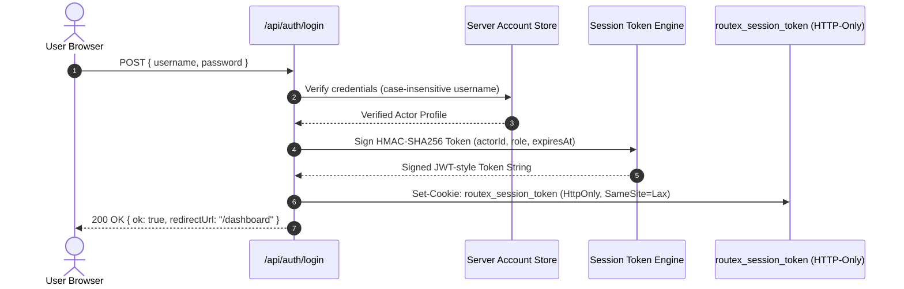

# Knowledge Base: 08 — Authentication & Security

> **Document Status:** `[Implemented]`  
> **Authority Level:** Authoritative Specification  
> **Last Verified:** November 2026  
> **Location:** `rrliRev/docs/knowledge-base/08-authentication-and-security.md`

---

## 1. Authentication Architecture

RouteX features a hardened, stateless, cryptographic session authentication system designed to work seamlessly in both Database-Free Preview Mode and Supabase Connected Mode without third-party vendor lock-in.



---

## 2. Session Management & Token Signing

- **Cookie Name:** `routex_session_token`
- **Signing Algorithm:** HMAC-SHA256 (`crypto.createHmac("sha256", secret)`).
- **Session Secret:** Provided via `ROUTEX_SESSION_SECRET` environment variable (minimum 32 characters in production; fallbacks guarded by environment checks).
- **Payload Structure:**
  ```json
  {
    "sub": "usr-admin-001",
    "username": "admin",
    "role": "admin",
    "exp": 1731500000,
    "iat": 1731413600
  }
  ```
- **Cookie Security Flags:** `HttpOnly`, `SameSite=Lax`, `Path=/`, and `Secure` (in HTTPS environments).

---

## 3. Password Policies & Cryptography

### A. Argon2id Password Hashing
- RouteX implements the **RFC 9106 Argon2id** password hashing standard for all user passwords and security question answers.
- Passwords are never stored in plaintext or with reversible encryption.
- Verification uses constant-time string comparison (`crypto.timingSafeEqual`) to prevent timing side-channel attacks.

### B. RouteX Password Policy Standards
Enforced via [`src/lib/auth/password-policy.ts`](file:///c:/Users/suchi/Documents/rrli/rrliRev/src/lib/auth/password-policy.ts):
- **Minimum Length:** 8 characters.
- **Complexity Requirements:**
  - At least 1 uppercase letter (`A-Z`).
  - At least 1 lowercase letter (`a-z`).
  - At least 1 numerical digit (`0-9`).
  - At least 1 special symbol (`!@#$%^&*()_+-=[]{}|;:,.<>?`).
- Real-time feedback provided via the `<PasswordCriteriaList />` UI component.

### C. Username Format & Normalization
- Length: 3 to 30 characters.
- Allowed characters: alphanumeric, dots (`.`), hyphens (`-`), underscores (`_`).
- Authentication is strictly **case-insensitive** (`ADMIN`, `Admin`, `admin` resolve to the same account).
- Passwords remain strictly **case-sensitive**.

---

## 4. Account Lifecycle & Security Workflows

### A. First-Login Mandatory Setup Modal (`<InitialSetupModal />`)
When an administrator provisions a new account with a temporary password:
1. The user account is flagged with `must_change_password = true` and `has_security_question = false`.
2. Upon initial sign-in, RouteX blocks workspace interaction and renders the non-dismissible `<InitialSetupModal />`.
3. The user must provide a new RFC-compliant password and configure a security question/answer before proceeding to the dashboard.

### B. Self-Service Password Recovery
1. User clicks **"Forgot password?"** on `/login`.
2. Enters their username (case-insensitive).
3. The system retrieves their pre-configured security question without revealing stored answers.
4. User enters their secret answer. The answer is hashed with Argon2id and verified against the stored hash.
5. Upon successful answer verification, the user can immediately set a new password.

### C. Admin-Assisted Password Recovery
If a user forgets both their password and security answer, an Admin user can reset their account from `/user-management`:
1. Generates an audited temporary password.
2. Flags the account for mandatory password reset on next login.
3. Automatically logs the administrative action to the system audit trail.

---

## 5. Security Headers & Protection Invariants

- **Clickjacking Defense:** `X-Frame-Options: DENY`
- **MIME Sniffing Defense:** `X-Content-Type-Options: nosniff`
- **Referrer Policy:** `strict-origin-when-cross-origin`
- **Open Redirect Protection:** All return paths (`?next=...`) are sanitized against whitelist patterns to prevent arbitrary external redirects.
