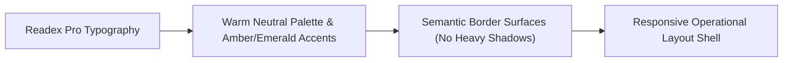

# Knowledge Base: 09 — UI/UX Guidelines & Design System

> **Document Status:** `[Implemented]`  
> **Authority Level:** Authoritative Specification  
> **Last Verified:** November 2026  
> **Location:** `rrliRev/docs/knowledge-base/09-ui-ux-guidelines.md`

---

## 1. Visual Identity & Brand Philosophy

RouteX’s design language is crafted for high-density logistics workflows. It prioritizes **clarity, operational efficiency, visual restraint, and legible typography** over unnecessary decoration.

---

## 2. Typography Foundations

- **Primary Font Family:** `Readex Pro` (Google Fonts), loaded in weights `300, 400, 500, 600, 700, 800`.
- **Monospace Family:** Standard system monospace (`Consolas, Monaco, "Liberation Mono", monospace`) reserved strictly for Waybill numbers, Plate numbers, UUIDs, and `@usernames`.
- **Font Scale Standards:**
  - Page Titles (`h1`): `24px` – `28px`, bold, `-0.02em` tracking.
  - Section Headings (`h2`): `16px` – `18px`, bold, `-0.01em` tracking.
  - Card & Subheading Titles (`h3`): `14px` – `15px`, semi-bold.
  - Body & Table Text: `13px` – `13.5px`, regular / medium.
  - Metadata, Eyebrows & Uppercase Labels: `10.5px` – `11px`, bold, `0.05em` letter-spacing.

---

## 3. Color Tokens & Theme System

RouteX supports both **Light Mode** (default) and **Dark Mode** (`html[data-theme="dark"]`). All colors are declared as CSS custom properties in `src/app/globals.css`:

| CSS Custom Property | Light Mode Value | Dark Mode Value | Semantic Role |
| :--- | :--- | :--- | :--- |
| `--color-page` | `#f8fafc` | `#0f172a` | App background canvas |
| `--color-surface` | `#ffffff` | `#1e293b` | Card & container surface |
| `--color-surface-hover`| `rgba(0,0,0,0.03)` | `rgba(255,255,255,0.04)` | Interactive item hover |
| `--line` / `--color-border`| `rgba(0,0,0,0.08)` | `rgba(255,255,255,0.12)` | Subtle card/table dividers |
| `--color-text-primary` | `#0f172a` | `#f1f5f9` | Primary headings and text |
| `--color-text-secondary`| `#475569` | `#94a3b8` | Subtitles and table values |
| `--color-text-muted` | `#64748b` | `#64748b` | Footers, hints, placeholders |
| `--deep-green` | `#064e3b` | `#10b981` | Brand logo mark & highlights |
| `--color-accent` | `#d97706` | `#f59e0b` | Operational primary amber |
| `--color-accent-soft` | `rgba(217,119,6,0.1)` | `rgba(245,158,11,0.15)` | Status pill background |
| `--color-accent-deep` | `#92400e` | `#fbbf24` | High-contrast monetary values |

---

## 4. Architectural Styling Invariants

### A. Single Global Stylesheet Rule
- All styles belong strictly in [`src/app/globals.css`](file:///c:/Users/suchi/Documents/rrli/rrliRev/src/app/globals.css).
- **CSS Modules (`*.module.css`) are strictly prohibited.** They break Turbopack builds in this repository.

### B. Zero Button Shadows Standard
- **No Box Shadows on Buttons:** Standard drop shadows on buttons have been eliminated throughout the system.
- Visual hierarchy and click affordance are achieved exclusively through:
  - High-contrast background colors (`.primary-action-button`, `.secondary-button`).
  - Crisp borders (`border: 1px solid var(--line)`).
  - Subtle upward hover translation (`transform: translateY(-1.5px)` with `transition: transform 0.15s ease`).

---

## 5. Table Pagination & Layout Standards

All data tables adhere to strictly enforced standards:

- **Component:** [`<TablePagination />`](file:///c:/Users/suchi/Documents/rrli/rrliRev/src/components/table-pagination.tsx).
- **Page Size Standard:**
  - **Dashboard Recent Deliveries:** Strictly **5 records**, fixed without pagination controls.
  - **All Other Tables:** Strictly **10 records per page** (`/deliveries`, `/reports`, `/truck-profitability`, `/pod-documents`, `/drivers`, `/finance`, `/user-management`).
- **Interactive Page Input:** Users can type a page number directly into `Page [ X ] of Y` and press Enter to jump immediately.

---

## 6. Profile-Centered Layout (Google Account Mobile Inspired)

The **Settings page (`/settings`)** implements a profile-centered layout:

- **Hero Profile Centerpiece:** Positioned at the top-center with a subtle radial background glow, a prominent 112px circular avatar, a floating camera upload button, the user's full name, `@username` handle, role pill, and email address.
- **Vertical Stream Below Profile:** Remaining settings (Account Details, Sign-in & Security, Recovery Questions, Security Status Checklist, and Role Permissions Matrix) are organized underneath in a centered, well-proportioned vertical stream (`max-width: 780px`).
- **Responsive Stacking:** Two-column form field grids collapse gracefully to a single column on mobile screens (`< 680px`).
