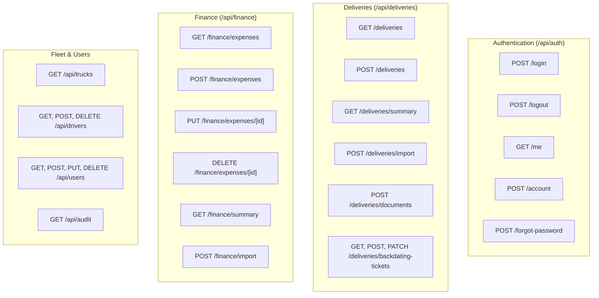

# Knowledge Base: 10 — API & Server Logic

> **Document Status:** `[Authoritative API Catalog]`  
> **Authority Level:** Authoritative Specification  
> **Master Source of Truth:** [`../CENTRAL_REQUIREMENTS_AND_SYSTEM_DESIGN.md`](../CENTRAL_REQUIREMENTS_AND_SYSTEM_DESIGN.md)  
> **Last Verified:** November 2026  
> **Location:** `rrliRev/docs/knowledge-base/10-api-and-server-logic.md`

---

## 1. Route Handlers Catalog & Specifications

All server-side endpoints are implemented as Next.js App Router Route Handlers located under [`src/app/api/`](file:///c:/Users/suchi/Documents/rrli/rrliRev/src/app/api/).

> [!NOTE]
> **Implementation Status:** Route handlers execute with full RBAC validation. In current preview mode, handlers read and write to `small-mock-database.ts` and browser `localStorage`. Supabase SQL execution represents `[Planned Backend]`.

---

## 2. Authentication Endpoints (`/api/auth/*`)

### `POST /api/auth/login`
- **Request Body:** `{ username: string, password: string }`
- **Validation:** Username normalized to lowercase; password evaluated.
- **Response:** Sets `routex_session_token` HTTP-only cookie. Returns `{ ok: true, redirectUrl: "/dashboard" }`.

### `POST /api/auth/logout`
- Clears `routex_session_token` cookie. Returns `{ ok: true, redirectUrl: "/login" }`.

### `GET /api/auth/me`
- Returns current actor profile: `{ ok: true, actor: { id, username, fullName, role, email, avatarUrl, securityQuestion } }`.

### `POST /api/auth/account`
- Supports actions: `update-profile-photo`, `change-username`, `change-password`, `change-security-question`.

---

## 3. Delivery Endpoints (`/api/deliveries/*`)

### `GET /api/deliveries`
- **Query Parameters:** `page`, `pageSize`, `search`, `status` (`all` | `completed` | `incomplete`), `client`, `truck`, `startDate`, `endDate`, `sortField`, `sortDirection`.
- **Response:** `{ ok: true, items: DeliveryLedgerItem[], total, page, pageSize, pageCount, filters }`.

### `POST /api/deliveries`
- **Permissions:** Admin or Operations (`canMutateDeliveryRecords`).
- **Policy Enforcement:** Rejects dates prior to `2024-01-01`. Enforces 3-day window for Operations unless an approved Backdating Request exists.
- **Payload:** Waybill number, delivery date, client name, truck plate, driver ID/name, helper ID(s)/name(s), locations array (`locationName`, `locationAddress`, `dropoffCount`), expenses (itemized for Owned; single subcontractor amount for Subcontracted), general notes.
- **Completeness Calculation:** Evaluates `unknown` expenses to assign `financialState` (`finalized` vs `incomplete`).

### `POST /api/deliveries/import`
- **Permissions:** Admin or Operations (`canImportAndReviewExcel`).
- **Payload:** Staged delivery rows.
- **Behavior:** Auto-registers any unregistered truck plates from available spreadsheet data without requiring manual pre-registration. Identifies Owned vs. Subcontracted entries. Creates delivery and location records.

### `GET, POST, PATCH /api/deliveries/backdating-tickets`
- **Endpoint:** Backdating Requests queue.
- **POST:** Operations submits a backdating request (`waybillNumber`, `deliveryDate`, `clientName`, `plateNumber`, `reason`).
- **GET:** Lists pending, approved, and rejected requests.
- **PATCH:** Admin authorizes decision (`decision: "approve" | "reject"`, optional `decisionNotes`).

---

## 4. Finance Endpoints (`/api/finance/*`)

### `GET /api/finance/expenses`
- **Query Parameters:** `startDate`, `endDate`, `search`, `page`, `pageSize`.
- **Response:** `{ ok: true, items: CompanyExpense[], total, summary: { totalAmount } }`.

### `POST /api/finance/expenses`
- **Permissions:** Admin or Finance (`canManageCompanyExpenses`). Operations is blocked (`403 Forbidden`).
- **Payload:** `{ amount: number, expenseDate: string, description: string, notes?: string }`.

### `PUT /api/finance/expenses/[id]` & `DELETE /api/finance/expenses/[id]`
- **Permissions:** Admin or Finance (`canManageCompanyExpenses`). Emits an immutable audit log entry.

### `POST /api/finance/import`
- **Permissions:** Admin or Finance. Ingests normalized rows from the 6-sheet workbook with duplicate review actions (`combine`, `separate`, `exclude`).
