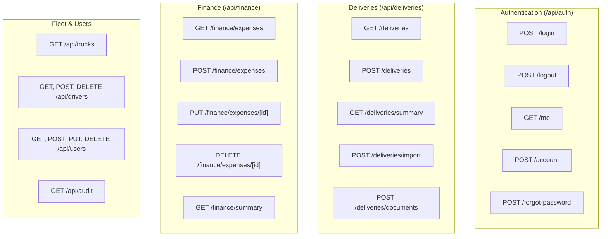

# Knowledge Base: 10 — API & Server Logic

> **Document Status:** `[Implemented]`  
> **Authority Level:** Authoritative Specification  
> **Last Verified:** November 2026  
> **Location:** `rrliRev/docs/knowledge-base/10-api-and-server-logic.md`

---

## 1. Route Handlers Catalog & Specifications

All server-side endpoints are implemented as Next.js App Router Route Handlers located under [`src/app/api/`](file:///c:/Users/suchi/Documents/rrli/rrliRev/src/app/api/).



---

## 2. Authentication Endpoints (`/api/auth/*`)

### `POST /api/auth/login`
- **Request Body:** `{ username: string, password: string }`
- **Validation:** Username normalized to lowercase; password evaluated.
- **Response:**
  - `200 OK`: Sets `routex_session_token` HTTP-only cookie. Returns `{ ok: true, redirectUrl: "/dashboard" }`.
  - `401 Unauthorized`: `{ ok: false, error: "Invalid username or password" }`.

### `POST /api/auth/logout`
- Clears `routex_session_token` cookie by setting `Max-Age=0`.
- Returns `{ ok: true, redirectUrl: "/login" }`.

### `GET /api/auth/me`
- Inspects session token and retrieves current actor profile.
- Returns `{ ok: true, actor: { id, username, fullName, role, email, avatarUrl, securityQuestion } }`.

### `POST /api/auth/account`
- Supports actions: `update-profile-photo`, `change-username`, `change-password`, `change-security-question`.
- Authenticates caller's current password for sensitive operations.

---

## 3. Delivery Endpoints (`/api/deliveries/*`)

### `GET /api/deliveries`
- **Query Parameters:** `page`, `pageSize`, `search`, `status` (`all` | `completed` | `incomplete`), `client`, `truck`, `startDate`, `endDate`, `sortField`, `sortDirection`.
- **Response:** `{ ok: true, items: DeliveryLedgerItem[], total, page, pageSize, pageCount, filters }`.

### `POST /api/deliveries`
- **Permissions:** Admin or Operations (`canMutateDeliveryRecords`).
- **Policy Enforcement:** Rejects records prior to `2024-01-01`. Enforces 3-day window for Operations.
- **Payload:** Waybill number, delivery date, client name, truck plate, driver, helper, drop-offs array, expenses, expense states.
- **Completeness Calculation:** Evaluates `unknown` expenses and missing PODs to assign `financialState` (`finalized` vs `incomplete`).

### `POST /api/deliveries/import`
- **Permissions:** Admin or Operations (`canImportAndReviewExcel`).
- **Payload:** Array of staged spreadsheet delivery rows.
- **Behavior:** Validates, maps, and atomically creates deliveries and store drop-offs. Emits audit trail entry.

---

## 4. Finance Endpoints (`/api/finance/*`)

### `GET /api/finance/expenses`
- **Query Parameters:** `startDate`, `endDate`, `search`, `page`, `pageSize`.
- **Response:** `{ ok: true, items: CompanyExpense[], total, summary: { totalAmount } }`.

### `POST /api/finance/expenses`
- **Permissions:** Admin, Operations, or Finance (`canManageCompanyExpenses`).
- **Payload:** `{ amount: number, expenseDate: string, description: string, notes?: string }`.
- **Validation:** `amount >= 0`, `expenseDate >= '2024-01-01'`.
- **Response:** `{ ok: true, expense: CompanyExpense }`.

### `DELETE /api/finance/expenses/[id]`
- **Permissions:** **Admin Only**.
- **Request Body:** `{ reason: string }` (mandatory audit explanation).
- **Behavior:** Permanently deletes company expense record and records structured deletion event in audit store.

---

## 5. Audit Logging Architecture (`/api/audit`)

- Every administrative mutation (delivery deletion, truck deletion, user status toggle, expense deletion) emits a structured audit record into [`src/lib/audit/server-audit-store.ts`](file:///c:/Users/suchi/Documents/rrli/rrliRev/src/lib/audit/server-audit-store.ts).
- Audit record attributes:
  ```typescript
  export type ServerAuditEntry = {
    id: string;
    timestamp: string;
    actorUsername: string;
    actorRole: string;
    actionType: string;
    targetType: "delivery" | "truck" | "user" | "expense";
    targetId: string;
    reason?: string;
    metadata?: Record<string, unknown>;
  };
  ```
- Accessible exclusively to Admin users via `/user-management` audit inspector.
