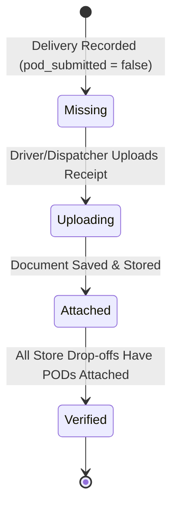

# Knowledge Base: 11 — File Management & POD Documents

> **Document Status:** `[Implemented]`  
> **Authority Level:** Authoritative Specification  
> **Last Verified:** November 2026  
> **Location:** `rrliRev/docs/knowledge-base/11-file-management.md`

---

## 1. Document Lifecycle & Proof of Delivery (POD)

In freight logistics, a completed delivery is only billable once signed Proof of Delivery (POD) receipts are acquired from customer stores. RouteX manages this critical lifecycle at both the delivery trip level and individual store drop-off level.

---

## 2. Supported File Formats & Upload Dropzones

- **Permitted Formats:** Images (`image/jpeg`, `image/png`, `image/webp`) and PDF documents (`application/pdf`).
- **File Size Constraint:** Maximum 5MB per document.
- **Stop-Level Attachment:** Through [`<DeliveryPodDocuments />`](file:///c:/Users/suchi/Documents/rrli/rrliRev/src/components/delivery-pod-documents.tsx) on `/deliveries/[id]`, dispatchers attach specific signed receipts to each store drop-off.
- **Trip-Level Supporting Documents:** Tollway receipts, weight certificates, entry fee tickets, and incident reports can be uploaded alongside the delivery.

---

## 3. Dual-Mode Storage Implementation

### A. Database-Free Preview Mode (Deterministic SVG Receipts)
When running without Supabase credentials:
- RouteX avoids failing uploads or broken image placeholders by generating **instant offline SVG receipt documents**.
- The SVG embeds the Waybill Number, Store Name, Delivery Date, Driver Name, and a digital stamp (`"RRLI RECEIVED & CONFIRMED"`).
- Rendered as base64 data URIs or downloaded directly as clean vector documents.

### B. Supabase Connected Mode (Private Cloud Storage)
When configured with Supabase:
- Files are uploaded directly to the private Supabase Storage bucket: `routex-documents`.
- File naming pattern:
  `deliveries/{waybillNumber}/{dropoffId}_{timestamp}.{ext}`
- **Security & Signed URLs:**
  - The storage bucket is completely private (no public read access).
  - Documents are retrieved using **5-minute time-limited pre-signed URLs** generated via `supabase.storage.from("routex-documents").createSignedUrl(path, 300)`.
  - Download links expire automatically to prevent unauthorized external distribution.

---

## 4. Centralized Document Repository (`/pod-documents`)

The dedicated **POD Documents** workspace view provides high-speed document search:

- **Filter Controls:**
  - Status filter: **"POD Attached"** vs **"Missing POD"** (canonical terminology; never uses "Verified" / "Pending Verification").
  - Search by Waybill Number or Client Name.
  - Date range filtering via the global date range picker.
- **Pagination:** Strictly **10 records per page** via `<TablePagination />`.
- **Integrated Lightbox Viewer:** Click any document thumbnail to inspect high-resolution images or multi-page PDFs with zoom, rotation, and print controls.
