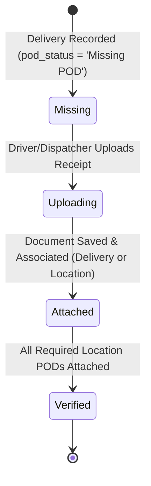

# Knowledge Base: 11 — File Management & POD Documents

> **Document Status:** `[Authoritative Document Specification]`  
> **Authority Level:** Authoritative Specification  
> **Master Source of Truth:** [`../CENTRAL_REQUIREMENTS_AND_SYSTEM_DESIGN.md`](../CENTRAL_REQUIREMENTS_AND_SYSTEM_DESIGN.md)  
> **Last Verified:** November 2026  
> **Location:** `rrliRev/docs/knowledge-base/11-file-management.md`

---

## 1. Document Lifecycle & Proof of Delivery (POD)

In freight logistics, a completed delivery is only billable once signed Proof of Delivery (POD) receipts are acquired. RouteX manages this lifecycle at two distinct levels:
1. **Delivery-Level Documents:** Trip-wide paperwork covering the entire run (Master Waybill, Fuel Receipts, Weight Certificates, Gate Passes).
2. **Location-Level Documents:** Proof of delivery receipts and invoices attached to a specific **Location** on the delivery trip.

> [!IMPORTANT]
> **No Individual Stop Records for Documents:** Documents are associated with either the Delivery or a Location. The system **does not create individual stop/drop-off records** solely for document association.

---

## 2. Supported File Formats & Upload Dropzones

- **Permitted Formats:** Images (`image/jpeg`, `image/png`, `image/webp`) and PDF documents (`application/pdf`).
- **File Size Constraint:** Maximum 5MB per document.
- **Location-Level Dropzone:** Dispatchers attach signed receipts to specific locations within `/deliveries/[id]`.
- **Trip-Level Supporting Dropzone:** General trip documents (highway receipts, diesel receipts) attach to the overall delivery.

---

## 3. Storage Architecture: Preview vs. Planned Connected Mode

### A. Database-Free Preview Mode (`[Frontend Implemented]` · `[Mock-Only]`)
When running without Supabase credentials:
- RouteX avoids failing uploads or broken placeholders by generating **instant offline SVG receipt documents**.
- The SVG embeds the Waybill Number, Location Name, Delivery Date, Driver Name, and digital verification stamp.
- Rendered as base64 data URIs or downloaded directly as clean vector documents.

### B. Supabase Connected Mode (`[Planned Backend]`)
When configured with Supabase:
- Files are uploaded directly to the private Supabase Storage bucket: `routex-documents`.
- File naming pattern:
  - Trip Documents: `deliveries/{waybillNumber}/trip_{timestamp}.{ext}`
  - Location Documents: `deliveries/{waybillNumber}/loc_{locationId}_{timestamp}.{ext}`
- **Security & Pre-Signed URLs:**
  - The storage bucket is completely private (no public read access).
  - Documents are retrieved using **5-minute time-limited pre-signed URLs** generated via `supabase.storage.from("routex-documents").createSignedUrl(path, 300)`.
  - Links expire automatically to prevent unauthorized external distribution.

---

## 4. Centralized Document Repository (`/pod-documents`)

The dedicated **POD Documents** workspace view provides high-speed document search:

- **Filter Controls:**
  - Status filter: **"POD Attached"** vs **"Missing POD"** (canonical terminology; never uses "Verified" / "Pending Verification").
  - Search by Waybill Number or Client Name.
  - Date range filtering via the global date range picker.
- **Pagination:** Strictly **10 records per page** via `<TablePagination />`.
- **Integrated Lightbox Viewer:** Click any document thumbnail to inspect high-resolution images or multi-page PDFs with zoom, rotation, and print controls.
