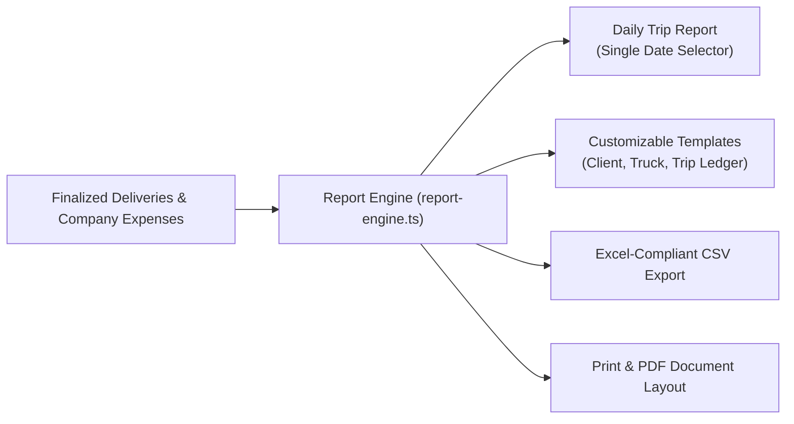

# Knowledge Base: 12 — Reporting & Calculations

> **Document Status:** `[Implemented]`  
> **Authority Level:** Authoritative Specification  
> **Last Verified:** November 2026  
> **Location:** `rrliRev/docs/knowledge-base/12-reporting-and-calculations.md`

---

## 1. Overview of Reporting Capabilities

RouteX provides an executive and operational reporting engine located at [`/reports`](file:///c:/Users/suchi/Documents/rrli/rrliRev/src/app/(workspace)/reports/page.tsx). It translates raw delivery ledgers and company expenses into auditable management summaries, Excel-compliant CSV files, and print layouts.



---

## 2. Daily Trip Report Architecture

- **Independent Date Selector:** The Daily Trip Report is locked to a **single date selector** (`YYYY-MM-DD`) and operates completely independently of the global date range picker.
- **Operational Purpose:** Daily reconciliation for dispatchers and fleet supervisors to inspect all vehicles operating on a given business day.
- **Summary Metrics:**
  - Active trucks dispatched on date.
  - Total stores served across all drop-offs.
  - Daily delivery revenue.
  - Total daily fuel, toll, fee, and crew expenses.
  - Net operating profit for that calendar day.

---

## 3. Customizable Report Templates (`report-template-types.ts`)

RouteX provides six built-in company templates (`BUILTIN_REPORT_TEMPLATES`):

| Template ID | Name | Target Dataset | Primary Grouping |
| :--- | :--- | :--- | :--- |
| `client-summary` | **Client Summary Report** | Finalized Deliveries | Grouped by Client Name |
| `truck-summary` | **Truck Profitability Summary**| Finalized Deliveries | Grouped by Plate Number |
| `trip-ledger` | **Comprehensive Trip Ledger**| Finalized Deliveries | Itemized by Waybill Number |
| `financial-summary` | **Executive Financial Overview**| Deliveries & Expenses| High-level Revenue vs Expenses |
| `daily-operations` | **Daily Operational Log** | Single Date Trips | Itemized by Dispatch Sequence |
| `audit-export` | **Audit Trail Export** | System Audit Log | Chronological Event Stream |

### Template Customization Rules
- Default templates cannot be deleted or renamed (`isDefault: true`).
- Administrators can configure visible columns, column order, and custom column heading labels (`resolveTemplateColumns`).
- Report templates enforce the `finalized_only` filter to prevent incomplete deliveries from skewing reported financial totals.

---

## 4. Excel-Compliant CSV Generation Engine

The CSV generator ([`src/features/reports/report-engine.ts`](file:///c:/Users/suchi/Documents/rrli/rrliRev/src/features/reports/report-engine.ts)) formats data strictly for Microsoft Excel compatibility:

1. **UTF-8 Byte Order Mark (BOM):** Prepends `\uFEFF` to ensure Excel renders currency symbols (₱ PHP) and accented characters cleanly without encoding corruptions.
2. **Company Header Metadata:**
   ```csv
   Redeemed Route Logistics Inc. (RRLI)
   Report: Client Summary Report
   Generated: 2026-11-11 03:00
   Date Range: 2026-11-01 to 2026-11-10
   ```
3. **Escaping & Quoting:** Values containing commas, quotation marks, or line breaks are wrapped in double quotes with quote doubling (`""`).
4. **Summary & Totals Row:** Automatically calculates and appends a formal `TOTALS` row at the bottom of monetary columns.

---

## 5. Mathematical & Formula Specifications

### A. Delivery Margins
$$\text{Net Profit} = \text{Revenue} - \text{Expenses}$$
$$\text{Margin \%} = \begin{cases} 
\left(\frac{\text{Net Profit}}{\text{Revenue}}\right) \times 100 & \text{if Revenue} > 0 \\ 
\text{null} & \text{if Revenue} = 0 
\end{cases}$$

### B. Company Consolidated Margins
$$\text{Consolidated Net Profit} = \text{Total Revenue} - \text{Total Trip Expenses} - \text{Total Company Expenses}$$
$$\text{Company Margin \%} = \left(\frac{\text{Consolidated Net Profit}}{\text{Total Revenue}}\right) \times 100$$
Negative net profit (net operating loss) evaluates to a valid negative profit margin percentage without runtime errors.
