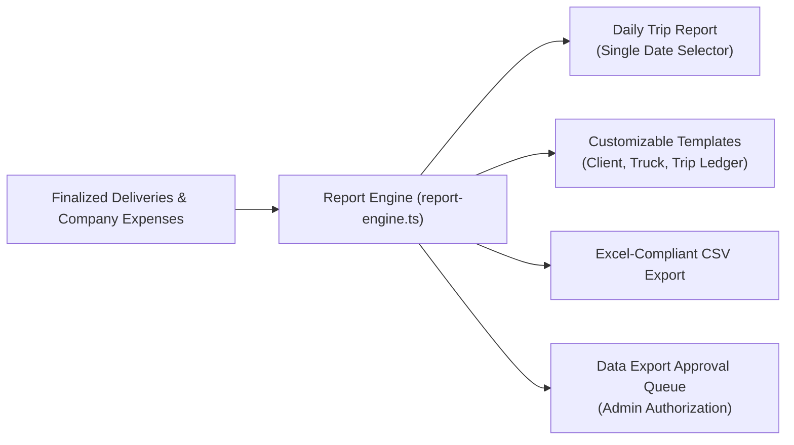

# Knowledge Base: 12 — Reporting & Calculations

> **Document Status:** `[Authoritative Reporting Specification]`  
> **Authority Level:** Authoritative Specification  
> **Master Source of Truth:** [`../CENTRAL_REQUIREMENTS_AND_SYSTEM_DESIGN.md`](../CENTRAL_REQUIREMENTS_AND_SYSTEM_DESIGN.md)  
> **Last Verified:** November 2026  
> **Location:** `rrliRev/docs/knowledge-base/12-reporting-and-calculations.md`

---

## 1. Overview of Reporting Capabilities

RouteX provides an executive and operational reporting engine located at [`/reports`](file:///c:/Users/suchi/Documents/rrli/rrliRev/src/app/(workspace)/reports/page.tsx). It translates raw delivery ledgers and company expenses into auditable management summaries, Excel-compliant CSV files, and print layouts.

---

## 2. Daily Trip Report Architecture

- **Independent Date Selector:** The Daily Trip Report is locked to a **single date selector** (`YYYY-MM-DD`) and operates completely independently of the global date range picker.
- **Operational Purpose:** Daily reconciliation for dispatchers and fleet supervisors to inspect all vehicles operating on a given business day.
- **Summary Metrics:**
  - Active trucks dispatched on date.
  - Total locations served and total derived drop-offs.
  - Daily delivery revenue.
  - Total daily trip expenses (owned itemized fuel/tolls/crew + subcontracted expenses).
  - Net operating profit for that calendar day.

---

## 3. Customizable Report Templates

RouteX provides six built-in company templates:

| Template ID | Name | Target Dataset | Primary Grouping |
| :--- | :--- | :--- | :--- |
| `client-summary` | **Client Summary Report** | Finalized Deliveries | Grouped by Client Name |
| `truck-summary` | **Truck Profitability Summary**| Finalized Deliveries | Grouped by Plate Number |
| `trip-ledger` | **Comprehensive Trip Ledger**| Finalized Deliveries | Itemized by Waybill Number |
| `financial-summary` | **Executive Financial Overview**| Deliveries & Expenses| High-level Revenue vs Expenses |
| `daily-operations` | **Daily Operational Log** | Single Date Trips | Itemized by Dispatch Sequence |
| `audit-export` | **Audit Trail Export** | System Audit Log | Chronological Event Stream |

### Template Customization Rules
- Default templates cannot be deleted or renamed (`isDefault: true`).
- Administrators can configure visible columns, column order, and custom column heading labels.
- Report templates enforce the `finalized_only` filter to prevent incomplete deliveries from skewing reported financial totals.

---

## 4. Mathematical & Profitability Formulas

### A. Delivery Margins

#### 1. Owned Truck Deliveries
$$\text{Total Trip Expenses} = \sum \text{Itemized Expenses (Diesel, Tolls, Crew Rates, Allowances, Other)}$$
$$\text{Net Profit} = \text{Delivery Revenue} - \text{Total Trip Expenses}$$
$$\text{Margin \%} = \begin{cases} 
\left(\frac{\text{Net Profit}}{\text{Delivery Revenue}}\right) \times 100 & \text{if Revenue} > 0 \\ 
\text{null} & \text{if Revenue} = 0 
\end{cases}$$

#### 2. Subcontracted Truck Deliveries
$$\text{Net Profit} = \text{Delivery Revenue} - \text{Subcontractor Expense}$$
$$\text{Margin \%} = \begin{cases} 
\left(\frac{\text{Net Profit}}{\text{Delivery Revenue}}\right) \times 100 & \text{if Revenue} > 0 \\ 
\text{null} & \text{if Revenue} = 0 
\end{cases}$$

### B. Truck Profitability (Strict Isolation)
$$\text{Truck Revenue} = \sum \text{Finalized Delivery Revenue for Truck Plate}$$
$$\text{Truck Expenses} = \sum \text{Finalized Trip Expenses for Truck Plate}$$
$$\text{Truck Net Profit} = \text{Truck Revenue} - \text{Truck Expenses}$$
> [!IMPORTANT]
> Truck profitability is strictly isolated from company-wide operating expenses. Corporate expenses (hub rent, electricity, management salaries) are **never** allocated to individual trucks.

### C. Company Consolidated Margins
$$\text{Consolidated Net Profit} = \sum \text{Total Delivery Revenue} - \sum \text{Total Trip Expenses} - \sum \text{Total Company Expenses}$$
$$\text{Company Margin \%} = \left(\frac{\text{Consolidated Net Profit}}{\sum \text{Total Delivery Revenue}}\right) \times 100$$
Negative net profit (net operating loss) evaluates to a valid negative profit margin percentage without runtime errors.

---

## 5. Data Export Suite & Approval Queue

RouteX provides five standardized export packages:
1. **Excel Workbook (`.xlsx`)**: Deliveries, locations, drop-off counts, truck profitability, and expenses.
2. **CSV Spreadsheets (`.csv`)**: Normalized comma-separated tables.
3. **JSON Database (`.json`)**: Structured database dump.
4. **SQL Database Dump (`.sql`)**: PostgreSQL schema and INSERT statements.
5. **Offline Web App (`.html`)**: Interactive offline dashboard snapshot.

### Export Approval Governance
- System Admin can download packages directly.
- Operations and Finance roles submit export requests with a mandatory reason.
- Requests appear in the **Approval Queue** table on `/reports` for Admin review (Approve or Reject with review notes).
