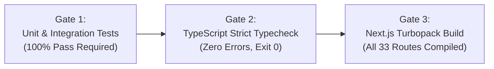

# Knowledge Base: 13 — Testing & Quality Assurance

> **Document Status:** `[Implemented]`  
> **Authority Level:** Authoritative Specification  
> **Last Verified:** November 2026  
> **Location:** `rrliRev/docs/knowledge-base/13-testing-and-quality-assurance.md`

---

## 1. Quality Assurance Philosophy & Gates

RouteX requires a zero-defect standard before any code change is merged. Every update must satisfy three strict verification gates:



---

## 2. Test Runner Architecture

RouteX uses the **native Node.js Test Runner** (`node:test` and `node:assert/strict`) via Node's experimental TypeScript stripping:

```powershell
node --test --experimental-strip-types --disable-warning=MODULE_TYPELESS_PACKAGE_JSON <test_files>
```

This delivers ultra-fast execution (~4.5 seconds for 222 tests) without Jest or Vitest dependencies.

---

## 3. Test Suite Inventory (16 Suites, 222+ Tests)

| Suite File | Tests | Focus Area & Verified Invariants |
| :--- | :---: | :--- |
| `src/lib/auth/rbac.test.ts` | 6 | 6-role permission matrix, access level mappings, navigation items. |
| `src/lib/auth/route-policy.test.ts` | 5 | Route access rules, unauthorized redirects, open redirect defense. |
| `src/lib/auth/session-guard.test.ts` | 4 | HMAC-SHA256 token signing, secret requirement, token tamper rejection. |
| `src/lib/auth/username-auth.test.ts` | 11 | Argon2id hashing, RFC 9106 password criteria, case-insensitive usernames, password recovery. |
| `src/lib/config/env.test.ts` | 3 | Supabase environment variable validation, service_role key leak defense. |
| `src/features/deliveries/delivery-domain.test.ts` | 7 | Trip calculation, unknown expense handling, N/A evaluation, truck profitability. |
| `src/features/deliveries/delivery-query.test.ts` | 8 | Paging, search filtering, client/truck filters, status counts. |
| `src/features/deliveries/delivery-recording-policy.test.ts` | 6 | Founding year (2024) boundary, 3-day Operations window, Admin exemption. |
| `src/features/deliveries/small-mock-database.test.ts` | 4 | Mock fixture integrity, unique waybill numbers, valid plate relationships. |
| `src/features/deliveries/small-mock-repository.test.ts` | 7 | Upsert, retrieval, deletion, drop-off sequence, pagination. |
| `src/features/deliveries/delivery-workflow.test.ts` | 6 | End-to-end trip creation, edit, document upload, status transitions. |
| `src/features/deliveries/truck-management.test.ts` | 6 | Fleet CRUD, truck type validation, plate format enforcement. |
| `src/features/deliveries/driver-management.test.ts` | 5 | Driver/helper registry, name format validation, role distinction, no employee code. |
| `src/features/reports/report-customization.test.ts` | 10 | Template engine, column visibility, Excel CSV export, daily trip report. |
| `src/components/global-date-range-picker.test.ts` | 11 | "All Time" default, presets, boundary clamping to 2024, date formatting. |
| `src/features/audit/post-implementation-regression.test.ts` | 5 | Automated regression gate testing 2024 boundary, auto-resolution, incomplete exclusion. |
| `src/features/audit/system-integrity-audit.test.ts` | 23 | Comprehensive multi-system security and audit verification. |
| `src/features/finance/company-expense-domain.test.ts` | 8 | Company expense validation, date filtering, single total input verification. |
| `src/features/finance/company-profitability-integration.test.ts` | 8 | Consolidated net profit, negative margins, truck isolation, RBAC. |
| `src/features/dashboard/dashboard-kpi.test.ts` | 6 | Revenue, Expenses, Profit, Top Client ranking (revenue-based, tie handling). |
| `src/features/deliveries/delivery-details-navigation.test.ts` | 7 | Dedicated details page navigator, sorting consistency, bound clamping, filter preservation. |
| `src/features/users/settings-profile-photo.test.ts` | 7 | Profile photo storage, initials extraction, remove photo, avatar isolation. |

---

## 4. Verification Execution Commands

To execute the verification pipeline:

```powershell
cd rrliRev

# Step 1: Execute all unit & integration tests
npm test

# Step 2: Strict TypeScript check (must output 0 errors)
npm run typecheck

# Step 3: Production compilation check
npm run build
```

---

## 5. Regression Safeguards & Continuous Assurance

- **Never Silently Zero Unknown Expenses:** Verified in `delivery-domain.test.ts` and `post-implementation-regression.test.ts`.
- **Exclusion of Incomplete Trips:** Automated assertion that incomplete trips do not inflate dashboard KPI totals.
- **Company Foundation Boundary (2024):** Verified in `delivery-recording-policy.test.ts` and `global-date-range-picker.test.ts`.
- **Truck Profitability Isolation:** Verified in `company-profitability-integration.test.ts`.
