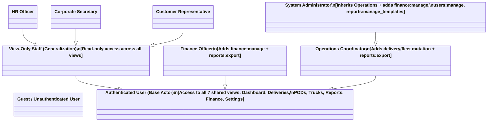
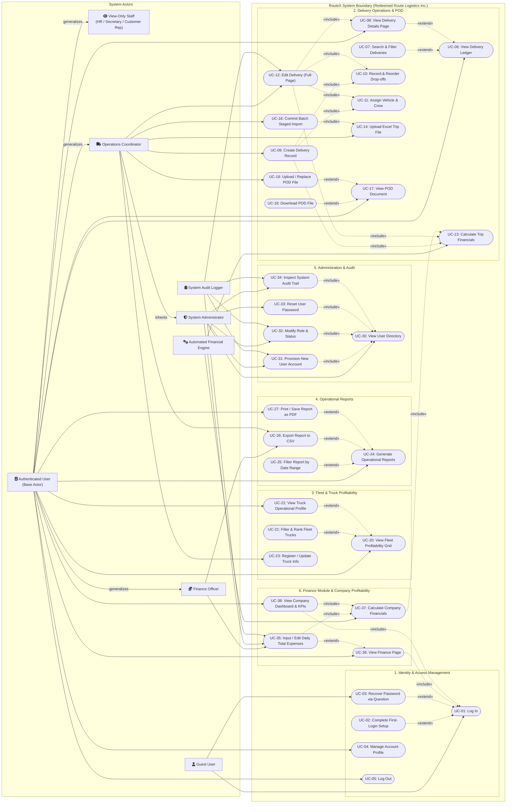

# RouteX: Role-Based Access Control (RBAC) & Use Case Diagram Reference Guide

**Project:** RouteX — Logistics Delivery Operations & Truck Profitability Management System  
**Client / Domain Organization:** Redeemed Route Logistics Inc. (RRLI)  
**Target Audience:** Systems Analyst / UI-UX Designer / Software Engineering Groupmate  
**Document Purpose:** Complete, cross-checked specification of Actors, Roles, Permissions, Use Cases, and UML Relationships to construct an accurate and compliant **Use Case Diagram** and **RBAC Architecture Reference**.  
**Revision:** Fully updated and cross-checked against production codebase implementation (Next.js 16.4.2, TypeScript, Turbopack, 254 unit tests). Incorporates all recent delivery workflow redesigns, Audit Trail enhancements, truck list view classification, company expenses architecture, and the finalized 4-tier RBAC security engine.

---

## 1. System Overview & Scope Boundaries

RouteX is a centralized logistics web application designed specifically for **Redeemed Route Logistics Inc. (RRLI)** to record completed delivery trips, audit revenue and trip expenses, manage cold chain (refrigerated) and dry cargo fleet vehicles, verify proof-of-delivery (POD) documentation, manage company-wide operating expenses, and generate operational and financial reports.

### System Boundaries & Core Invariants

* **In Scope:**
  - **Completed Delivery Lifecycle:** Record completed trips via an ergonomic 4-step wizard or edit existing records through a dedicated full-page workflow (`/deliveries/[id]/edit`) with pre-populated form state.
  - **Multi-Store Drop-off Sequencing:** Destination store tracking with vertically centered sequence markers, Up/Down nudge buttons (`▲`/`▼`) for reordering stops, and individual invoice/crate quantities.
  - **Granular Trip Financials:** Fuel (liters, unforced price/L), highway tolls, store entry fees, 1-row 3-column crew compensation (Driver, Helper 1, Helper 2 with dynamic `+ Add Helper` slot), miscellaneous expenses, net profit, and margin.
  - **Financial Integrity & Incomplete Isolation:** Trips with unconfirmed or missing expenses are flagged `incomplete` and **strictly excluded** from gross revenue and net profit totals until resolved. Missing expenses are never silently zeroed.
  - **Truck Fleet Management:** Owned fleet (4-wheelers, 6-wheelers, 10-wheelers), Subcontracted fleet, cargo capability classifications (`Cold Chain` in cyan vs. `Dry Cargo` in warm amber), sortable list view, and vehicle profiles (`/truck-profitability/[plate]`).
  - **Truck Profitability Isolation:** Company-wide operating expenses are **never** allocated to individual trucks. Per-truck margins and truck ledgers reflect only direct delivery revenue and expenses.
  - **Finance Module (`/finance`):** Record company-wide operating expenses (rent, utilities, hub maintenance, administrative overhead) as a single daily total without requiring forced breakdown or tag allocation.
  - **Company Profitability Integration:** Automatically compute company-level net profit and margin on the Dashboard and reports by combining finalized delivery financials with the company expense ledger:
    $$\text{Company Net Profit} = \text{Total Delivery Revenue} - \text{Total Delivery Expenses} - \text{Total Company Expenses}$$
    $$\text{Company Profit Margin} = \left(\frac{\text{Company Net Profit}}{\text{Total Delivery Revenue}}\right) \times 100$$
  - **Staged Bulk Import (`/deliveries/import`):** Multi-step Excel/CSV wizard with staging table, multi-stop waybill aggregation, client-side validation, duplicate detection, and non-destructive commit.
  - **Proof of Delivery (POD) Management:** Digital attachment, inspection, inline preview, and replacement of signed receipts and delivery invoices.
  - **Operational & Financial Reporting:** Custom template authoring (Admin only), column ordering/visibility customization, in-page date range filtering, and RFC 4180 CSV/Excel data export.
  - **Identity, RBAC & Audit Trail:** Argon2id password hashing, mandatory password setup on first login, self-service security questions, admin-assisted password resets, and an immutable Audit Trail capturing attribute transitions with `@username` handles and human-readable action titles.
  - **Expanded Sidebar Aesthetics:** Subtle 360° rotating conic gradient ray beam with pulsating ambient glow at the base of the expanded sidebar (automatically hidden in collapsed rail mode).

* **Out of Scope (Explicit Domain Boundaries):**
  - **No Live GPS / Dispatching:** RouteX is an operations ledger and profitability auditor, not a real-time driver GPS tracking tool.
  - **No Hard Deletes:** Data records (deliveries, trucks, users) are preserved for auditing; user accounts use soft deactivation (`isActive: false`).
  - **No Open Self-Registration:** All system accounts are provisioned by an Administrator; guest users cannot register themselves.
  - **No Itemized Sub-Breakdown on the Finance Page:** The Finance page accepts one total expense value per date entry (no per-category or per-truck distribution requirement).
  - **No Pop-up Editing for Deliveries:** Delivery editing is not confined to a modal drawer; it is a full-page route at `/deliveries/[id]/edit`.

---

## 2. Actors & Role Hierarchy

### 2.1 The Six Canonical User Roles

RouteX implements **6 Canonical Business Roles** mapped into **4 Tiered Access Levels**:

| Role Name | Access Level | UI Label & Badge Tone | Primary Business Purpose & Domain Responsibilities |
| :--- | :--- | :--- | :--- |
| **`admin`** | **Admin** (`admin`) | `Admin`  *(Success / Amber)* | Full system administration: user account provisioning, role assignment, credential resets, audit trail inspection, custom report template authoring, full delivery/fleet management, and company expense management (`finance:manage`). Can perform all operations across the platform. |
| **`operations`** | **Operations** (`operations`) | `Operations`  *(Success / Green)* | Daily logistics operations: creating and editing deliveries (including full-page `/deliveries/[id]/edit`), multi-store drop-offs, Excel bulk staging, POD file uploads/replacements, truck registration/updates, and exporting operational reports. **Cannot** edit the Finance page (`finance:manage` is excluded) and cannot manage user accounts. |
| **`finance`** | **Finance** (`finance`) | `Finance`  *(Neutral / Slate)* | Financial auditing and expense management: inspects delivery financials, trip expenses, profit margins, truck profitability rankings, and financial reports. **Holds `finance:manage`:** enters and edits daily total company expenses on the Finance page (`/finance`). **Holds `reports:export`:** exports financial and operational summaries to CSV/Excel for accounting audits. Cannot create or edit deliveries, trucks, or users. |
| **`hr`** | **View-Only** (`view_only`) | `HR`  *(Neutral / Slate)* | Personnel and crew auditing: inspects delivery records, driver and helper crew assignments, daily trip wage rates, and meal allowances to verify bi-monthly payroll compensation. |
| **`secretary`** | **View-Only** (`view_only`) | `Secretary`  *(Neutral / Slate)* | Operational and document compliance: monitors delivery completion, verifies that signed POD receipts are attached and valid, checks waybill status, and reviews company performance reports. |
| **`customer_representative`** | **View-Only** (`view_only`) | `Customer Rep`  *(Neutral / Slate)* | Customer service inquiry resolution: inspects client delivery waybills, store drop-off timelines, invoice numbers, delivery dates, and POD receipt verification to resolve customer claims or delivery disputes. |

### 2.2 Unauthenticated & Secondary Actors

* **`Guest / Unauthenticated User`**: Any visitor accessing the public route (`/login`). Can submit credentials to authenticate, complete first-login setup, or perform password self-recovery via security questions.
* **`System Audit Logger` (Secondary / Supporting Actor)**: Automated background subsystem that intercepts mutations (user provisioning, credential updates, delivery financial corrections, company expense edits/deletions) and records immutable attribute transitions (old vs. new values).
* **`Automated Financial Engine` (Secondary / Supporting Actor)**: Background computation engine that recalculates trip-level net profit and profit margins upon delivery entry/edit, and computes company-level profitability by aggregating finalized deliveries with the company expense ledger.

### 2.3 Actor Generalization Hierarchy (UML Inheritance)

In UML Use Case modeling, actor generalization eliminates clutter while maintaining exact RBAC fidelity:

* **Inheritance Rules & Domain Verification:**
  - `Authenticated User` provides the baseline capability for all authenticated staff to access the 7 shared views: Dashboard, Deliveries, Trucks, PODs, Reports, Finance page, and Settings.
  - `View-Only Staff` (`HR`, `Secretary`, `Customer Rep`) inherits read-only access. Mutation controls are hidden in the UI and blocked with HTTP 403 at the API layer.
  - `Finance Officer` inherits viewing capabilities and adds:
    1. `finance:manage`: Create, edit, and manage company expenses on `/finance`.
    2. `reports:export`: Export reports and financial summaries to RFC 4180 CSV/Excel.
  - `Operations Coordinator` inherits viewing capabilities and adds operational execution: creating and editing deliveries, multi-store drop-offs, bulk Excel imports, POD attachments, truck fleet registration, and report exports. Operations **cannot** edit the Finance page (`finance:manage` is false) and cannot manage user accounts.
  - `System Administrator` inherits all `Operations Coordinator` capabilities and adds administrative privileges: `finance:manage` (full control of company expenses), `users:manage` (user account lifecycle and credential resets), and `settings:manage`.

---

## 3. Comprehensive Use Case Catalog by Subsystem

RouteX comprises **36 Canonical Use Cases** across 8 subsystems.

### Subsystem 1: Identity & Access Management (IAM)

| UC ID | Use Case Name | Primary Actor | Relationships & Triggers | Brief Description |
| :--- | :--- | :--- | :--- | :--- |
| **UC-01** | **Log In** | Guest User | — | Authenticate using username or email and password; establishes HMAC-SHA256 session token. |
| **UC-02** | **Complete First-Login Setup** | Authenticated User | `<<extend>>` UC-01 *(Condition: temporary password assigned)* | Mandatory first-login wizard to set permanent password and register security question/answer for recovery. |
| **UC-03** | **Recover Password via Security Question** | Guest User | `<<extend>>` UC-01 *(Condition: user forgot password)* | Self-service recovery workflow: verify username and security answer to set a new password. |
| **UC-04** | **Manage Account Profile** | Authenticated User | `<<include>>` UC-01 | Self-manage display name, username, contact number, avatar profile photo, and password in Account Settings. |
| **UC-05** | **Log Out** | Authenticated User | `<<include>>` UC-01 | Invalidate session cookie and redirect to `/login`. |

---

### Subsystem 2: Delivery Operations & Trip Management

| UC ID | Use Case Name | Primary Actor | Relationships & Triggers | Brief Description |
| :--- | :--- | :--- | :--- | :--- |
| **UC-06** | **View Delivery Ledger** | View-Only Staff, Finance, Operations, Admin | `<<include>>` UC-01 | View completed delivery records in an paginated tabular ledger with gross revenue, trip expenses, and net profit. |
| **UC-07** | **Search & Filter Deliveries** | View-Only Staff, Finance, Operations, Admin | `<<extend>>` UC-06 *(Condition: user applies filters)* | Filter ledger records by client name, truck plate, driver, or POD status; sort columns with 3-state sort controls. |
| **UC-08** | **View Delivery Details Page** | View-Only Staff, Finance, Operations, Admin | `<<extend>>` UC-06 *(Condition: user opens a delivery)* | Navigate to `/deliveries/[id]` to inspect trip overview, vehicle specs, drop-offs, crew, and inline financial metric cards (clean layout without redundant warning alert banners). |
| **UC-09** | **Create Delivery Record** | Operations, Admin | `<<include>>` UC-01, `<<include>>` UC-10, `<<include>>` UC-11, `<<include>>` UC-13 | Record completed trip via the 4-step wizard (`/deliveries/new`): Trip Identity, Multi-Store Drop-offs, Expenses & Crew, and Review. |
| **UC-10** | **Record & Reorder Multi-Store Drop-off Sequence** | Operations, Admin | *(Included by UC-09 and UC-12)* | Define destination stores with vertically centered stop numbering (`top: 50%; transform: translateY(-50%)`), Up/Down nudge buttons (`▲`/`▼`) for reordering without data loss, and single `×` removal. |
| **UC-11** | **Assign Vehicle & Crew** | Operations, Admin | *(Included by UC-09 and UC-12)* | Select truck plate, assign driver, and assign up to two helpers in a unified 1-row 3-column layout with dynamic `+ Add Helper` card slot. |
| **UC-12** | **Edit Delivery Record (Full-Page Workflow)** | Operations, Admin | `<<include>>` UC-08, `<<include>>` UC-10, `<<include>>` UC-11, `<<include>>` UC-13 | Full-page edit route (`/deliveries/[id]/edit`) pre-populating all existing delivery data, updating via audited `PATCH /api/deliveries`, and redirecting back upon save (no popup modal). |
| **UC-13** | **Calculate Trip Financials & Margin** | Automated Financial Engine | *(Included by UC-09 and UC-12)* | Automatically compute delivery revenue, trip expenses (fuel, tolls, crew pay, store fees), net income, and profit margin percent. Flags incomplete trips and excludes them from KPI totals. |

---

### Subsystem 3: Batch Staging & Excel Bulk Import

| UC ID | Use Case Name | Primary Actor | Relationships & Triggers | Brief Description |
| :--- | :--- | :--- | :--- | :--- |
| **UC-14** | **Upload Excel / CSV Trip File** | Operations, Admin | `<<include>>` UC-01 | Upload `.xlsx` / `.csv` file in the dedicated 4-step import wizard (`/deliveries/import`). |
| **UC-15** | **Review & Validate Staged Deliveries** | Operations, Admin | `<<include>>` UC-14 | Inspect parsed rows, validate rates, auto-aggregate multi-store drop-offs under identical waybills, and detect duplicate trips. |
| **UC-16** | **Confirm & Commit Batch Import** | Operations, Admin | `<<include>>` UC-15 | Atomically commit validated staging rows to the active delivery ledger; skips duplicates non-destructively. |

---

### Subsystem 4: Proof of Delivery (POD) & Document Management

| UC ID | Use Case Name | Primary Actor | Relationships & Triggers | Brief Description |
| :--- | :--- | :--- | :--- | :--- |
| **UC-17** | **View Proof of Delivery (POD)** | View-Only Staff, Finance, Operations, Admin | `<<include>>` UC-08 | Inspect attached POD documents (signed receipt images or PDF delivery slips) inline or via zoom viewer. |
| **UC-18** | **Download POD File** | View-Only Staff, Finance, Operations, Admin | `<<extend>>` UC-17 *(Condition: user clicks download)* | Download original signed receipt or invoice for external client dispute resolution or audits. |
| **UC-19** | **Upload / Replace POD Document** | Operations, Admin | `<<extend>>` UC-17 *(Condition: document missing or updated)* | Attach new or replacement digital POD file to a specific delivery stop; records audit trail event. |

---

### Subsystem 5: Fleet & Truck Profitability Analytics

| UC ID | Use Case Name | Primary Actor | Relationships & Triggers | Brief Description |
| :--- | :--- | :--- | :--- | :--- |
| **UC-20** | **View Fleet & Profitability Grid** | View-Only Staff, Finance, Operations, Admin | `<<include>>` UC-01 | Inspect Owned and Subcontracted fleet assets in Grid or List view with trips, revenue, trip expenses, and net profit. |
| **UC-21** | **Filter & Rank Trucks** | View-Only Staff, Finance, Operations, Admin | `<<extend>>` UC-20 *(Condition: user sorts/filters)* | Filter by classification (`Cold Chain` vs. `Dry Cargo`), vehicle size, or ownership; sort list view by classification, size, trips, or profitability. Click row to open truck profile. |
| **UC-22** | **View Truck Operational Profile** | View-Only Staff, Finance, Operations, Admin | `<<extend>>` UC-20 *(Condition: user selects truck)* | Navigate to `/truck-profitability/[plate]` to view truck specs, photo, trip history, and financial performance (isolated from company expenses). |
| **UC-23** | **Register / Update Truck Information** | Operations, Admin | `<<include>>` UC-01 | Register new truck plate, define classification, ownership, size/capacity, and upload vehicle image. |

---

### Subsystem 6: Operational & Financial Reporting

| UC ID | Use Case Name | Primary Actor | Relationships & Triggers | Brief Description |
| :--- | :--- | :--- | :--- | :--- |
| **UC-24** | **Generate Operational Reports** | View-Only Staff, Finance, Operations, Admin | `<<include>>` UC-01 | View built-in operational reports: Client Deliveries, Operational Expenses, Truck Profitability, POD Completeness, Trip Ledger, and Daily Trips. |
| **UC-25** | **Filter Report by Date Range** | View-Only Staff, Finance, Operations, Admin | `<<extend>>` UC-24 *(Condition: user selects date range)* | Apply in-page `<GlobalDateRangePicker />` inside the report actions bar (Today, This Week, This Month, All Time, or custom interval). |
| **UC-26** | **Export Report to CSV / Excel** | Operations, Finance, Admin | `<<extend>>` UC-24 *(Condition: user clicks export)* | Export RFC 4180-compliant CSV containing metadata, active filters, column headings, and calculated summary totals. |
| **UC-27** | **Print / Save Report as PDF** | View-Only Staff, Finance, Operations, Admin | `<<extend>>` UC-24 *(Condition: user prints)* | Open clean browser print preview formatted for physical paper or PDF archiving. |

---

### Subsystem 7: User Administration & System Auditing

| UC ID | Use Case Name | Primary Actor | Relationships & Triggers | Brief Description |
| :--- | :--- | :--- | :--- | :--- |
| **UC-30** | **View User Directory** | Admin | `<<include>>` UC-01 | Inspect system staff directory, assigned roles, usernames, emails, phone numbers, and active status. |
| **UC-31** | **Provision New User Account** | Admin | `<<include>>` UC-30 | Create staff account with temporary credentials and role assignment via grouped 3-card form (Identity, Contact, Security). |
| **UC-32** | **Modify User Role & Status** | Admin | `<<include>>` UC-30 | Change staff role assignment or toggle soft deactivation (`isActive: false` preserving historical attribution). |
| **UC-33** | **Reset User Password (Admin-Assisted)** | Admin | `<<include>>` UC-30 | Issue temporary password to unlock an account when staff forgets security question answers. |
| **UC-34** | **Inspect System Audit Trail** | Admin | `<<include>>` UC-30 | Inspect security events, credential modifications, and record diffs showing old vs. new values with 1-line toolbar, friendly action titles, and `@username` format. |

---

### Subsystem 8: Finance Page & Company-Level Financials

| UC ID | Use Case Name | Primary Actor | Relationships & Triggers | Brief Description |
| :--- | :--- | :--- | :--- | :--- |
| **UC-35** | **Input / Edit Daily Total Expenses Value** | Finance, Admin *(Secondary: System Audit Logger)* | `<<extend>>` UC-36 *(Condition: user is Finance or Admin)*, `<<include>>` UC-37 | Enter or edit the single total-expenses value for a date on `/finance` (PHP hero input, foundation date validation `>= 2024-01-01`, no itemized breakdown required). Triggers audited state diff. |
| **UC-36** | **View Finance Page** | View-Only Staff, Finance, Operations, Admin | `<<include>>` UC-01 | View company expense ledger table (Date, Total Amount, Note/Reference, Recorded By) with pagination; edit controls visible only to Finance and Admin. |
| **UC-37** | **Calculate Company-Level Financials** | Automated Financial Engine | `<<include>>` UC-13 | Compute company net profit ($\text{Delivery Revenue} - \text{Delivery Expenses} - \text{Company Expenses}$) and company profit margin. Incomplete deliveries excluded from revenue and delivery expenses; missing company expense days safely contribute ₱0. |
| **UC-38** | **View Company Dashboard & KPIs** | View-Only Staff, Finance, Operations, Admin | `<<include>>` UC-01, `<<include>>` UC-37 | View company-level KPIs on `/dashboard`, incorporating delivery performance and total company expenses within the active date range. |

---

## 4. RBAC Permissions Matrix (CRUD & Execution Mapping)

This matrix maps system permissions directly to the **6 Canonical Roles**, verified by unit tests in `src/lib/auth/rbac.test.ts`:

| Subsystem / Capability | Permission Key | Admin | Operations | Finance | HR | Secretary | Customer Rep |
| :--- | :--- | :---: | :---: | :---: | :---: | :---: | :---: |
| **Dashboard** | | | | | | | |
| View Dashboard & Company KPIs | `dashboard:view` | ✅ Full | ✅ Full | 👁 Read | 👁 Read | 👁 Read | 👁 Read |
| **Deliveries** | | | | | | | |
| View Delivery Ledger & Details | `deliveries:view` | ✅ Full | ✅ Full | 👁 Read | 👁 Read | 👁 Read | 👁 Read |
| Create New Delivery (`/deliveries/new`) | `deliveries:create` | ✅ Full | ✅ Full | ❌ | ❌ | ❌ | ❌ |
| Edit Delivery (`/deliveries/[id]/edit`) | `deliveries:edit` | ✅ Full | ✅ Full | ❌ | ❌ | ❌ | ❌ |
| Complete / Finalize Trip | `deliveries:complete` | ✅ Full | ✅ Full | ❌ | ❌ | ❌ | ❌ |
| Manage Store Drop-offs & Sequence | `dropoffs:manage` | ✅ Full | ✅ Full | ❌ | ❌ | ❌ | ❌ |
| **Excel Batch Staging** | | | | | | | |
| Upload Excel / CSV File | `imports:upload` | ✅ Full | ✅ Full | ❌ | ❌ | ❌ | ❌ |
| Review, Validate & Commit Import | `imports:review_confirm` | ✅ Full | ✅ Full | ❌ | ❌ | ❌ | ❌ |
| **Proof of Delivery (POD)** | | | | | | | |
| View & Download POD Receipts | `pod:view` | ✅ Full | ✅ Full | 👁 Read | 👁 Read | 👁 Read | 👁 Read |
| Upload / Replace POD Document | `deliveries:edit` | ✅ Full | ✅ Full | ❌ | ❌ | ❌ | ❌ |
| **Fleet & Profitability** | | | | | | | |
| View Trucks & Profitability | `profitability:view` | ✅ Full | ✅ Full | 👁 Read | 👁 Read | 👁 Read | 👁 Read |
| Register / Edit Trucks & Photos | `profitability:manage` | ✅ Full | ✅ Full | ❌ | ❌ | ❌ | ❌ |
| **Operational Reports** | | | | | | | |
| View Built-in Reports | `reports:view` | ✅ Full | ✅ Full | 👁 Read | 👁 Read | 👁 Read | 👁 Read |
| Export Reports to CSV / Excel | `reports:export` | ✅ Full | ✅ Full | ✅ Full | ❌ | ❌ | ❌ |
| **Finance Module (`/finance`)** | | | | | | | |
| View Company Expense Ledger | `finance:view` | ✅ Full | ✅ Full | 👁 Read | 👁 Read | 👁 Read | 👁 Read |
| Input / Edit / Delete Daily Expenses | `finance:manage` | ✅ Full | ❌ | ✅ Full | ❌ | ❌ | ❌ |
| **Administration & IAM** | | | | | | | |
| View User Directory | `users:view` | ✅ Full | ❌ | ❌ | ❌ | ❌ | ❌ |
| Manage Staff Accounts & Resets | `users:manage` | ✅ Full | ❌ | ❌ | ❌ | ❌ | ❌ |
| Inspect System Audit Trail | `users:manage` | ✅ Full | ❌ | ❌ | ❌ | ❌ | ❌ |
| View Settings Page | `settings:view` | ✅ Full | ✅ Full | 👁 Read | 👁 Read | 👁 Read | 👁 Read |
| Manage System Configuration | `settings:manage` | ✅ Full | ❌ | ❌ | ❌ | ❌ | ❌ |

> **Legend:**  
> - **✅ Full Access:** Full capability to view, create, edit, commit, or execute.  
> - **👁 Read Only:** Can view data, search, filter, and inspect details. Mutation controls are hidden in the UI and server-blocked with HTTP 403.  
> - **❌ Prohibited:** Action and navigation route are completely inaccessible.  
> - **Key Distinctions:**  
>   1. **Finance Role:** Has read-only access to all modules, **plus** `finance:manage` (edit on the Finance page) and **`reports:export`** (exporting financial summaries to CSV). It cannot mutate delivery trips, trucks, or user accounts.  
>   2. **Operations Role:** Has full operational write capability (deliveries, drop-offs, imports, PODs, trucks, and report export), but is **strictly excluded** from editing the Finance page (`finance:manage`) and managing user accounts.  
>   3. **Admin Role:** Has unrestricted full access across all operational, financial, and administrative modules.

---

## 5. Verified Mermaid UML Use Case Diagram

This diagram represents the exact system boundary, actors, generalizations, and use case relationships:

---

## 6. Role-Specific Business Context for Use Case Narratives

Use these domain summaries for system specifications, software requirements documentation, or user manual narratives:

### 1. Finance Officer (`finance`)
* **Core Mandate:** Audit delivery profitability, record company operating expenses, and export financial summaries without tampering with dispatch operations.
* **Key Use Cases:** UC-06 (View Deliveries), UC-08 (Delivery Details), UC-20 (Truck Profitability Grid), UC-24 (Client & Truck Summary Reports), **UC-26 (Export Reports to CSV)**, **UC-35 (Input Daily Total Expenses)**, UC-36 (View Finance Page), UC-38 (Company Dashboard & KPIs).
* **Specific Data Watched:** Fuel rates, highway tolls, helper allowances, client delivery billing rates, gross revenue, net profit margin percentages, incomplete expense flags, and daily company overhead expenses.
* **Explicit Constraint:** Cannot create or edit deliveries, assign crew, modify trucks, or manage staff user accounts.

### 2. HR Officer (`hr`)
* **Core Mandate:** Audit crew assignments and verify labor rates for accurate bi-monthly payroll compensation.
* **Key Use Cases:** UC-06 (Delivery Ledger), UC-08 (Delivery Details / Crew Compensation), UC-24 (Trip Ledger Report).
* **Specific Data Watched:** Driver assignments, Helper 1 and Helper 2 assignments, daily trip rates (e.g. ₱700 driver daily rate), meal allowances (e.g. ₱300), and delivery dates.

### 3. Corporate Secretary (`secretary`)
* **Core Mandate:** Verify client contract fulfillment, official document completeness, and organizational compliance.
* **Key Use Cases:** UC-06 (Deliveries), UC-17 (View POD Documents), UC-18 (Download POD File), UC-20 (Fleet Registry), UC-24 (Operational Reports).
* **Specific Data Watched:** Stamped waybill receipts, customer signature attachments on PODs, vehicle registration plate types, and delivery dates.

### 4. Customer Representative (`customer_representative`)
* **Core Mandate:** Investigate client delivery inquiries, track drop-off timing, and resolve missing delivery disputes.
* **Key Use Cases:** UC-06 (Search Deliveries by Client/Waybill), UC-08 (View Drop-off Sequence), UC-17 (View Signed POD), UC-18 (Download POD File).
* **Specific Data Watched:** Client name (e.g., Alfamart, SM Supermarket), waybill numbers, store drop-off timestamps, quantities delivered, and signed delivery receipts.

### 5. Operations Coordinator (`operations`)
* **Core Mandate:** Hands-on operational management of daily dispatch execution, drop-off tracking, and fleet records.
* **Key Use Cases:** UC-09 (Create Delivery), UC-10 (Drop-off sequence with nudge buttons), UC-11 (Crew layout), UC-12 (Full-page delivery edit), UC-14 (Excel Bulk Upload), UC-16 (Commit Batch Import), UC-19 (Upload PODs), UC-23 (Register Fleet Trucks), UC-26 (Export CSV).
* **Explicit Constraint:** Cannot edit the Finance page (`finance:manage` is blocked) and cannot provision or modify staff accounts.

### 6. System Administrator (`admin`)
* **Core Mandate:** System security, staff user provisioning, access control enforcement, audit accountability, and administrative governance.
* **Key Use Cases:** UC-30 through UC-34 (User Directory, Account Provisioning, Role Management, Password Resets, Audit Trail with State Diffs), UC-35 (Input Daily Total Expenses), and full operational privileges.

---

## 7. Resolution of Previous Assumptions & Open Items

All 7 architectural invariants and previous open items are now definitively resolved based on verified codebase architecture:

| # | Open Item / Assumption | Codebase Resolution & Verified Invariant |
|---|---|---|
| **1** | **How daily expenses combine with trip expenses** | **Canonically Defined:** $\text{Company Net Profit} = \text{Total Delivery Revenue} - \text{Total Delivery Expenses} - \text{Total Company Expenses}$. Company operating expenses are strictly non-trip overhead (hub rent, utilities, office salaries) and are added to trip expenses. Incomplete deliveries are excluded from revenue and expenses, preventing unfinalized estimates from distorting profitability. |
| **2** | **Reporting scope for company expenses** | **Integrated:** In addition to the dedicated `/finance` ledger, company operating expenses are aggregated in the **Client Summary Report** to calculate company-wide net margin, while the **Trip Ledger** and **Truck Summary** strictly isolate delivery-level operations. |
| **3** | **Handling of days with no expense value** | **Safe Zero Contribution:** In `filterExpensesByDateRange` and `calculateCompanyProfitability`, days without company expense entries safely contribute ₱0. No silent zeroing or artificial entries are forced. |
| **4** | **Dashboard KPI use case** | **Formally Documented (UC-38):** The `/dashboard` view recalculates company net profit and company profit margin dynamically within the active date range by combining confirmed delivery financials with the company expense ledger. |
| **5** | **Audit Trail for daily expenses** | **Confirmed & Tested:** All mutations on `/finance` (creating, updating, or deleting daily expense records) record an `audit_event` with attribute diffs (`old` vs. `new`) in the Audit Trail (`/api/audit` and `/user-management`). |
| **6** | **Actor inheritance consistency** | **Harmonized:** Formally unified with `Authenticated User` as the base viewing actor. `Finance Officer` and `Operations Coordinator` inherit directly from `Authenticated User` with their respective write privileges, and `System Administrator` inherits from `Operations Coordinator` while holding `finance:manage` and administrative authority. |
| **7** | **Retirement of Custom Report Templates** | **Removed from System:** Custom report template authoring and deletion (formerly UC-28 & UC-29) have been permanently removed. RouteX relies strictly on the 6 canonical built-in reports (Client Deliveries, Expenses, Truck Profitability, POD Completeness, Trip Ledger, and Daily Trips) with in-page date filtering, CSV export, and PDF printing. |
